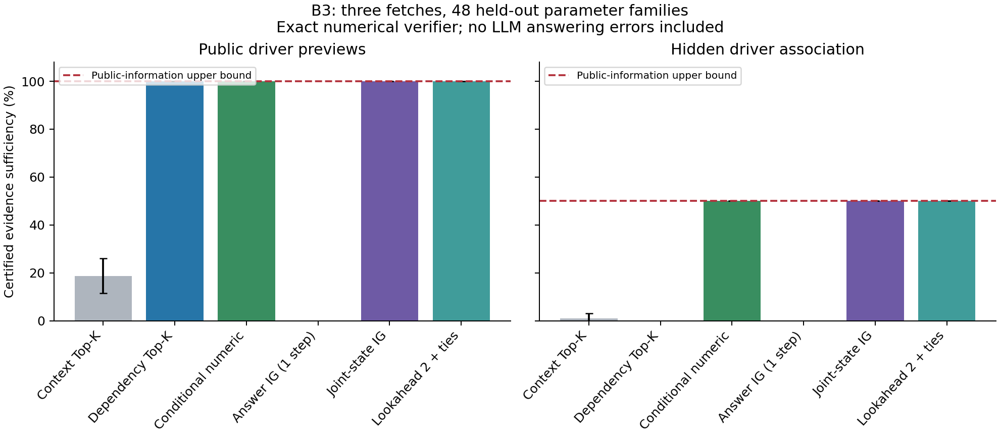

# 方向 3 · v018：多份时序证据必须联合使用，是否就需要新检索模型？

实验日期：2026-10-31。**对本轮这套任务，答案是：还不需要。** 本轮成功构造并审计了条件证据价值变化、三份及四份证据联合才能回答的任务；但是利用公开依赖关系的简单策略、传统数值匹配和联合状态信息增益已经解决。弱贪心方法失败，并没有形成支持新架构的充分理由。

只看三个要点即可：**可见条件下强简单方法已达 100%；Qwen 直接读完整原始数值为 3.5%，给峰值相位为 27.1%，工具算好延迟并说明完整后为 100.0%；本轮不训练新检索器。** 后两项同时提示取证之外的计算与工具语义问题，不能把低答案分数直接算成检索失败。

本轮新增代码与结果，保留 v001–v017、旧数据和 README。复用本地模型，没有训练、下载新权重或调用付费 API。

## 1. 先用一道实际题说明：这次到底增加了什么困难？

可以把它想成不同设备通过网关上报传感器记录。设备的时钟不完全同步，要通过校准记录还原事件的真实先后关系。题目问：**下游响应相对驱动事件，真实延迟是 2 格，还是 6 格？** 一个周期分成 8 格，真实延迟为 2 回答 YES，为 6 回答 NO。

测试家族 `1011-test-00` 的 B3 配对，保持问题和整个候选池不变，只改变已观察到的驱动波形：

| 当前看到的驱动 | 应取回哪组记录 | 驱动峰值 | 响应峰值 | 校准 1 | 校准 2 | 校正后的真实延迟 | 答案 |
|---|---|---:|---:|---:|---:|---:|---|
| 波形 S0 | 匿名组 1 | 7 | 3 | 1 | 1 | `(3−7−1−1) mod 8 = 2` | YES |
| 波形 S1 | 匿名组 0 | 1 | 0 | 3 | 6 | `(0−1−3−6) mod 8 = 6` | NO |

`mod 8` 表示绕过一个周期后重新计数，例如 −6 与 2 相差一个完整周期。这里展示的“组 0/1”是审计用的匿名编号，不是正确答案提示。组号与真实驱动的对应关系在家族间随机交换。

**为什么缺一份就真的不能回答？** 看第一行：若只拿到响应峰值 3 和校准 1 的偏移 1，却不知道校准 2，校准 2 可以是 1，也可以是 5。前者得到延迟 2，后者得到延迟 6；眼前已有的材料完全一样，两种答案都合理。这是数值证明，不是因为某个模型答错才说证据不足。

校准记录单独拿来，也不告诉我们响应到底发生在什么时候。B3 必须有初始驱动 S，加上响应 R、校准 C1、校准 C2：**总共四份证据，检索三次**。B2 需要 S+R+C1，总共三份证据、检索两次。A 不需要校准，只需再取回 R，是简单对照。

相比 v017，“缺哪个通道就补哪个”之外增加了两点：应该补哪一组，取决于当前驱动的时序形态；单独新增一条响应或校准，可能完全不能减少答案的不确定性，但联合起来能确定答案。不过，**依赖关系仍然事先给出，波形匹配也很清晰**，这成为强简单方法可以成功的原因。从研究价值看，它仍接近“匹配正确对象，再补齐已知公式的参数”，尚未变成需要从未知时序依赖中发现证据价值的问题。

## 2. 检索之前究竟能看见什么？

每个候选只公开匿名 ID、所属匿名组、记录类型、相同的时间范围，以及可选的驱动波形缩略数据。**不公开候选的响应值、校准值、真实延迟或答案。** 一次 FETCH 才能获得一条完整记录；预算为 1、2、3 次，不能绕过候选池读取全量数据。

公开缩略数据只描述“这条记录对应哪种驱动”，没有包含目标响应。可见索引条件下，普通归一化互相关就能匹配驱动；这是一种传统波形比较方法。遮住缩略图时，两个匿名组在检索前无法区分。取回任意一条后，会看到其驱动信息，从而知道它是否属于目标组。

候选还含有不必要的校准记录、另一组记录，以及一个有误差的粗略延迟测量 proxy。proxy 有时有帮助，**不是纯粹无关的干扰项**：它能提高猜对答案的概率。但它的所有误差取值都有非零概率，因此不能单独证明答案。我们同时报告确定回答的正确率和允许概率猜测的 MAP 正确率，避免把“不能证明”误写成“毫无信息”。

所有序列都是 48 点合成信号；相位通过唯一全局峰值提取。驱动匹配与目标延迟是分开的观测量。这里模拟了事件相位和多级时钟校准，**没有声称这些曲线来自真实设备，也没有验证真实系统服从该生成分布；未知偏移采用均匀、独立先验，单份证据零信息的强互补性质受这个理想化设定影响**。

## 3. 数据规模与审计：通过了什么，边界在哪里？

使用三个固定种子 1011、2022、3033，生成 96 个独立参数家族：训练预留 24、开发 24、测试 48。同一家族的所有反事实、顺序与观测条件留在同一划分。测试采用未在训练/开发中出现的频率组合，但并非两个频率各自都从未出现。没有训练任何模型；MMR 系数只用开发集选择。

审计覆盖 13,824 个设定，288 份家族×难度证书，另枚举 7,568 个部分观测状态。CPU 比较保留 497,664 条实际轨迹；**这些轨迹不是 497,664 个独立样本，独立测试单位只有 48 个家族。** 区间通过按家族反复重抽样计算（bootstrap），CPU与动态模型主指标按种子分层。

| 审计项 | 结果 |
|---|---|
| 只改变初始驱动，完整候选池保持相同 | 通过 |
| 初始驱动改变后，最省预算的正确候选集合改变 | 通过 |
| 改变答案后，初始输入和全部公开缩略数据保持相同 | 通过 |
| 驱动、响应的简单数值直方图和统计量不能直接给出标签 | 通过 |
| 每个必要证据集合的真子集，即使再加 proxy，也不能确定答案 | 通过 |
| 必要证据全部获得后，固定数值规则唯一确定答案 | 通过 |
| 遮住预览后，交换隐藏对应关系，公开输入保持相同 | 通过 |
| 所有评估动态取证轨迹通过访问代理重放 | 通过，评分程序逐条检查 |

需保留两个限制。第一，A/B2/B3 是**同一种物理机制的三种校准深度**，96 个随机参数家族不等于 96 种独立任务机制；还没有覆盖真实异常、非周期响应、未知依赖图等不同机制。第二，GPU 动态主实验取固定的全 YES / 全 NO 两组反事实，便于逐题配对；候选两组标签因此在该评估子集中相关。模型没有看到这个取样规则，但不能将其视为对所有跨组标签独立分布的完整检验。CPU 必要性审计和比较包含四种标签组合；“证据是否足够”的判定始终基于题目允许的全部可能世界，而非从 GPU 子集归纳出的偶然规律。

## 4. CPU 结果：哪些方法失败，哪些已经解决？

下面是公开预览、含 proxy 时的**证据充分率**：有多少题在预算内真的收集齐能证明答案的材料。此表分别使用刚好够完成证据链的预算；其他预算见下一表和完整记录。

| 方法 | A：预算 1 | B2：预算 2 | B3：预算 3 |
|---|---:|---:|---:|
| 仅按上下文相似度逐项排序 | 21.9% | 12.5% | 18.8% |
| 独立排序＋公开依赖关系 | 100.0% | 100.0% | 100.0% |
| 依赖关系覆盖 | 100.0% | 100.0% | 100.0% |
| MMR 多样性（开发集选参） | 21.9% | 12.5% | 18.8% |
| 只看共同时间范围（退化对照） | 9.4% | 3.1% | 1.0% |
| 当前证据＋数值匹配 | 100.0% | 100.0% | 100.0% |
| 单步答案信息增益 | 100.0% | 0.0% | 0.0% |
| 单步答案信息增益＋依赖并列处理 | 100.0% | 0.0% | 0.0% |
| 联合状态信息增益 | 100.0% | 100.0% | 100.0% |
| 两步前瞻＋依赖并列处理 | 100.0% | 100.0% | 100.0% |
| 三步前瞻＋依赖并列处理 | 100.0% | 100.0% | 100.0% |
| 知道隐藏对应关系的 Oracle | 100.0% | 100.0% | 100.0% |

图中柱高表示“确实拿齐证据”的比例，误差线按独立家族计算。红线是只依赖公开信息可达到的上界；右图的 50% 上限不是模型能力不足。

“仅按相似度排序”容易重复拿同组但无必要的材料；不能用它代表所有独立 Top-K。加入**同样公开的依赖关系**，独立排序本身已经 100%，无需学习。覆盖、数值匹配也都 100%。MMR 的开发集最优系数为 1，相当于不加多样性惩罚；完整选参分数已保留，没有为让多样性失败而手动设系数。时间范围在本任务中完全相同，时间对照退化为候选顺序，其失败说明时间标签没有提供选择线索。

B3 固定同一候选池，统一比较预算：

| 方法 | 预算 1 | 预算 2 | 预算 3 |
|---|---:|---:|---:|
| 仅按上下文相似度逐项排序 | 0.0% | 0.0% | 18.8% |
| 独立排序＋公开依赖关系 | 0.0% | 0.0% | 100.0% |
| 当前证据＋数值匹配 | 0.0% | 0.0% | 100.0% |
| 单步答案信息增益 | 0.0% | 0.0% | 0.0% |
| 联合状态信息增益 | 0.0% | 0.0% | 100.0% |
| 两步前瞻＋依赖并列处理 | 0.0% | 0.0% | 100.0% |

预算小于 3 时，B3 的确定回答率为 0 是任务的必然要求，不是方法缺陷。充分率和本表的数值答案正确率相等，因为共同数值验证器在不能确定时输出 UNKNOWN，计作未答对。**CPU 的 False Sufficiency Rate=0、充分性判断准确率=100%，来自我们提供的正确停止规则，不能归功于检索器学会了判断。**

在可见条件下，依赖排序、覆盖与条件数值规则的反事实两端都答对比例、最省预算条件首动作翻转正确率均为 100%。它们不是只在某一个标签方向有效。

相似度排序在 B3 预算 3 的充分率为 18.8%，家族 bootstrap 95% 区间为 [11.5%, 26.0%]。强规则在这 48 个测试家族上均成功；全为成功的 bootstrap 区间退化到 100%，不意味着所有未知真实任务都能成功。

### 为什么单步信息增益会失败？这是不是新发现？

它只看“取这一份后，答案 YES/NO 的不确定性平均减少多少”。在 B2/B3 的起点，R 或单个校准记录对答案的信息增益为 0，而 proxy 约为 0.261 bit。bit 在这里衡量不确定性减少多少：从两个等可能答案到完全确定，相当于减少 1 bit。它先取 proxy，随后剩余预算不足以拿齐准确记录。

但换成“减少答案**以及尚未知的时钟偏移**的不确定性”，联合状态信息增益就会选择校准链，并达到 100%。两步前瞻加公开依赖的并列处理，也达到 100%，包括需要三次取证的 B3。**没有出现稳定的“两步不行，三步才行”差距。**

补充消融进一步说明，并列处理很重要：只看“下一份能否立刻确定答案”的贪心法，按候选顺序处理并列，在 B3 为 14.6%；优先推进已知依赖链后为 100%。两步前瞻按候选顺序处理并列为 69.8%，按依赖处理并列为 100%。这些消融在主结果后新增，原方法未被替换。

去掉 proxy 后，带依赖并列处理的单步答案信息增益，在 B3 为 100.0%。因此失败既涉及高阶互补，也涉及优化目标与并列处理；**不能从一个特定贪心分数的失败，跳到“传统方法无法解决”。** proxy 对概率预测有真实价值，追求熵下降与追求预算内拿齐确定性证据，也不是同一个目标。

### 遮住对应关系：50% 不能被当成模型缺陷

B3 的预览全隐藏，预算仍为 3。第一次取证前，两个组公开信息完全对称。先选错组就浪费一次，剩下两次不足以取回目标的三条记录。因此任何只用公开信息的策略，最高成功概率是 **50%**；事先知道隐藏对应关系的 Oracle 可以 100%。

这里也观察到真实但可以由简单方法解决的动态收益：隐藏预览的 B2、预算 3 下，带依赖的静态排序为 50%，取证后更新组对应关系的数值规则为 100%；B3 则从 0% 提升到公开上界 50%。这支持“取得新观测后应更新策略”，但不支持必须训练新策略。

条件数值规则、覆盖、联合状态信息增益和两/三步前瞻均达到 50%，已经达到这个公开信息上界。可实现的证书策略在首次探查发现走错组后，可以直接弃答，平均花 2 次取证；继续花满 3 次可能还有概率预测收益，却无法补齐证明。此处必须先明确优化目标，不能把少花成本的弃答与强制猜测混比。

## 5. GPU 实验：把取证、充分性声明和读数算术分开

复用本地 Qwen3-8B：BF16、vLLM、非 Thinking、temperature=0，最多并发 4，8,192 上下文。主参考条件与明确规则条件各 960 个固定条目，均来自全部 48 个测试家族；没有按表现换题。另在事先固定的 288 个读题条目上，增加去掉弃答示例的提示消融。后两种提示对照是看到接口/参考行为后新增的诊断，**不是预注册的独立确认实验**。

Qwen 动态主实验使用从已公开数值提取的相位和波形匹配分数，不负责从原始列表定位峰值；但不提供验证器的充分性结论、答案或未取回的值。模型自己选择 FETCH/STOP、声明是否充分并回答。与原生时序编码、完整原始数值的读题对照另行评分。

以下均为预览可见条件，A/B2/B3 每种参考条件 192 条；中性示例消融每种 96 条。模型均有最多 3 次检索预算，A/B2 可以提前停止：

| 提示条件 | 任务 | 条目数 | 证据确实充分 | 模型答对（含猜中） | 证据足够且答对 | 错误声称充分 FSR | 已充分却说不足 | 平均取证次数 |
|---|---|---:|---:|---:|---:|---:|---:|---:|
| 参考工具提示 | A | 192 | 43.2% | 1.6% | 1.6% | 0.0% | 97.7% | 3.00 |
| 参考工具提示 | B2 | 192 | 54.2% | 3.1% | 3.1% | 0.0% | 94.8% | 3.00 |
| 参考工具提示 | B3 | 192 | 19.8% | 3.6% | 3.6% | 0.1% | 57.9% | 3.00 |
| 明确工具语义与规则 | A | 192 | 100.0% | 46.9% | 46.9% | 0.0% | 68.2% | 3.00 |
| 明确工具语义与规则 | B2 | 192 | 84.9% | 44.3% | 39.6% | 3.9% | 50.5% | 3.00 |
| 明确工具语义与规则 | B3 | 192 | 58.9% | 47.4% | 28.6% | 10.5% | 0.9% | 3.00 |
| 明确规则，去掉弃答示例 | A | 96 | 100.0% | 50.0% | 50.0% | 0.0% | 66.6% | 3.00 |
| 明确规则，去掉弃答示例 | B2 | 96 | 97.9% | 50.0% | 49.0% | 1.0% | 47.5% | 3.00 |
| 明确规则，去掉弃答示例 | B3 | 96 | 74.0% | 50.0% | 36.5% | 8.0% | 0.0% | 3.00 |

“模型答对”允许材料不足时恰好猜中；只有“证据足够且答对”同时满足取证完成与答案正确。FSR 的分母是所有“实际证据不足”的决策状态；“已充分却说不足”的分母是实际充分的状态。不能只看 FSR：**一直回答 UNKNOWN 可以让 FSR 很低，却没有完成任务。** 在同一 288 例全部决策状态上的充分性判断准确率为：qwen-agents-schema：84.8%;qwen-agents-documented：72.5%;qwen-agents-neutral：73.7%。不足状态占比高，始终说不足也可能获得很高总分，因此必须和两种错误率一起看。错误提前作答、获得必要材料比例、反事实配对与家族区间见机器可读结果。

隐藏预览条件只用于检查公开信息限制：B2 预算 3 的可实现充分率上界为 100%，B3 为 50%。有限测试样本的经验比例可能偏离理论期望，应结合家族区间，不拿单次偏离当作违反上界。

| 提示条件 | 任务 | 证据确实充分 | 最终回答正确 |
|---|---|---:|---:|
| 参考提示 | B2 | 41.7% | 0.0% |
| 参考提示 | B3 | 9.4% | 1.0% |
| 明确规则 | B2 | 47.9% | 26.6% |
| 明确规则 | B3 | 6.2% | 17.7% |

去掉弃答示例的 288 个动态条目最终全部回答 YES，因标签均衡而得到 50% 表面正确率；这不是稳定的关系判断。

提示消融的严格比较还需对齐题目。下面只取三种提示都运行过的同一 288 例，每种难度 96 例，指标是“证据足够且回答正确”。不能直接用上表不同条目数的平均值判断提示效果。

| 提示条件 | A | B2 | B3 |
|---|---:|---:|---:|
| qwen-agents-schema | 1.0% | 4.2% | 4.2% |
| qwen-agents-documented | 46.9% | 42.7% | 28.1% |
| qwen-agents-neutral | 50.0% | 49.0% | 36.5% |

### 材料直接给齐，模型还会不会答错？

原始数值和相位事实条件都是固定的 288 个完整证据条目，每种难度 96 条、48 个家族。使用相同数值规则取得完整证据，**没有把正确答案传给模型**。下面最后一列是 JSON 是否能解析，而不是答案是否正确。

| 模型 | 输入方式 | 任务 | 答案正确率 | YES/NO 配对两端都正确 | 可解析率 |
|---|---|---|---:|---:|---:|
| Qwen3-8B | 已提取的峰值相位 | A | 0.0% | 0/48 | 100.0% |
| Qwen3-8B | 完整原始数值文本 | A | 0.0% | 0/48 | 100.0% |
| Qwen3-8B | 完整原始数值文本 | B2 | 8.3% | 0/48 | 100.0% |
| Qwen3-8B | 已提取的峰值相位 | B2 | 47.9% | 8/48 | 100.0% |
| Qwen3-8B | 已提取的峰值相位 | B3 | 33.3% | 7/48 | 100.0% |
| Qwen3-8B | 完整原始数值文本 | B3 | 2.1% | 0/48 | 100.0% |
| Qwen3-8B | 工具给出校正延迟＋明确材料完整 | A | 100.0% | 48/48 | 100.0% |
| Qwen3-8B | 工具给出校正延迟＋明确材料完整 | B2 | 100.0% | 48/48 | 100.0% |
| Qwen3-8B | 工具给出校正延迟＋明确材料完整 | B3 | 100.0% | 48/48 | 100.0% |
| ChatTS-8B | 原生时序编码 | A | 49.0% | 5/48 | 100.0% |
| ChatTS-8B | 已提取的峰值相位 | A | 50.0% | 0/48 | 100.0% |
| ChatTS-8B | 原生时序编码 | B2 | 50.0% | 0/48 | 100.0% |
| ChatTS-8B | 已提取的峰值相位 | B2 | 51.0% | 3/48 | 100.0% |
| ChatTS-8B | 原生时序编码 | B3 | 50.0% | 0/48 | 100.0% |
| ChatTS-8B | 已提取的峰值相位 | B3 | 49.0% | 8/48 | 100.0% |

另加 288 次 Qwen 控制：固定程序从已取得的完整材料算出校正延迟，明确说明材料已齐，再让模型映射到 YES/NO。这是工具完成计算和明确完备语义的联合控制，不计作检索成绩，也不能仅据此分离算术与指令理解。该控制在发现完整证据下仍有弃答后新增，原结果保留。

值得警惕的是，Qwen 在最简单的 A 条件中，即使已给出峰值相位，也全部回答 UNKNOWN；复杂些的 B2 反而有部分答对。这个非单调现象不支持把当前模型分数直接解释成“依赖阶数越高越不会检索”。提示理解、对空校准集合的处理、算术与弃答倾向仍相互交织。

ChatTS 使用原有 FP16 贪心运行环境、每题独立缓存，原生时序输入检查每条序列的 `<ts><ts/>` 占位符；数值事实控制使用同一模型的文本通道。它在这里是**完整证据阅读对照，不是检索方法**。ChatTS 的 B2、B3 原生时序条件各 96 例也全部回答 YES，因此约 50% 正确率不能解释为它理解了半数关系；相位事实条件同样不稳定，不能只怪时序编码器。TimeOmni 本轮未运行：现有强简单方法已解决任务，增加另一个阅读模型不能建立新检索机制的必要性。

另外比较首次选组：原始驱动列表/公开缩略数据，和传统算法提取相似度后的事实输入。下面“省预算动作”要求取的是匹配组中真正需要的记录；在 A/B2 的额外预算下，这不等同于唯一最优首动作。

| 输入条件 | 任务 | 选对匿名组 | 选择省预算的必要记录 |
|---|---|---:|---:|
| raw_first_action | A | 43.8% | 6.2% |
| raw_first_action | B2 | 45.8% | 40.6% |
| raw_first_action | B3 | 47.9% | 41.7% |
| facts_reference_first | A | 55.2% | 14.6% |
| facts_reference_first | B2 | 54.2% | 54.2% |
| facts_reference_first | B3 | 58.3% | 54.2% |
| facts_documented_first | A | 97.9% | 89.6% |
| facts_documented_first | B2 | 100.0% | 97.9% |
| facts_documented_first | B3 | 100.0% | 97.9% |

### 实际错误案例怎么读？

为每个条件、每种错误类型选择 ID 字典序第一例，原文和取证过程保存在 `representative-cases.json`，不以这些案例代替全体统计。`response` 在此表已经减去驱动相位；校准项仍是各自偏移。

| 条件 | 类型 | 固定样本 ID | 已取得的目标观测 | 模型回答 | 数值真值 |
|---|---|---|---|---|---|
| qwen-agents-schema | 拿齐证据但答错 | `1011-test-00-d0-y00-s1-clear-m0-p1` | {'clock1': 3, 'response': 2, 'proxy': 5} | UNKNOWN | YES |
| qwen-agents-schema | 预算用完仍未拿齐 | `1011-test-00-d0-y00-s0-clear-m0-p1` | {'clock2': 1} | UNKNOWN | YES |
| qwen-agents-schema | 拿齐且答对 | `1011-test-09-d2-y00-s1-clear-m0-p1` | {'clock1': 1, 'clock2': 6, 'response': 1} | YES | YES |
| qwen-agents-documented | 拿齐证据但答错 | `1011-test-00-d0-y11-s0-clear-m0-p1` | {'response': 6, 'proxy': 6, 'clock1': 1} | YES | NO |
| qwen-agents-documented | 预算用完仍未拿齐 | `1011-test-00-d1-y00-s1-blind-m0-p1` | {'response': 5} | YES | YES |
| qwen-agents-documented | 拿齐且答对 | `1011-test-00-d0-y00-s0-clear-m0-p1` | {'response': 2, 'proxy': 2, 'clock1': 1} | YES | YES |
| qwen-agents-neutral | 拿齐证据但答错 | `1011-test-00-d0-y11-s0-clear-m0-p1` | {'response': 6, 'proxy': 6, 'clock1': 1} | YES | NO |
| qwen-agents-neutral | 预算用完仍未拿齐 | `1011-test-02-d2-y00-s0-clear-m0-p1` | {'response': 7, 'clock1': 0} | YES | YES |
| qwen-agents-neutral | 拿齐且答对 | `1011-test-00-d0-y00-s0-clear-m0-p1` | {'response': 2, 'proxy': 2, 'clock1': 1} | YES | YES |

例如明确规则条件的第一条错误案例是 A：没有必需校准，响应相对驱动的相位已是 6，所以答案应为 NO。模型已经取得这条响应，仍回答 YES；再提高检索覆盖率不会修正这次回答。另一条 B2 隐藏预览案例只取得相对相位 5，没有必要的校准，却恰好答中 YES，这不能算有证据支持的成功。

“拿齐但答错”归到充分性判断或最终计算环节；“预算用完未拿齐”才是证据选择未完成。完整证据读取与原始/事实对照，仍不能直接揭示模型内部机制。**本轮没有把全部错误归因为互补检索。**

## 6. 接口问题、实际用量与复现范围

最早接口原型里，模型复制了示例中的 `FETCH|STOP` 字面量；该运行被中断并保留，未计入有效结果。这是我们给出的接口有问题，不能算作模型检索失败。正式运行改为约束 JSON、合法候选 ID 和剩余预算；语法合法和不能超预算由运行框架保证，不算模型本事。

参考提示还含一个 UNKNOWN 的 STOP 示例，所以补充了明确规则和去掉该示例的条件，原结果没有被覆盖。公开完整请求、实际输出、原参考及明确规则版本的代码快照，可检查提示差异。若提示变化明显改变成绩，应优先解释为指令/工具语义敏感性，不能当作一个稳定的新互补机制缺陷。

本轮不是 Sonar-TS 官方性能测试。Qwen 的动态取证代理是独立受控接口，没有重新执行 Sonar-TS 的完整规划、搜索、代码生成系统；没有拿功能不完整的 Sonar 适配器作为失败证据。v016/v017 的官方代码与适配尝试均保留。

| 阶段 | 完成条目数（动态条目含多次调用） | 阶段墙钟时间 |
|---|---:|---:|
| qwen-agents-schema | 960 | 13.37 分钟 |
| qwen-agents-documented | 960 | 15.46 分钟 |
| qwen-agents-neutral | 288 | 12.45 分钟 |
| qwen-readers | 864 | 3.71 分钟 |
| qwen-lag-control | 288 | 1.98 分钟 |
| chatts-readers | 576 | 3.50 分钟 |

明确规则与中性示例阶段有一部分并发，不能直接把阶段时间相加当作总租赁时长。计入评分的 Qwen 实际完成 9,983 次调用，输入 11,761,000 tokens、输出 259,176 tokens，非正常结束/长度截断 0 次；ChatTS 576 次，未遇 EOS 0 次。无效接口原型另计，不混入这些分数。

设备为 RTX 4090D 24GB。Qwen 服务观测到 21,663 MiB（约 21.2 GiB）驻留显存（包含预留 KV cache）；这不是逐 token 测得的全程峰值。ChatTS 每条保存 PyTorch 峰值分配量，两种内存口径不能直接横比。没有付费 API。AutoDL 实际租赁单价未获得，因此不虚构金额：成本应以实际占用小时数乘服务器账单单价计算。全部推理结束后停止本轮服务，不保留 GPU 后台进程。

## 7. 与已有研究的关系：能不能作为论文贡献？

**“证据价值依赖已知信息”和“只看下一步会错过联合收益”不是新概念。** Krause and Guestrin 的 *Near-optimal Nonmyopic Value of Information in Graphical Models*（UAI 2005）研究多步观测选择和不确定性减少；Golovin and Krause 的 *Adaptive Submodularity: Theory and Applications in Active Learning and Stochastic Optimization*（JAIR 2011）说明自适应贪心的保证需要相应结构条件，不能推成对任意互补任务都有效。本文用这些工作界定已有问题，并非声称我们复现了它们所有算法或定理。来源：[UAI 2005 原文](https://www.cs.cmu.edu/~guestrin/Publications/UAI2005/uai2005.pdf)、[Adaptive Submodularity 作者预印本](https://arxiv.org/abs/1003.3967)。

本任务中，最后一条校准的价值会在其他材料已知时增加，这与“越拿越没有新增收益”的直觉相反；足以构造一个高阶互补例子。但它采用已知生成规则、已知校准图和理想化噪声分布，联合状态估计与依赖规则又已经成功。**将这种经典依赖包装成时序问答，或报告弱贪心失败，还不足以支持新方法论文。**

| 本轮要回答的问题 | 实际判断 |
|---|---|
| 比 v017 真正增加了什么？ | 初始时序内容改变目标组；三/四份材料联合才确定，单条可无答案信息增益。 |
| 哪些简单方法失败？ | 只按相似度排序、特定单步答案信息增益、部分候选顺序并列处理。失败原因有预算、优化目标和并列处理差异。 |
| 标准方法能否解决？ | 能。带依赖的独立排序、覆盖、条件数值规则、联合状态信息增益和两步前瞻均解决可见条件。 |
| 是否存在公开可预测、简单方法仍难利用的价值？ | 本轮没有找到。公开可预测时数值匹配已解决；公开完全对称时存在信息上界。 |
| 是否已经需要学习条件证据价值函数？ | 没有。强简单基线未留下实质选择差距。 |
| 现在进入模型设计吗？ | 不进入。本轮不训练、不以更换架构作为结论。 |

若继续方向 3，应先补上**不同真实依赖机制与未知对应关系**：例如事件形态随传播改变、部分观测下几种对齐都合理、依赖图需要由公开历史推断。仍先比较互相关/动态对齐、状态估计、依赖图推断和有限步决策；还要证明公开信息确实含有可利用的线索。不能只增加噪声、藏掉必需信息，或不断改规则直到某个基线失败。

这套实验当前的价值是一个可复现的审计和排除工具：它能证明材料何时必要、能区分不可辨认与选错、能拆开取证和读数错误。**当前发现支持继续审查任务与数据，不支持正式开发新的互补检索架构。** 如果后续真实场景也被标准数值方法稳定解决，应调整研究问题，而不是为了维持方向而制造困难。

## 8. 文件位置

- [实验代码与复现步骤](../experiments/v018-conditional-evidence-value/REPRODUCE.md)：生成规则、CPU 审计、12 项主基线、补充消融、取证代理、模型接口、评分和只读验证。
- [汇总指标](../experiments/v018-conditional-evidence-value/artifacts/results.json)：全部预算、两种索引、proxy 消融、家族区间与模型分项评分。
- `artifacts/cpu-and-audit.tar.gz`：合成家族参数、固定条目、审计证书、CPU 逐步轨迹、开发集选参与反事实配对。`private` 文件只用于评估重放，不能传给检索器。
- `artifacts/gpu-traces.tar.gz`：所有有效模型调用原文、取证轨迹、配置、运行时间和历史代码快照。模型权重、已有大型数据、缓存与凭据不上传。
- 服务器完整记录：`/root/autodl-tmp/cf-run/TSQA_ideas/complementary-ts-retrieval/results/v018-conditional-evidence-value/`，包括被排除的接口原型和中断日志。GitHub 保留复现必需的小型压缩文件及哈希清单。
