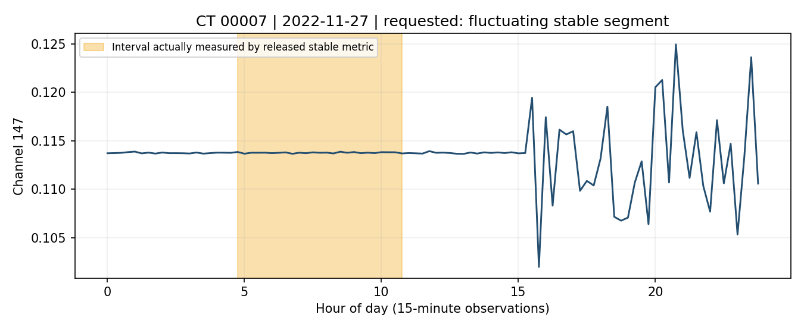

# v019：Sonar-TS 的 CPU 失败案例审计

日期：2026-11-01。方向 3 的阶段性研究记录；**没有使用 GPU，没有下载模型权重，没有调用 LLM API。**

## 先读这段：这次到底查出了什么？

这次不是让模型再答题，而是检查官方公布的答案，并用公开的固定 Python 程序重算。先固定了 12 道 Composite Trend（复合趋势）题，又补查了 2 道形状题和 2 道上下游异常题。

最重要的发现是：**官方结果与当前检索模板不是同一时间版本。** 如果忽略这一点，很容易把新模板的行为误当成官方生成答案时的行为。换回结果文件同版本的旧模板后，不调用模型，也能复现选定 12 道题的全部预测日期集合。

在这 12 道题上，只取消旧模板的“SAX 候选优先”排序，保留相同原始数据、相同数值计算和门槛，3 道改善、9 道不变，平均 Set-F1 从 0.467 变为 0.583。但仍有题完全没改善。这表明至少要拆开查：**候选优先规则、有没有量对题目指定的片段、标签到底按什么定义生成。** 不能把低分统一解释成“缺少互补证据”。

本轮也没有找到必须设计新模型的证据。一个官方零分的上下游异常案例，公开的固定数值程序就能得到 0.922 IoU。下一步应先解决任务定义和可靠验证，暂不进入新架构设计。

## 1. 结果和代码来自哪里？

官方仓库：[Atlamtiz/Sonar-TS](https://github.com/Atlamtiz/Sonar-TS)。本轮固定 Git Commit：`99866c43cd7ceb91a929de745e9f49cea92962e5`；只读核对远端 HEAD 也为该提交。当地已有代码，未改动官方工作树。

核验文件包括 [per_task.json](https://github.com/Atlamtiz/Sonar-TS/blob/99866c43cd7ceb91a929de745e9f49cea92962e5/output/per_task.json)、[summary.json](https://github.com/Atlamtiz/Sonar-TS/blob/99866c43cd7ceb91a929de745e9f49cea92962e5/output/summary.json)、[predict.json](https://github.com/Atlamtiz/Sonar-TS/blob/99866c43cd7ceb91a929de745e9f49cea92962e5/output/predict.json)、[tasks.json](https://github.com/Atlamtiz/Sonar-TS/blob/99866c43cd7ceb91a929de745e9f49cea92962e5/nlqtsbench/tasks.json)，以及评分器、离线特征程序、检索与验证模板。每个本地文件都与 `git show` 的提交内容逐字节一致，SHA-256 和 Git Blob 存在 [official-audit.json](../results/v019-cpu-failure-atlas/official-audit.json)。

对全部 1,153 道题：题目索引、Task ID、公布预测之间全部对应；使用官方评分器重新计算，**分数不一致为 0 道**；各任务均值也与 summary 一致。按 tasks 中的标签和结果文件内的标签分别评分，未发现分数差异。这说明现有公布分数可复算；不代表标签语义已经全部正确。

### 一个必须保留的版本区别

| 文件/实现 | 最后相关提交 | 日期 | 实际访问与选择方式 |
|---|---|---|---|
| 公布的预测与分数 | `f2d6185` | 2026-05-27 | 文件只含最终预测，没有每题执行轨迹 |
| 同提交的旧 CT 模板 | `f2d6185` | 2026-05-27 | 读全年原始值；计算全年门槛；优先输出 SAX 池中通过门槛的日期，再补池外日期 |
| 当前 CT 模板 | `575058c`，包含于固定 HEAD | 2026-06-02 | 通常仅读 SAX 候选日期；候选不足 5 天才回退到全年；在实际候选上重算门槛 |

旧模板来源：[结果同版本的 composite-trend-topk.md](https://github.com/Atlamtiz/Sonar-TS/blob/f2d61852498f1e406effc9d2696c512d2b3a2180/sonar_ts/skills/library/composite-trend-topk.md)。新模板来源：[固定 HEAD 的对应文件](https://github.com/Atlamtiz/Sonar-TS/blob/99866c43cd7ceb91a929de745e9f49cea92962e5/sonar_ts/skills/library/composite-trend-topk.md)。

旧模板重算的 12/12 预测集合与公布结果相同；新模板为 8/12。**这是数值结果的一致性证据，不能证明官方当时执行的 SQL、生成代码逐行等于模板。** 审计的官方输出目录没有这些原始轨迹，也没有足够信息核实每次预测的模型配置。不能用 README 当前默认模型反推公布结果使用了哪个模型、提示或重试配置。

## 2. 三类任务的公布结果

| 任务 | 题数 | 指标 | 平均值 | 中位数 | 零分 / 部分分 / 满分 |
|---|---:|---|---:|---:|---|
| Composite Trend | 220 | Set-F1 | 0.3264 | 0.2000 | 85 / 115 / 20 |
| Shape Identification | 129 | IoU | 0.3276 | 0.2526 | 24 / 105 / 0 |
| Causal Anomaly | 95 | IoU | 0.4230 | 0.3903 | 26 / 69 / 0 |

**Set-F1** 比较两组日期重合多少。例如都输出 5 天、其中 4 天正确，得分是 0.8。题目虽然要求有顺序的日期列表，官方这个指标**不检查日期排名顺序**。

**IoU** 比较两个时间段的重叠时长：交集除以并集。例如预测区间偏长或边界偏移，也可能得到部分分。这些均值都不是“答对题目比例”，不能与分类准确率混用。

全部 444 道目标任务的 ID、问题、预测、标签、指标和分数见 [official-case-catalog.json](../results/v019-cpu-failure-atlas/official-case-catalog.json)。它是评估资料，未提供给预测程序。

## 3. 如何避免看着答案调整程序？

在读取选定题目的原始时序前，写入 [protocol.json](../experiments/v019-cpu-failure-atlas/protocol.json)：按公布得分分成零分、部分分、满分三组，各组按 ID 排序取前 4 道，不根据复现结果替换。**这是为了覆盖不同情况的案例样本，不是随机抽样，12 题均值不能代表整个 Benchmark。**

原始 CSV 固定来自 [mrtan/NLQTSBench](https://huggingface.co/datasets/mrtan/NLQTSBench/tree/81571171c5c614d01698497626bff8eb6ad8dcf4)，Revision `81571171c5c614d01698497626bff8eb6ad8dcf4`。优先复用本地文件；缺少时只下载所选 CSV，不下载完整题库。12 个 CT 文件共 16,428,789 字节，逐文件核验上游大小与 Git Blob/LFS 哈希。

执行程序只读单独的 `public-inputs.json`：问题、通道、数据路径。正确答案、公布预测、生成元数据另存，仅在评分阶段读取。特别隔离 `meta.top_k`、`all_injections` 和注入片段边界，它们包含直接或间接答案信息。

先按当前公开模板完成全部预设对照。发现版本差异后，另行记录 [版本诊断方案](../results/v019-cpu-failure-atlas/version-diagnostic-protocol.json) 和 [旧模板干预方案](../results/v019-cpu-failure-atlas/legacy-interventions-protocol.json)，在**原来全部 12 题**上执行，不改题、不调参数。

离线 SAX 特征调用官方 `offline.py`：15 分钟原始点按小时求均值，每天形成 24 个字母，字母表示该天内部标准化后的数值高低。SQLite 查询、实际读取日期、每日日值、门槛、结果和固定程序均保存。各题有 365 或 366 天，不把闰年当成缺失/重复数据。

## 4. 与公布结果同版本的主要干预

下面只比较旧模板，避免版本混淆。表中编号均为 `L3_T1_Composite_Trend_` 后缀。

- **原模板**：全年数值计算后，先取 SAX 候选，再取其他日期；在这 12 题上复现公布分数和预测集合。
- **取消候选优先**：原始数据、数值、全年门槛全部保持，只按数值统一排序。不保证所有入选日期都符合完整趋势形态，因此它是定位原因的对照，不是完整替代方法。
- **只修正端点**：原优先规则不变，只把单调区间幅度计算补上最后一个增量。

| ID 后缀 | 原模板 / 公布分 | 取消候选优先 | 只修正端点 |
|---|---:|---:|---:|
| 00005 | 0.0 | 0.4 | 0.0 |
| 00007 | 0.0 | 0.0 | 0.0 |
| 00008 | 0.0 | 0.8 | 0.0 |
| 00019 | 0.0 | 0.0 | 0.0 |
| 00001 | 0.2 | 0.4 | 0.2 |
| 00003 | 0.4 | 0.4 | 0.4 |
| 00004 | 0.8 | 0.8 | 0.8 |
| 00006 | 0.2 | 0.2 | 0.2 |
| 00002 | 1.0 | 1.0 | 1.0 |
| 00033 | 1.0 | 1.0 | 1.0 |
| 00061 | 1.0 | 1.0 | 1.0 |
| 00066 | 1.0 | 1.0 | 0.8 |
| 本批案例均值 | **0.4667** | **0.5833** | **0.4500** |

结构化结果见 [legacy-intervention-scores.csv](../results/v019-cpu-failure-atlas/legacy-intervention-scores.csv)。这些是确定性程序的配对对照，未做总体显著性或模型优劣声明。

### 案例一：00008，粗检索优先级挡住了更强的数值候选

问题要求：2023 年通道 151，出现“缓慢上升 → 快速下降 → 缓慢上升”的日期里，找下降最快的 5 天。

正确日期集合为：11-25、07-11、08-20、10-28、03-15。新模板 SAX 命中 84 天，其中一个正确日期也没有。旧模板的 SAX 集合也未包含这些正确日期，**但旧模板已读全年 35,040 个原始点**，所以不能说它“没有读到正确数据”。

旧模板通过门槛后仍有 56 个 SAX 池内日期，先从这里填满 5 个位置，得到的日期全部不在标签里。取消优先级后，选出：08-20、10-28、07-11、11-25、09-21。其中 4 个命中，Set-F1 从 0 变为 0.8，数值规则和门槛没有改变。

**能够确认**：在这个固定程序的复现中，粗检索优先级可以压过更强的数值候选，导致标签得分降低。**不能确认**：官方模型当时是否运行了相同 SQL；池外某一天按自然语言形态定义是否一定合格；因此不能直接把取消 SAX 优先当作正确的最终算法。

### 案例二：00007，数据齐了，程序仍可能量错片段

问题是“先平稳、再波动”的日内曲线，要求比较其中**波动段**。新模板候选有 364 天，5 个正确日期全部在内，仍得 0 分；全年数值排序也没有解决。

看其中一个正确日期 **2022-11-27**：曲线前面平坦，后面明显波动。但公开 `stable` 计算先找“差分波动较低的最长区间”，实际测量 **04:45–10:45 的平坦部分**，得到标准差约 `0.0000550`。这不是题目想比较的后面那段波动。

更一般地，模板没有用到“目标是第几段”；`rapid`、`slow` 大多没有用于定位不同的同类片段。220 道 CT 中，122 道含重复 kind，例如一题里有两个 fall。**仅找全天最长的 fall，不能保证找到题目指定的 slow fall。** 这是代码语义限制；还不能据此断言它解释了所有相关题的低分。

## 5. 当前模板的补充对照：不能套回官方历史运行

这部分保留最初预先固定的全部干预，作为当前代码诊断。完整逐题结果见 [intervention-scores.csv](../results/v019-cpu-failure-atlas/intervention-scores.csv)。

| 当前模板/干预 | 本批平均 Set-F1 |
|---|---:|
| 当前模板：候选内计算 | 0.4333 |
| 全年数据、门槛随之重算 | 0.5833 |
| 全年数据、冻结原候选门槛 | 0.5667 |
| 原候选内、修正单调区间端点 | 0.4167 |
| 全年数据、修正端点 | 0.5667 |
| 独立分段线性拟合诊断 | 0.3833 |

具体到 **00019**：当前模板原分 0.2；读全年后变为 0；但冻结原门槛后仍为 0.2。扩大候选使门槛从约 `0.0022175` 降为 `0.00179`，随后按升序挑选，选中了另一组较小值。**数据更多导致分数改变，可能是筛选门槛变了，不能只归因于找回了更多证据。** 这不是公布结果的 0→0.2 改善：公布结果该题为 0，属于不同版本。

4 道题在当前模板回退后候选中没有任何正确日期；其余 8 道包含全部 5 个。其中 00006 的 SAX 候选为零，但模板按既定规则回退到全年，所以最终并没有缺失正确日期。完整检索前后召回、实际访问天数和点数均留存。

独立算法采用有方向约束的分段线性最小二乘拟合：按题目顺序切成指定段数，每段至少 4 点；上升段斜率为正、下降段为负；目标 rise/fall 按绝对斜率排序，stable 按该段标准差排序。它不使用标签或注入边界，但没有完整定义 rapid/slow/steady 的阈值，也不能作为标准答案。**整体低于公开模板，不能宣传为改进方法。**

另外，单调区间差分的末端少计了一个增量：对原始 `0,1,…,7`，按模板平滑后，正确的该单调段幅度为 4，模板返回 3。修正计算端点在本批没有带来均值提升，00066 反而下降。**代码的数学端点问题是真实的，但不是本批低分的主要解释，也不意味着修正后会更贴合合成标签。**

## 6. 标签语义：发现了需要澄清的地方，尚未证明标签错误

这一步仅作事后评估，没有用来构造候选或调参数。

- 220/220 道 CT 的答案集合等于元数据 `top_k`，也等于 `all_injections` 中 rank 1–5 的注入日期。因此元数据包含答案来源，必须隔离。**本轮没有证据表明官方检索器实际使用了这些字段。**
- 167 道元数据的 `rank_axis` 为 `slope`，53 道为 `std`。当前模板说明却明确采用单调段总幅度，并反对斜率排序。这是可以直接核对的定义差异；仅凭字段名还不能断言生成代码真的按观测斜率排序。
- 注入强度的排序不必等于加上真实背景后，实际观测片段的斜率、幅度或波动排序。需要找到生成脚本、形式化片段定义后，才能严谨判定具体标签是否错误。
- Set-F1 只看集合，无法检查题目所要求的“最快到最慢”的顺序。

所以本轮用“与公布标签得分一致/不一致”，不直接把它写成“自然语言意义上一定正确/错误”。语义审计见 [semantic-audit.json](../results/v019-cpu-failure-atlas/semantic-audit.json)。

## 7. 其他两类任务：各补查两题

CT 出现明确机制差异后，按 [extension_protocol.json](../experiments/v019-cpu-failure-atlas/extension_protocol.json) 固定：每类取 ID 最靠前的零分题和非零分题，不更换题。只运行公开固定模板。

| Task ID | 公布 IoU | 本轮固定模板 IoU | 受控补查 |
|---|---:|---:|---|
| `L2_T1_Shape_Identification_00017` | 0.0000 | 0.0000 | 读完整公开搜索窗口仍为 0 |
| `L2_T1_Shape_Identification_00001` | 0.5858 | 0.5556 | 原访问已覆盖公开窗口，扩大访问不变 |
| `L3_T3_Causal_Anomaly_00386` | 0.0000 | **0.9215** | 固定上下游波动检测，已读两通道全年数据，无兜底输出 |
| `L3_T3_Causal_Anomaly_00387` | 0.3449 | 0.3449 | 已读两通道全年数据；固定残差阈值只找出部分标签区间 |

形状题的自然语言映射事先固定：“low plateau (bottom out)”→`depression`，“step ascent”→`step_up`。映射本身也是复现假设，不能当作原模型的实际参数。

**00386 的具体例子**：标签为 2022-02-17 21:00 至 02-20 22:15；公布预测却在 7 月。固定模板在 6 小时滑窗里比较上下游波动，输出 02-18 00:00 至 02-20 19:30，IoU 为 0.9215。说明正确的传统程序已足以大幅改善此例。没有历史轨迹，无法知道官方失败究竟来自问题转译、代码、参数、执行还是最后回答。

**00387 的具体例子**：标签结束于 04-22 18:45；固定程序和公布预测均结束于 04-16 12:45，漏掉后半段。两条全年通道已经读取，不能把本次固定程序的截断解释为缺少另一条通道的互补证据；它首先是残差判定与区间标签的一致性问题。

形状题 00017 在本轮访问范围内已包含标注区间，完整窗口仍失败；当前低方差区间检测没有解决“哪个低平台才算题目指定对象”的问题。它也不支持“只要扩大检索就能解决”。各题预测、原始访问范围、SQL 和固定代码见 [extension/](../results/v019-cpu-failure-atlas/extension/)。4 例不能代表各任务总体。

## 8. 归因证据有多强？

这里把“代码存在某种行为”与“官方当时为何答错”分开。

| 观察 | 证据等级 | 可说的结论 | 不能越过的边界 |
|---|---|---|---|
| 1,153 题评分完全复算，代码和结果有版本差异 | A：提交与文件直接核验 | 没有发现已公布分数的复算错误；必须锁定版本 | 不能保证标签自然语言语义正确 |
| 旧模板 12/12 日期集合复现 | B：确定性 CPU 复现 | 公开数值路径足以重现这些结果 | 不能据此恢复官方当时的实际轨迹 |
| 取消旧版 SAX 优先，3 例改善 | B：同题同数据单因素干预 | 该优先规则在复现中影响得分 | 不能说候选外日期一定满足完整形态，也不能外推全题库 |
| 00007 测量平坦段，任务问波动段 | A+B：代码与实际测量区间 | 固定验证器未可靠对齐目标片段 | 不能概括为模型不懂互补证据 |
| `slope` 字段、幅度模板、注入排序不一致 | A：字段和源码；标签错因待证 | 需要单独核验标签生成语义 | 目前不能宣布标签错误 |
| 00386 固定程序得 0.922 | B：数值复现 | 此例不必引入新模型即可改善 | 官方失败环节仍属 C：待轨迹验证的假说 |

没有官方每题轨迹时，“原模型写错 SQL”“没有继续搜”“错误停止”等归因均不成立。本轮没有重跑 LLM，因而也没有模型检索次数或停止判断能力的新测量。

## 9. 对方向 3 有什么帮助？下一步值得研究什么？

**候选问题一：粗形态检索与精确数值验证冲突时，怎样判断该相信谁？**

00008 表明，固定优先级可能压住数值上更强的池外候选。但直接取消形态约束并不完整。下一步先比较简单的候选放宽、完整形态约束分段拟合、数值排序后复核，检查是否能兼顾形态合格与排序正确。只有这些传统方法稳定失败，才有理由研究学习型选择机制。

**候选问题二：怎样把问题中的“那一段”可靠地对应到实际时序片段，并判断验证结果是否可信？**

00007 和重复 kind 暴露了目标定位问题。先用传统变化点检测、约束分段回归、明确的时间顺序约束建立可靠验证器。若这些已解决，贡献应定位为可验证任务与工具流程，而不是声称必须训练新模型。标签生成规则尚不清楚的题，要单列为语义未决，不拿来证明方法失败。

**候选问题三：何时需要继续获取证据，何时只是现有验证程序不可靠？**

这与方向 3 最接近，但**本轮还没有证明条件互补检索瓶颈**。CT 主要是单通道日内形态与排序；旧版已读取全年；本次上下游异常模板也一次读完两通道。它们不能直接支撑“已有 A 时，要根据其内容选择 B”的研究主张。未来若继续，必须先可靠区分“确实缺少数据”和“数据齐了但判定器量错”，再在受限候选访问和可验证反事实任务里评价下一步动作与停止。

**当前决定：先完善任务语义、片段验证与版本一致的基线，暂不进入新模型设计，也不为了维持方向 3 而把这些失败包装成互补检索缺陷。** 没有必要立刻跑整个 Benchmark；优先找齐标签生成脚本，并为上述已定位案例建立可靠的规则对照。

## 10. 保存与复现

入口：[实验代码与复现说明](../experiments/v019-cpu-failure-atlas/REPRODUCE.md)。结果根目录：[v019-cpu-failure-atlas](../results/v019-cpu-failure-atlas/)。所有运行均为 CPU；旧实验未覆盖，根 README 未修改。GitHub 仅提交本轮代码、指标、所选案例轨迹与必要说明，不提交原始 CSV、模型或敏感配置。

当前阶段完成：全体官方结果文件审计；固定 12 道 CT 数值复现与干预；4 道扩展案例。**未开展更大样本数值实验、LLM 重跑或模型训练。**
