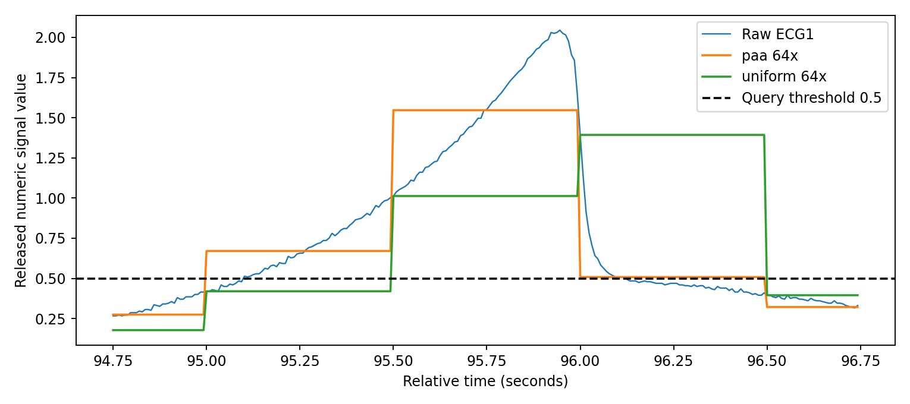
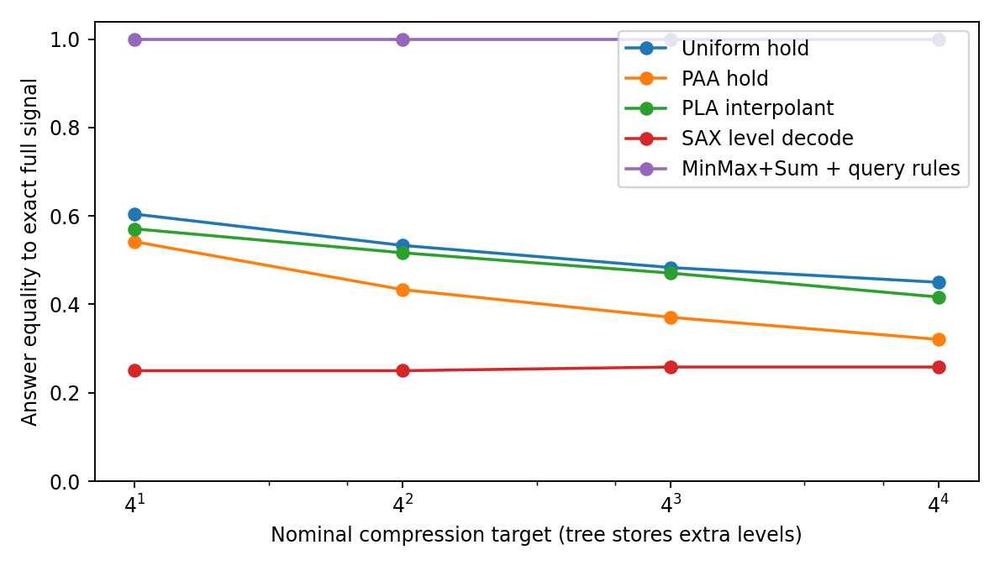
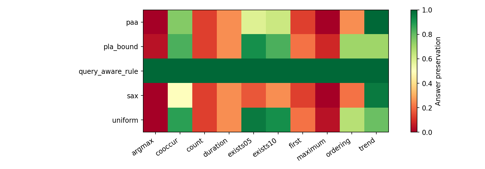
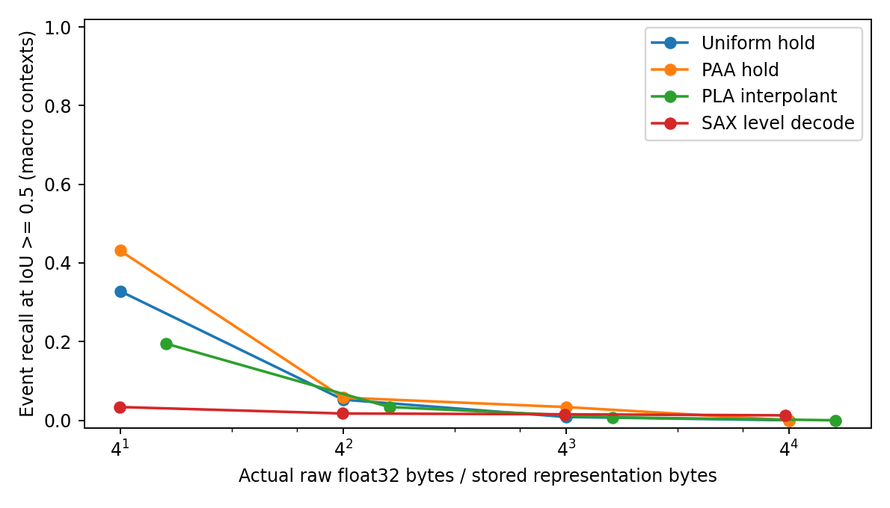
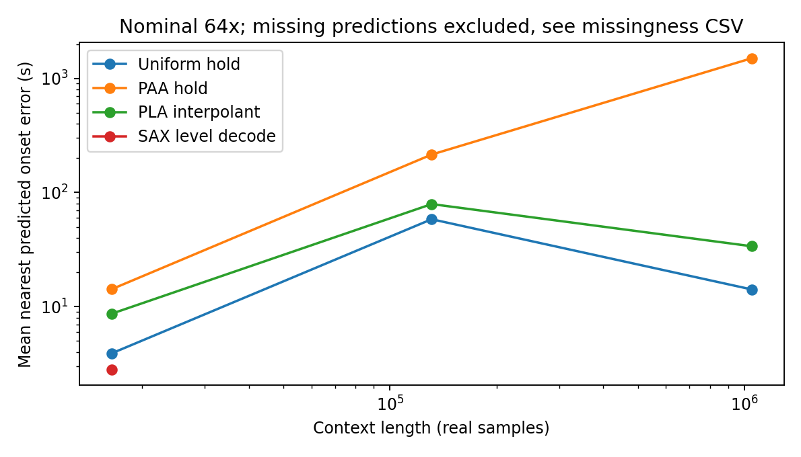
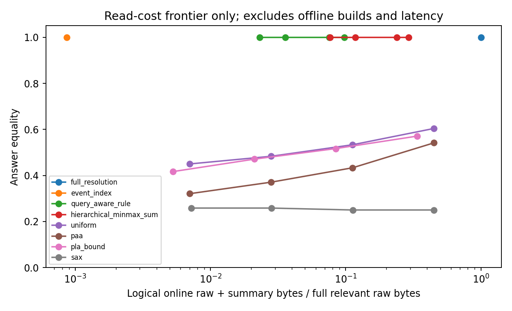

# v020：长时序压缩会丢掉哪些答题证据？哪些可以用传统方法找回来？

实验日期：2026-11-02。第一轮 Pilot 已完成：240 道 CPU 数值题、8,160 条方法—问题结果、14 次 Sonar 完整系统运行。没有训练，没有付费 API，没有下载新模型权重。v001–v019 未修改，仓库首页未修改。当前检出的仓库及项目根目录均没有 README，因此以历史报告作为背景入口。

## 先说结论

**这轮尚不支持训练新模型。** 固定降采样确实会改变部分问题的答案，但在这里，强传统索引和精确规则已经恢复了全部答案；Sonar-TS + Qwen3-8B 读取完整数据也没有暴露稳定的回答缺陷。应归入任务要求中的 **Case A：传统方法已经很好**，不能写成已经发现 Case C。

这不等于长时序研究没有空间。它说明“真实信号 + 可直接写出的阈值规则”仍不足以证明需要学习新的细化策略。更不能把压缩产生的误差包装成 LLM 的缺陷。

## 1. 用一个真实例子说明我们在测什么

记录 `104` 的前 16,384 个心电采样点，问题是：“ECG1 连续超过 0.5 的事件有几次？”一次事件指一串相邻且都达到阈值的点，中间掉到阈值以下就算分开。

| 输入 | 事件次数 | 第一次超过阈值的位置 | 最大值 |
|---|---:|---:|---:|
| 完整信号 | 9 | 第 12,173 点 | 2.045 |
| 每 64 点取均值，均值代表整段 | 2 | 第 12,160 点 | 1.547 |
| 每 64 点取一个点，保持至下个采样点 | 2 | 第 12,224 点 | 1.393 |

图只放大其中约两秒，表中的次数统计基于完整 128 秒。均值可能把几次短事件揉成一次，也可能把短峰压低。这里不用任何语言模型，答案就已经变了。

但是，如果问题只是“有没有超过 0.5”，保存最大值就够了；不能因为上表的事件次数变了，就说 Min/Max 对所有问题都丢失关键证据。**需要保留什么，取决于问什么。**

案例数据见 [worked-example.json](../results/v020-evidence-fidelity/worked-example.json)。0.5、1.0 是提前固定的数值阈值，单位按发布文件的数值单位处理；上游转换清单没有注明物理单位，本轮不擅自称为 mV。这些事件不是心律失常或临床 R 波标签。

## 2. 数据到底来自哪里，哪些是新构造的题？

主要信号来自 TS-Haystack 官方链接的真实 LTAF ECG 原始数据仓库 `nz00shuuuu/ltaf-raw`，固定版本 `f6b42b56f698507660a65d5a63ba98c1e2342ab0`。选择官方 test 记录按字典序排列的前八条：`100,104,105,11,200,32,48,49`。选取规则在读取这些信号的数值结果前冻结，未根据正确率换样本。

每条记录取三个互不重叠的窗口：

| 起点（采样点） | 长度 | 按 128 Hz 换算的时长 |
|---:|---:|---:|
| 0 | 16,384 | 128 秒 |
| 16,384 | 131,072 | 1,024 秒 |
| 147,456 | 1,048,576 | 8,192 秒 |

两条原始通道均保留；没有重复拼接序列、插入尖峰或改写信号。共 24 个上下文，每个提出 10 道事先定义的数值问题：两个阈值的存在性、事件计数、首次出现、最大值位置、最大值、前后半段均值比较、两通道首次事件先后、同时超过阈值、超过 1.0 的采样点总数。答案由 NumPy 精确程序产生。

**这 240 道是基于官方来源真实信号新建的数值 QA，不是 TS-Haystack 官方临床 QA 成绩。** 它覆盖短事件、全局汇总及两通道关系，但不覆盖全部骤降、变点、复杂跨尺度语义、Sleep PSG 或疾病识别。本轮不把这类能力当作已验证。

另下载并审计了官方 LTAF QA 的 existence/100s、counting/3600s、ordering/7200s 三份 test 元数据，各 150 条。它们提供记录 ID、窗口边界、128 Hz 采样率、问题和答案；部分 metadata 含事件区间。例如 ordering 问的是第几次 VT 与 AFIB 的先后，不能用超过固定振幅阈值来代替。详情在 [official-qa-audit.json](../results/v020-evidence-fidelity/official-qa-audit.json)。Sleep PSG 的公开文件目录已检查，未下载其大规模信号或产生测试分数。

没有训练，也没有跨记录的拟合或阈值调参。**独立记录只有 8 条，不能把 240 道相关题说成 240 个独立受试者。** 不确定区间按记录整体重采样，保留同一记录内部的题目关联。当前只有一个领域、两个固定阈值，因此适用范围较窄。

## 3. 六项相关工作的可运行性核验

以下是本轮检查到的代码状态和实际执行范围，不把不同论文的原始成绩排在一起。表内“未运行”不代表方法失败。

| 工作 | 官方实现、模型与数据 | 输入及目标 | 本轮可行性与资源 | 实际做了什么 |
|---|---|---|---|---|
| TS-Haystack / ARTS | 官方代码与数据链接公开；领域分类器有下载脚本 | benchmark 涵盖 100 秒到 24 小时；LTAF 为 2 通道/128 Hz，Sleep PSG 为 13 通道/100 Hz；多种事件 QA | ARTS 先跑领域分类器，再由 LLM 查询结果；LTAF 预处理会覆盖完整窗口，并使用 beat timeline 的位置。原脚本涉及外部模型 provider；本机没有这些分类器，不以阈值程序冒充临床分类器 | 固定源码与数据版本，下载八条真实 ECG、审计 450 条官方 QA。**未复现 ARTS 官方模型成绩**。本轮不为不兼容的临床目标下载额外权重或调用付费模型 |
| TimeRLM | agent、AnomalyXL 生成器和数据公开；README 明确列出未随代码提供的模型权重及未固定的 prime-rl patches | AnomalyXL 16k–131k、1–16 通道；异常定位、幅度、跨通道、滞后，另有真实 ECG/Sleep 迁移集 | 可通过本地 OpenAI-compatible endpoint 适配 REPL agent；完整训练环境与本机现有软件不同。官方 classical baseline 也有需训练的分类头，不能当作免费现成零样本检测器 | 阅读论文、README、复现文档及代码；**未执行原版或本地适配的 agent**。本轮完成 Sonar 对照后没有继续安装整套训练环境，不能声称已证明 TimeRLM 不适用或不能运行 |
| Sonar-TS | 官方任务规划、技能、代码生成、执行/重试及评分代码公开；复用 NLQTSBench | 数据库多通道检索与数值验证；长度取决于数据库，没有本轮确认的统一百万点性能保证 | 现有 Qwen3-8B BF16、4090D 24 GB 可运行；localhost API、workers=1 | **实际跑通两道官方任务与 12 个统一数值任务条件**；名称统一为 Sonar-TS + local Qwen3-8B，不是官方 DeepSeek 成绩 |
| TT-SAX | NumPy reference encoder、encoding card 与 regex search 公开；原评测为 NLQTSBench shape queries | 两轨分别记录水平与跨段趋势；默认 24 段；按通道/窗口编码 | CPU 即可编码和检索；自然语言到正则仍需要 LLM | 运行 reference encoder；在一个原生 CT 文件的 365 天上运行官方 regex search。后者为手写符号形态查询的执行检查，**不是整套自然语言形态 benchmark 复现** |
| ARTIST | controller/reasoner、SFT/RL/推理代码公开；当前 README 推理需指定本地训练 checkpoint，没有找到直接可用的最终 checkpoint 链接 | 动态选片段及停止，跨六个 benchmark；未核验百万点/本机多通道运行上限 | 文档训练为 1×H100 SFT、4×H100 RL；这不是其推理最低硬件要求。复现需先解决 checkpoint 与数据接口 | 检查固定 commit 的源码目录与 README；**未运行**，没有给它编造失败分数 |
| TiMER | 多粒度编码、query router、训练/评测代码及 MTE checkpoint 公开；TSAQA 有公开链接 | 问题自适应路由/对齐到 LLM；不是数据库局部原始值读取系统；百万点输入上限未确认 | README 的推荐 frozen-LLM 配置使用 Qwen3-0.6B，但仍需训练 QGR/GTE/TLA；所列 MTE 权重不等于完整 QA 系统权重 | 检查固定版本的 README、文件树和资源链接；**未训练或强行接入 ECG 数值题** |

相关论文与官方实现：

- [TS-Haystack: A Multi-Task Retrieval Benchmark for Long-Context Time-Series Reasoning](https://arxiv.org/abs/2602.14200)，[official repository](https://github.com/AI-X-Labs/TS-Haystack)。
- [TimeRLM: Recursive Language Models Enable Precise Anomaly Localization in Long-Context Time-Series](https://arxiv.org/abs/2608.03391)，[official repository](https://github.com/OpenTSLM/TimeRLM)。
- [Sonar-TS: Search-Then-Verify Natural Language Querying for Time Series Databases](https://arxiv.org/abs/2602.17001)，[official repository](https://github.com/Atlamtiz/Sonar-TS)。
- [TT-SAX: A Two-Track Time Series Symbolization for Natural Language Shape Querying](https://arxiv.org/abs/2610.30593)，[official repository](https://github.com/Atlamtiz/tt-sax)。
- [Adaptive Time Series Reasoning via Segment Selection](https://arxiv.org/abs/2602.18645)，[official repository](https://github.com/mims-harvard/ARTIST)。
- [Bridging Time Series and Language via Query-Adaptive Multi-Granularity Routing for Temporal Reasoning](https://aclanthology.org/2026.emnlp-main.1397/)，[official repository](https://github.com/hyuna0926/TiMER_paper)。

固定源码 commit：TS-Haystack `5e8d3162d47176e19fbd9c5f3d3cf9c6e0e9a7d4`；TimeRLM `31fcd847b7cb37a1f1e6859b1dca7973ed0eae74`；Sonar `99866c43cd7ceb91a929de745e9f49cea92962e5`；TT-SAX `95fe2c1d50561538a6fe822ec6a97e0f0829ff80`；ARTIST `2bbc28a86f346efb7311ddc227f8952c3aa8b21e`；TiMER `daf870f5ee5bce6797436b8c16eccf091149bccc`。

这些工作已涉及自适应选片段、多粒度表示或工具精查。因此“根据问题选择分辨率/片段”本身不能当成我们的新贡献。是否存在未解决的问题，需要在强对照下另外证明。

## 4. 固定压缩的结果：哪些答案容易变？

所有方法都测试标称 4、16、64、256 倍。存储按实际数值/符号载荷字节计，包含归一化参数、上下界和符号；不把 Python 对象头、容器开销或 SQLite 文件大小混入这个口径；标称倍数不等于完全相同的实际预算。Uniform 与 PAA 每 r 点保存一个 float32；Min/Max 每 2r 点保存两个值；PLA 每 4r 点保存两端点及最大插值误差；SAX 使用五级 Gaussian 字母、全局均值和标准差。

下表是**特定解码/回答程序的答案保留率**，不是表示能力的理论上限：

| 方法 | 标称 4× | 16× | 64× | 256× |
|---|---:|---:|---:|---:|
| Uniform，按采样值保持重建 | 60.4% | 53.3% | 48.3% | 45.0% |
| PAA，按均值保持重建 | 54.2% | 43.3% | 37.1% | 32.1% |
| 固定分区 PLA，按直线重建 | 57.1% | 51.7% | 47.1% | 41.7% |
| SAX，按字母区间中心重建 | 25.0% | 25.0% | 25.8% | 25.8% |
| 分层 Min/Max+Sum，精确细化 | 100% | 100% | 100% | 100% |
| Min/Max+Sum，按问题精确细化 | 100% | 100% | 100% | 100% |

需要避免三个误读：

1. SAX 区间中心重建不擅长保留原始幅度和精确采样点位置，不能据此断言 SAX 形态检索很差。TT-SAX 也运行了 level-only 重建诊断，但它丢掉了 trend track 的使用，不进入上表的系统排名。完整两轨的执行检查另存 `ttsax-native-smoke.json`。
2. 固定 Min/Max 直接由最大值回答两个存在性问题和最大值问题，均精确；其余只在上下界足够时回答，否则 UNKNOWN。当前实现并非所有可辨识情形的最强判定器，所以不把整体 37.5% 当成 Min/Max 能力上限，也不拿中点重建的低事件召回否定其上下界价值。强 Min/Max 对照是后面的分层精确细化。
3. PLA 的误差界另做了验证：96 个“上下文×倍率”的每个原始点都位于保存的界内。192 个存在性判断中，保守区间规则认证了 81 个、全部正确；其余属于界不足以判定。直线重建答错或区间较宽，都不单独证明信息不可恢复。

总体上，全局均值比较较容易保留；事件计数、首次发生的精确点位置、最大值位置及阈值以上持续采样数更敏感。两通道关系要分开看：先后关系可能因定位改变，而“有没有一次同时发生”可能碰巧仍为真；高存在性准确率不等于准确保留了每一个事件。

证据召回定义为：对每个原始阈值事件，寻找重建结果中重叠区间的最高 IoU；IoU≥0.5 算召回。它是逐原始事件召回，不是分类准确率，也不是一对一匹配 F1。以 PAA 为例，平均召回从标称 4× 的 43.1% 降到 64× 的 3.36%；这两个数衡量**该重建方式**，不是 PAA 全部可能检索器的上限。无预测事件时的时间误差未定义，不补成零；图中的时间误差必须连同缺失率表阅读。

### 什么时候可以真正说“表示里已经分不出来”？

我们额外在内存中构造并验证了 10 个歧义见证：两条序列的**实际保存表示逐字节相同，但精确答案不同**。原始下载文件没有改写；这些只是机制检查，不混入 240 道主测试。

例如记录 104 的 `[12160,12224)` 区间内重排数值，PAA64 的全部均值保持相同，但事件数从 9 变成 10，首次事件也移动了。因此任何只看到这份 PAA 表示、无法恢复原始数据的算法，都不能对这两个可能信号同时保证答对。Min/Max、Uniform、SAX、完整 TT-SAX 两轨也找到了部分这样的见证，具体方法、倍率、重排规则及表示 hash 全部保存。其余尝试没有找到见证，**不据此宣称有损或无损**。

这比“某个解码器算错”更强，但见证是人为重排的可行信号，不证明这种替代信号在临床上等概率，也不能用来估计真实错误率。见 [ambiguity-witnesses.json](../results/v020-evidence-fidelity/ambiguity-witnesses.json)。

## 5. 传统细化能否补救，成本是什么？

分层索引每个节点保存 Min、Max 和 Sum。加 Sum 是为了公平回答均值问题；不能把它称为纯 Min/Max。检索策略只可读索引或通过计数 Broker 取得原始窗口，不能读答案。遇到上下界不能确定的区间才恢复原始点。计数时还合并相邻区间边界，避免把跨边界的一次事件算两次。

三种强传统方案均在 240 题上达到 100%：

- 分层 Min/Max+Sum：用界排除不可能区间，再精确计算。
- 按问题细化：存在性看最大值即可；找第一次就从前向后搜索并在确定后停止；计数才继续遍历其他可能事件区间。
- 预先事件索引：离线保存两通道在 0.5/1.0 的连续区间，以及最大值、位置和半段汇总。**它针对预声明的问题族，新增阈值、临床事件或任意新统计量不保证能直接回答。**

例如标称 16× 时，按问题细化平均只恢复相关原始数值的 2.73%，加索引节点访问后是完整相关原始数据字节的 3.58%。一般分层方案为 9.14% 原始值、11.77% 含节点访问。按问题细化中，计数仍需恢复平均 22.8% 的相关原始数值；存在性和均值比较不需要在线恢复原始值。

**省读取并不是无代价。** 这档树索引实际占原始两通道存储约 25%，相当于约 4×，并非真正的 16×。标称 4× 的树因保存全部层，大小接近原始数据。事件索引更小，但为特定阈值提前做了完整扫描。

| 方法 | 平均在线查询时间 | 平均一次构建时间 | 范围说明 |
|---|---:|---:|---|
| 完整 NumPy 计算 | 0.659 ms | 无索引 | 原始数组已在内存 |
| 一般分层方案，标称 16× | 41.7 ms | 27.5 ms | Python 遍历，包含访问计数 |
| 按问题细化，标称 16× | 11.3 ms | 与上行共用同一种树 | 逻辑访问少，但本实现更慢 |
| 预先事件索引 | 0.161 ms | 3.21 ms | 仅保证当前预声明的问题族 |

这不是冷磁盘端到端比较。当前内存向量化扫描非常快，Python 节点遍历有额外开销；**没有观察到规则细化的实际延迟优势**。不能用少读数据替换掉时间证据，更不能声称总体加速。每上下文处理 1/10/100 个查询的构建摊销另见 `amortized-cost.csv`；离线读入完整数据与多次内部扫描也明确保留。

这里的横轴仅为“在线逻辑读取字节”，包括索引读取；不是物理磁盘 I/O，也没有混入 Sonar 的 SQL 返回行数。真正不被其他点支配的点另存 `read-cost-pareto.json`。事件索引在这个轴上占优，并不说明它没有预处理成本或适用于所有查询。固定压缩的查询计时使用已重建的数组，构建计时包含重建，所以它们只作为保真诊断，**不用于宣称部署时的端到端速度优势**。

全部 1,920 条细化轨迹无损保存；另通过 280 个独立边界/并列最大值/跨叶节点事件与访问计数检查。停止规则依据可证明的数值界，本轮未声称测到了语言模型自身的置信度校准。

## 6. 实际 SOTA 系统对照：Sonar-TS + local Qwen3-8B

使用未改动的官方 planner、skills、代码生成、执行/验证重试和后处理；复用 v016 的本地 LLM 接口与只读 SQL 跟踪。只增加独立 SQLite 导入以保留 ECG 的亚秒时间精度，以及本轮题目和 PAA 表输入。PAA 表明确告诉系统：每行代表 64 个原始点，持续采样数需要乘 64，事件次数不能乘。没有把降采样后的行数误当作原始时长。

模型为本地已有 Qwen3-8B，已有下载清单对应 `Qwen/Qwen3-8B@b968826d9c46dd6066d109eabc6255188de91218`；本轮核对 config hash，没有重新计算全部权重分片 hash。BF16、非 Thinking、temperature=0、max output=4096、context=16384、workers=1。协议及统计重采样种子为 20261102；GPU 服务没有显式指定种子，日志为 seed=None，贪心生成不保证跨环境逐位一致。vLLM 0.8.5.post1，PyTorch 2.6.0+cu124，Transformers 4.52.4；4090D 24 GB、驱动 550.107.02。最大手动观察显存为 21,377 MiB，**没有连续采样，不能把它当成严格峰值**。vLLM 缓存预留也包含在占用中。模型 config hash 和运行参数已保存。

先固定两道官方 Global Aggregation：`L1_T1_Global_Aggregation_00007`、`00009`，都执行成功且精确正确，官方 rel_acc 均为 1。之后固定记录 100 中等长度窗口的六类题，分别运行完整表与 PAA64 表。共 14 次完整规划→代码→执行→验证→回答，没有按表现换题。

| 条件 | 相对原始信号答案 | 相对实际提供表的精确答案 | 平均单题耗时 | 平均 LLM 调用耗时 |
|---|---:|---:|---:|---:|
| 原生 NLQTSBench | 2/2 | 2/2 | 5.82 s | 5.27 s |
| 真实 ECG，完整表 | 6/6 | 6/6 | 8.74 s | 5.39 s |
| 同段 ECG，PAA64 表 | 3/6 | 6/6 | 5.73 s | 5.11 s |

这些时间包含观测用的 SQL/变量轨迹序列化开销，不能直接当作无跟踪的生产部署速度。全部任务总耗时 98.43 秒，29 次 LLM 调用，输入 42,041 tokens，输出 3,393 tokens；不含启动模型、离线建表、下载及初次环境准备。总共一次代码失败并成功重试：对 Python int 调 `.item()`，是工程错误，不能算成研究发现。服务器调用耗时不是纯 CUDA kernel 时间，后者未测；租赁单价未提供，不能编造金额。本轮 GPU 服务已在实验结束后停止。

还有一个重要成本对照：完整表平均输入 3,076 tokens/题，PAA64 表约 2,994 tokens/题，只减少约 2.7%，不是 64 倍。原因是 Sonar 让 Python 读取数据并计算，没有把全部 13 万个数都塞进 LLM 对话。对于这样的工具系统，压缩原始序列未必能显著减少模型输入成本。

具体发生了什么？

| 记录 100，中等窗口的题 | 完整信号答案 | PAA64 表精确答案 | Sonar 在 PAA 表上的答案 |
|---|---:|---:|---:|
| 阈值 0.5 的连续事件次数 | 2,149 | 13 | 13 |
| ≥1.0 的原始采样点数 | 1,073 | 896 | 896 |
| 最大值 | 4.474 | 2.883 | 2.883 |

因此，这里的三次变化首先是**提供给系统的数据已经改变了数值答案**。Sonar 对可见表计算正确，并未证明它在完整证据下也不会回答。三个任务也未要求它输出“证据不足”，不能把它直接给出可见表结果算成错误提前停止。若要研究自动请求原始窗口，需显式提供摘要语义、不确定性及恢复工具，再公平测试；本轮没有用缺失该接口的系统来证明其策略失败。

官方 `rel_acc` 是连续相对误差分数：PAA 条件平均约 0.748；它与本轮严格答案相等的 3/6 是两件事，不能混为分类准确率。只运行一段数据的六类查询也不足以给出 Sonar 的普遍性能结论。SQL 查询、返回行及代码完整保存，但没有测到 SQLite 物理扫描字节，不将其画进 Broker 的读取成本排名。

## 7. 回答四个研究问题，决定是否继续

**RQ1：哪些问题最容易丢证据？** 在这些真实 ECG 数值题上，短阈值事件的数量、精确时间和持续采样数比全局均值关系更敏感。重建误差、原答案变化、严格的同表示异答案证明分别报告，不能互相代替。尚未测到临床形态理解、复杂变点语义的相同结论。

**RQ2：传统索引和数值验证能否解决？** 能。当前全部问题都可由明确规则表达；分层 Min/Max+Sum 与精确恢复达到 100%，预先事件索引也达到 100%。按问题细化确实减少逻辑原始值访问，但在本机内存场景中不比直接扫描更快。它是强基线，不应包装成需要新模型解决的障碍。

**RQ3：当前可复现系统有什么实际缺陷？** 这轮没有发现 Sonar-TS + Qwen3 在完整表上的稳定缺陷。PAA 表上的变化可由压缩输入的数值变化解释。ARTS、TimeRLM、ARTIST、TiMER 未被运行，不能推断它们解决不了这些题；TT-SAX 仅完成参考编码及原生符号检索执行检查。更不能声称我们已战胜当前最强 SOTA。

**RQ4：是否值得训练新模型？** 目前没有证据支持。固定压缩丢失短事件并不新；自适应读片段及多粒度编码已有 ARTIST、TiMER、ARTS、TimeRLM。再训一个“看到峰值就恢复窗口”的网络，很可能只是用模型重复传统算法。

建议到此保留 v020 Pilot 的负面结果，**不因固定压缩分数低而扩大同类阈值题或开始训练**。如继续，应先检验下面一个更窄的假设，而不是立即设计架构：

> 面对难以预先定义的真实事件语义，系统能否可靠判断现有粗粒度检测/摘要是否足以支持“没有事件”或“所有事件关系都成立”？

下一轮应先选少量官方临床标注窗口，获得可用且经过单独校验的领域检测器，保留其漏检、置信区间与全量分类成本；用传统信号算法、校准检测器及合理搜索规则对照，再检验哪些语义查询仍不能用界或精确程序解决。**只有在这些强对照仍有稳定、可重复的准确率—成本差距时，才考虑学习条件证据保真函数。** 该建议尚不是已验证的新贡献，ARTS/TimeRLM 原版及本地适配对照仍是后续必要工作。

## 8. 复现入口及交付范围

- 代码：[experiments/v020-evidence-fidelity](../experiments/v020-evidence-fidelity/)，具体命令见 [REPRODUCE.md](../experiments/v020-evidence-fidelity/REPRODUCE.md)。
- 固定协议：[protocol.json](../experiments/v020-evidence-fidelity/protocol.json)；冻结 hash `7d1b0719b46cddedab471fdc1e7e1417133bfe3c03269d7f9950601e34a5055c`。
- 原始数值结果：[raw-results.csv](../results/v020-evidence-fidelity/raw-results.csv)；聚合及记录级不确定区间：[aggregate.json](../results/v020-evidence-fidelity/aggregate.json)。
- 输入校验：[acquisition.json](../results/v020-evidence-fidelity/acquisition.json)；统一 QA：[qa.json](../results/v020-evidence-fidelity/qa.json)；数值事件区间单独压缩保存，策略不读取该标注文件。
- 原始窗口恢复轨迹：[refinement-traces.jsonl.gz](../results/v020-evidence-fidelity/refinement-traces.jsonl.gz)；Sonar 规划、模型响应、代码和执行结果在 `results/v020-evidence-fidelity/sonar/traces/`。含完整信号数组的 SQL 轨迹仅留本地；GitHub 的 `sonar/public-sql/` 保留 SQL、行数及载荷校验 hash，避免变相上传原始信号。
- 原始信号、临床 QA parquet、SQLite 与权重留在服务器，不上传 GitHub。新增本地数据约 738 MB：原始信号约 639 MB，Sonar SQLite 约 90 MB，其余为小型原生文件和元数据。结束检查数据盘约余 3.0 GB；未删除任何旧数据。

这是一轮完成的 Pilot，不是六套方法的完整官方 benchmark 复现。结果支持先停止当前简单任务上的模型设计，而不是以实验量替代方法缺口证据。
