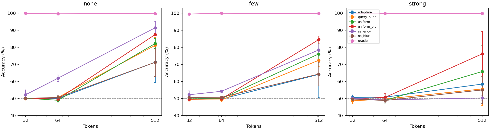
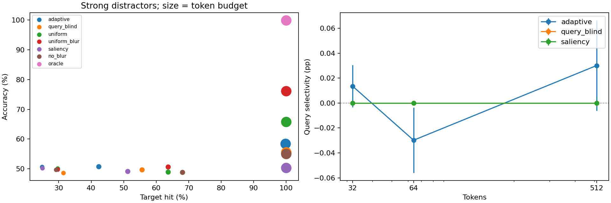
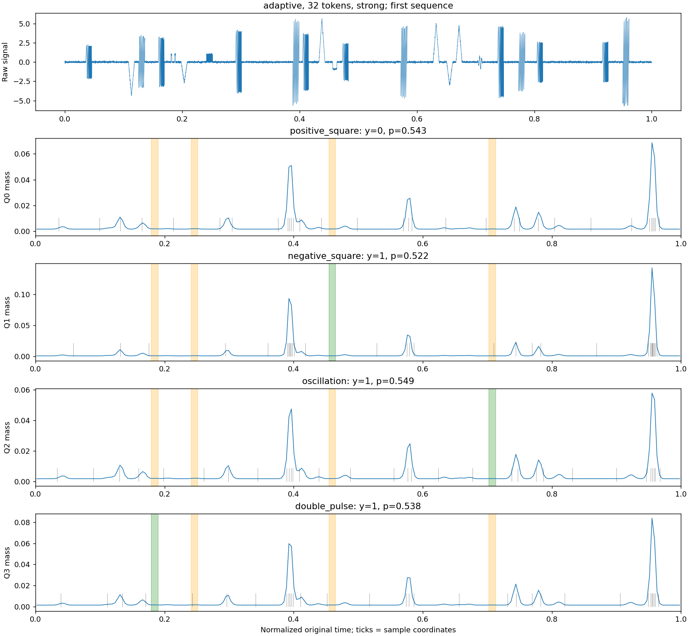
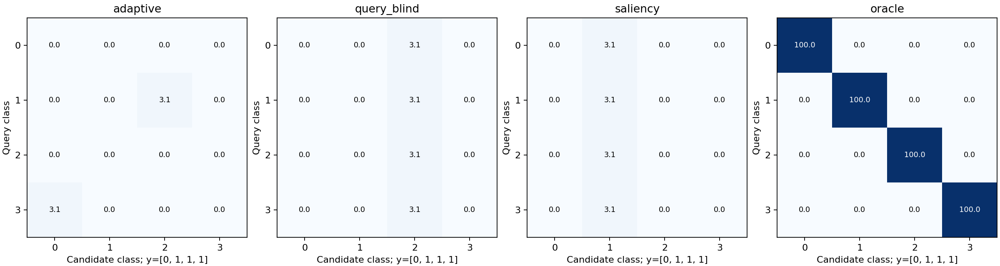
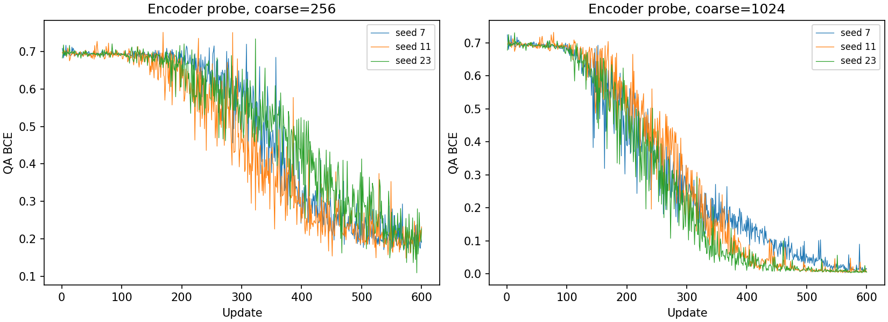
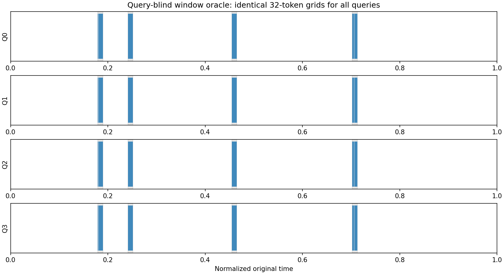

# Q-Sample 第二阶段：架构防捷径与 Query-Adaptive 能力验证

实验日期：2026-11-03。第一阶段原报告已命名为[第一版](REPORT_V1.md)，原实验目录与结果保留。本阶段未接入自然语言编码器或 LLM，未加入辅助重建 Loss。

## 结论

**本轮没有验证 Q-Sample 的核心 Query-Adaptive 假设。** 在固定的四类别形态任务上，32/64 Tokens 的非 Oracle 方法普遍接近类别先验；512 Tokens 的 Adaptive 也没有稳定优于公平的平滑 Uniform。不同 Query 确实能改变密度，但变化没有形成稳定且有用的条件化证据选择。

另一个重要否定结果来自补充预算诊断：即使只有 32 Tokens，知道全部候选窗口的查询盲 Oracle 仍能达到 94.53% 的强干扰准确率。因此，本任务暴露了搜索和证据传递困难，**尚未建立必须依赖 Query 条件采样的强信息瓶颈**。不能把小预算下学习失败直接包装为 Query-Adaptive 的必要性。

共保存 69 项冻结矩阵运行、6 项粗特征诊断、9 项补充预算诊断及 7 项开发实验，合计 91 项。所有主矩阵配置完成，无隐藏的失败运行。训练未按测试准确率选择最佳 checkpoint。

## 1. 架构审查和最小修改

第一阶段 `SyntheticQA(readout="signal")` 已经隔离直接坐标输入，本轮没有重复改写这一路径。`model.py` 仅增加默认值为 1 的 `query_dim` 参数，使原有标量 Query 和历史默认行为兼容，第二阶段传入四类别 One-Hot。

第二阶段在 `phase2_model.py` 复用 `QSample`、`inverse_cdf`、`sample_linear`、`gaussian_smooth`：

- 主模型：原始序列 → 五类局部统计 → 小卷积与 Query FiLM → 密度 → 逆 CDF → 插值信号值 → 答案头。
- 答案头：只读取采样值和类别 Query，以两层局部卷积识别有序形态，再做 mean/max 聚合。相比第一阶段逐点 MLP，局部卷积是区分振荡、双脉冲所需的最小扩展。
- `grid`、间隔、Fourier 时间特征、密度及粗编码特征均不传给主答案头。返回给评估器的坐标不等于提供给答案头。
- 独立 `signal_time` 对照通过时间投影显式读取坐标，结果单独报告。
- 本轮仅用答案 BCE：没有事件位置监督、密度监督或重建损失。事件元数据只进入评估与标注清楚的 Oracle/诊断程序。

16 项测试覆盖原有采样梯度和数值稳定性，以及配对输入、标签平衡、反事实直方图保持、事件不重叠、强干扰、Signal-Only 隔离、Query Blind 网格不变、多类 QA 梯度、已知选择性指标和主模型忽略 Oracle 元数据。记录见 [data-and-architecture-validation.json](results/phase2/data-and-architecture-validation.json)。新增注释与文档字符串使用中文。

## 2. 数据生成和 Query 定义

序列长 100,000，单通道独立高斯噪声标准差 0.06。每条信号有四个随机候选窗口，每类一个，窗口宽度 1024。Query 要求识别**完整窗口形态**，不是泛指任意异常或任意子脉冲：

| Query | 正例完整模板 |
|---|---|
| 正向长方波 | 窗口中央 70% 为正平台，两端为零 |
| 负向长方波 | 对应负平台 |
| 局部振荡 | Hann 形包络下的三周期正弦；不包括任意频率的 chirp |
| 双脉冲 | 两个分离的短正平台，每瓣占窗口约 16%；单瓣不算长方波类 |

各候选窗口的存在性独立按 Bernoulli(0.5) 产生；每批用随机标签向量及其补向量保持每类严格平衡。不存在时，窗口中填入对应模板的随机数值排列，作为破碎形态负例。因此，正负例的完整窗口数值多重集、幅值、能量和插入窗口数相同，标签不能直接由插入事件总数或全局幅值直方图确定。测试验证了无噪声反事实信号的排序数值完全一致；有噪声时是分布上的匹配，不要求同一噪声实现下的能量逐值相等。

目标名义幅值独立采样于 [0.8,1.2]。每条信号额外加入三角形、五周期锯齿、变频 chirp 等不满足上述完整模板定义的干扰：

| 难度 | 额外干扰数 | 名义幅值 |
|---|---:|---:|
| none | 0 | — |
| few | 2–5，均匀随机 | [0.8,2.0] |
| strong | 12–20，均匀随机 | [2.0,6.0] |

`none` 表示没有额外干扰，仍包含另外三个类别的候选窗口。位置在整个时间轴上随机提议，拒绝重叠和过近窗口，最小起点间距为 1.5 倍窗口宽度。目标标签不改变位置、幅值或额外干扰的随机数消耗；反事实测试验证了这一点。

同一条序列始终展开为四个 Query，不为不同 Query 重新生成噪声或事件。每个难度评估 128 条序列、512 个 Query，每类恰为 64 Yes / 64 No。三个难度共 384 条独立测试信号；所有模型种子与方法共享这组测试信号，不能把重复评估当成更多独立测试样本。

训练混合采样三种难度，评估按难度分层；没有为每个难度单独训练。不同难度的测试信号不是逐条配对的反事实，配对只指同一信号的多个 Query。

### 开发调整与冻结

开发阶段只使用模型种子 101、评估种子族 900001，与完整测试分开。宽度 384 时，Oracle 在 32 Tokens 下可学习，但 Adaptive 在 32 Tokens、粗分辨率 256/1024 上接近随机，延长到 1200 步仍失败。宽度只调整一次至 1024，使 512 Tokens 参考条件能看到更多形态细节；开发集 Adaptive 在 512 Tokens 下的无额外干扰准确率约为 82%，64 Tokens 下仍接近随机。

随后固定完整矩阵，未根据完整测试继续调整数据、模型或训练长度。全部 7 项开发运行见 [development_runs.json](results/phase2/development_runs.json) 及 `results/phase2/smoke-*`，包含失败曲线和图像。宽度调整意味着本轮不是第一阶段宽度 50 的同一任务，也不能宣称已经解决微弱事件。

## 3. 冻结实验矩阵与公平性

主设置：粗分辨率 256、Token 数 512/64/32、宽度 48、模型种子 7/11/23、AdamW 学习率 0.001、权重衰减 1e-4、梯度范数裁剪 5。每项 600 步，每步 8 条序列 × 4 Query，即 4800 条训练信号、19200 个 QA 样本。评估始终使用未平滑原始信号，checkpoint 固定为第 600 步。

适用方法的 Gaussian σ 从 32 在前 60% 步数线性退火到零，随后 240 步使用原始信号。采用较小 σ，是为了避免第一阶段 σ=128 对三周期振荡的过度抑制。

| 方法 | 采样方式 | 训练平滑 |
|---|---|---|
| Adaptive | 四类 Query 条件密度 | 是 |
| Query Blind | 密度网络 Query 置零；答案头保留 Query | 是 |
| Uniform | 均匀分位网格 | 否 |
| Uniform Blur | 相同均匀网格 | 与 Adaptive 相同 |
| Saliency | 固定的局部方差 + 极值绝对值 + 最大差分分数归一化 | 与 Adaptive 相同 |
| Adaptive No Blur | Query 条件密度 | 否 |
| Oracle | 在 Query 对应候选窗口内均匀采样 | 与 Adaptive 相同 |

Oracle 正负例都使用对应候选窗口，负例采样破碎形态，不通过“是否有坐标”直接泄露标签。它使用特权候选位置，只是理想证据参照，不是主模型，也不构成严格数学上界。

七种方法 × 三种预算 × 三个种子为 63 项，再加 `signal_time` 的 32 Tokens 三种子和粗分辨率 1024 的 Adaptive 32 Tokens 三种子，共 69 项。适用配置的答案头、初始化、训练数据流和超参数尽量一致；时间编码诊断另有投影参数，不视为参数量完全匹配的主对照。

所有方法/预算/种子的评估输入 SHA256 相同，每类标签平衡，运行源码哈希与冻结清单一致。见 [frozen_manifest.json](results/phase2/main/frozen_manifest.json) 和 [validation.json](results/phase2/analysis/validation.json)。± 是三个模型种子间的样本标准差，不是置信区间；CUDA 运算未要求逐位确定性。

## 4. 全部主对照准确率

单位为百分比。完整逐种子、逐难度指标见 [all_runs.csv](results/phase2/analysis/all_runs.csv)，聚合值及三个原始种子值见 [aggregate.json](results/phase2/analysis/aggregate.json)。下面未选择最佳运行。

| Tokens | 方法 | 无额外干扰 Acc | 少量干扰 Acc | 强干扰 Acc |
|---:|---|---:|---:|---:|
| 512 | adaptive | 71.29 ± 11.84 | 64.13 ± 13.48 | 58.46 ± 8.83 |
| 512 | query_blind | 81.18 ± 4.49 | 72.40 ± 3.73 | 55.60 ± 9.70 |
| 512 | uniform | 82.23 ± 2.89 | 76.11 ± 7.65 | 65.82 ± 15.18 |
| 512 | uniform_blur | 87.50 ± 0.85 | 84.51 ± 2.11 | 76.17 ± 13.18 |
| 512 | saliency | 91.47 ± 3.84 | 78.45 ± 3.56 | 50.33 ± 1.63 |
| 512 | no_blur | 71.22 ± 8.35 | 64.32 ± 6.91 | 55.01 ± 8.02 |
| 512 | oracle | 99.80 ± 0.34 | 99.87 ± 0.11 | 99.93 ± 0.11 |
| 64 | adaptive | 49.93 ± 0.11 | 49.67 ± 1.11 | 50.78 ± 1.35 |
| 64 | query_blind | 50.65 ± 0.30 | 49.15 ± 0.98 | 49.67 ± 1.49 |
| 64 | uniform | 48.96 ± 1.08 | 49.93 ± 0.74 | 48.89 ± 1.59 |
| 64 | uniform_blur | 49.67 ± 0.30 | 49.80 ± 1.47 | 50.65 ± 2.22 |
| 64 | saliency | 61.91 ± 1.86 | 54.23 ± 0.63 | 49.15 ± 1.30 |
| 64 | no_blur | 50.59 ± 1.01 | 50.72 ± 0.41 | 48.83 ± 1.28 |
| 64 | oracle | 99.67 ± 0.11 | 100.00 ± 0.00 | 99.87 ± 0.23 |
| 32 | adaptive | 50.20 ± 0.20 | 50.52 ± 1.08 | 50.65 ± 1.47 |
| 32 | query_blind | 49.87 ± 0.23 | 49.28 ± 0.81 | 48.63 ± 1.67 |
| 32 | uniform | 50.20 ± 0.20 | 49.80 ± 0.70 | 50.07 ± 0.96 |
| 32 | uniform_blur | 50.26 ± 0.45 | 49.61 ± 0.20 | 49.80 ± 0.34 |
| 32 | saliency | 52.21 ± 2.88 | 52.21 ± 2.26 | 50.20 ± 0.90 |
| 32 | no_blur | 50.13 ± 0.45 | 50.65 ± 0.11 | 49.67 ± 1.58 |
| 32 | oracle | 100.00 ± 0.00 | 99.54 ± 0.30 | 99.93 ± 0.11 |



Adaptive 在 32 Tokens 强干扰下比 Query Blind 高约 2.02 个百分点，但两者均接近 50% 先验；目标命中率反而更低，不能据此声称条件选择成功。64 Tokens 的排名不一致。512 Tokens 下，无额外干扰时 Adaptive 为 71.29%，Query Blind 为 81.18%；强干扰下 Adaptive 为 58.46%，公平的 Uniform Blur 为 76.17%。

## 5. 证据覆盖与 Query 切换

设 O[q,r] 为使用 Query q 时落入候选窗口 r 的 Token 比例，M[q,r] 为同一窗口的密度概率质量。

- Target Hit：目标存在时，至少一个采样坐标落在对应完整窗口的正例比例。
- Target Occupancy：目标存在时，分配到其完整窗口的 Token 比例。
- Distractor Occupancy：其他三个候选窗口与所有额外干扰窗口的 Token 比例，在同一正例集合上平均。
- ≥4 点覆盖：目标窗口至少分到四个点的正例比例；这是额外的操作性指标，不是形态可恢复的充分条件或理论下界。
- Query Selectivity：对存在的窗口 r，计算 O[r,r] 减去另外三个 Query 在同一窗口上的 O[q,r] 均值，再对正例平均。密度质量另算相同的差值。
- Paired Transfer：在同一信号中，两个目标 r、s 都存在时，计算 `((O[r,r]-O[s,r]) + (O[s,s]-O[r,s])) / 2`。同时记录严格正向转移比例，零变化计为未转移。

窗口包含模板内的零区和双脉冲间隙。因此，命中窗口不等于采到了非零证据，更不等于足够辨认完整形态。下面为强干扰结果，所有比例乘 100；Selectivity 的单位为百分点。

| Tokens | 方法 | Hit | ≥4 点覆盖 | Target Occ | Distractor Occ | Selectivity |
|---:|---|---:|---:|---:|---:|---:|
| 512 | adaptive | 99.740 | 75.911 | 0.955 | 27.954 | 0.030 |
| 512 | query_blind | 100.000 | 82.812 | 0.995 | 23.574 | 0.000 |
| 512 | uniform | 100.000 | 100.000 | 1.026 | 19.371 | 0.000 |
| 512 | uniform_blur | 100.000 | 100.000 | 1.026 | 19.371 | 0.000 |
| 512 | saliency | 100.000 | 55.859 | 0.732 | 68.375 | 0.000 |
| 512 | no_blur | 100.000 | 89.453 | 0.930 | 24.816 | -0.000 |
| 512 | oracle | 100.000 | 100.000 | 100.000 | 0.000 | 100.000 |
| 64 | adaptive | 42.318 | 0.000 | 0.661 | 42.621 | -0.030 |
| 64 | query_blind | 55.599 | 0.000 | 0.869 | 25.439 | 0.000 |
| 64 | uniform | 63.672 | 0.000 | 0.995 | 19.141 | 0.000 |
| 64 | uniform_blur | 63.672 | 0.000 | 0.995 | 19.141 | 0.000 |
| 64 | saliency | 51.172 | 0.000 | 0.800 | 68.414 | 0.000 |
| 64 | no_blur | 68.099 | 0.000 | 1.064 | 18.193 | 0.010 |
| 64 | oracle | 100.000 | 100.000 | 100.000 | 0.000 | 100.000 |
| 32 | adaptive | 24.870 | 0.000 | 0.777 | 27.380 | 0.014 |
| 32 | query_blind | 31.380 | 0.000 | 0.981 | 20.544 | 0.000 |
| 32 | uniform | 29.688 | 0.000 | 0.928 | 19.617 | 0.000 |
| 32 | uniform_blur | 29.688 | 0.000 | 0.928 | 19.617 | 0.000 |
| 32 | saliency | 25.000 | 0.000 | 0.781 | 70.471 | 0.000 |
| 32 | no_blur | 29.167 | 0.000 | 0.911 | 19.710 | 0.008 |
| 32 | oracle | 100.000 | 100.000 | 100.000 | 0.000 | 100.000 |

不能直接把多个干扰窗口的总占比与一个目标窗口相比而忽略面积。相同测试集上的 Uniform 提供面积参照：32 Tokens 下，Adaptive 目标占比 0.777%，低于 Uniform 的 0.928%；干扰占比 27.380%，高于 Uniform 的 19.617%。Saliency 的干扰占比更达 70.471%。本轮没有观察到 Adaptive 稳定压制强干扰。

32 Tokens 的点占比选择性仅为 +0.014 个百分点，密度质量选择性为约 +0.000049 ± 0.000715 个百分点，几乎为零。64 Tokens 的点占比选择性为 -0.030 个百分点；512 Tokens 为 +0.030 个百分点，幅度仍小，且没有带来优于公平 Uniform 的性能。



下图固定使用强干扰测试流的第一条信号、seed7，不根据模型表现选样。Adaptive 的四个 Query 密度虽略有变化，但高峰主要仍落在同一批强干扰上；并没有随绿色目标窗口系统转移。





## 6. 架构捷径与干预

以下均为强干扰、三个种子平均准确率。Zero 将采样值清零；Uniform Intervention 使用原答案头换成均匀网格；Wrong-Q Grid 把同一信号的另一 Query 网格交给原 Query 的答案头；Shuffle 打乱采样值的顺序。后面三项会造成输入分布或几何不匹配，不能把准确率下降全解释为采样器的因果贡献。

| 方法 / Tokens | 正常 | Zero | Uniform Intervention | Wrong-Q Grid | Shuffle |
|---|---:|---:|---:|---:|---:|
| adaptive / 512 | 58.46 | 50.00 | 54.69 | 56.58 | 50.13 |
| adaptive / 64 | 50.78 | 50.00 | 49.93 | 49.54 | 50.33 |
| adaptive / 32 | 50.65 | 50.00 | 49.41 | 51.17 | 49.61 |
| uniform_blur / 512 | 76.17 | 50.00 | 76.17 | 76.17 | 50.46 |
| signal_time / 32 | 50.33 | 50.65 | 50.00 | 49.80 | 50.72 |
| oracle / 32 | 99.93 | 50.00 | 48.70 | 51.82 | 49.61 |

所有 Signal-Only 配置的 Zero 准确率都为 50%，符合每类平衡的先验。这是直接坐标输入被隔离的实现检查，不是所有隐式信息通道已被理论排除的证明；采样值自身仍可能携带选择策略编码的信息。

`signal_time` 在本轮强干扰下正常准确率为 50.33%，Zero 为 50.65%；无额外干扰下正常为 52.60%，Zero 为 52.67%。没有重现第一阶段的 100%/100% 捷径结果，但模型在此任务中本身未充分学会答题，不能由此宣布坐标通道安全。第一版的明确反例仍保留。

对正例保留原网格、仅清除目标窗口内采样值时：Adaptive 512 Tokens 在无额外干扰下的 Yes 率从 63.41% 降至 4.95%，强干扰下从 59.11% 降至 44.27%；Uniform Blur 强干扰下从 65.76% 降至 6.77%。这些结果支持部分高预算模型使用了真实波形，但该干预也是分布外操作，且移除目标后语义标签已改变；这里报告的是 Yes 率，不是拿原标签计算的“干预准确率”。

相反，在 32/64 Tokens 下，清除目标对 Yes 率影响很小，结合正常准确率约 50%，更符合未学会有效利用目标证据。第一批错误样本按测试序列顺序保存，未筛选最戏剧化案例，见 [failure_cases.json](results/phase2/analysis/failure_cases.json)；全部预测保存在各运行目录的 `predictions.json`。

## 7. 当前粗特征是否已经丢掉答案？

另外训练六个直接读取粗特征的分类探针，使用相同训练流、步数、测试集和种子。它们绕过采样，**属于明确的信息旁路诊断，不计为 Signal-Only 或 Q-Sample QA 成绩**。

| 粗分辨率 | 无额外干扰 Acc | 少量干扰 Acc | 强干扰 Acc | 强干扰双脉冲 Acc |
|---:|---:|---:|---:|---:|
| 256 | 89.32 ± 2.43 | 88.28 ± 2.25 | 88.67 ± 1.28 | 54.95 |
| 1024 | 99.93 ± 0.11 | 100.00 ± 0.00 | 99.87 ± 0.23 | 99.48 |

256 个粗特征对正/负方波和振荡已很有效，但强干扰双脉冲平均仅 54.95%，提示类别相关的分辨率或建模瓶颈。提高到 1024 后，双脉冲达 99.48%，总体强干扰为 99.87%；这不等于证明 256 分辨率已经不可逆地丢掉全部双脉冲信息。

然而，将主 Adaptive 采样器的粗分辨率提高到 1024，32 Tokens 强干扰准确率仍为 50.00% ± 0.78，选择性约为 -0.003 个百分点。因此，失败不能仅归因为 Pooling 已把所有目标证据抹掉；可用粗特征与纯 QA 驱动采样/解码之间仍有明显落差。

这没有单独隔离逆 CDF 优化、稀疏梯度、时间形变后的形态失真或答案头训练各自的贡献。Signal-Only 下答案头不知真实采样间隔，也可能增加非均匀形态解码难度，不能只归咎于一个数学算子。



## 8. 小预算是否真的造成必须按 Query 选择的竞争？

主矩阵显示真实的覆盖不足：强干扰下，512 Tokens 的 Uniform 对所有目标都有至少四点覆盖；64/32 Tokens 的各非 Oracle 方法均未形成 ≥4 点覆盖。32 Tokens 的查询感知 Oracle 则接近 100% 准确率，说明该预算内存在可读的局部表示。

但这些事实**不足以证明查询盲策略不可能覆盖所有相关事件**。因此，在查看主矩阵之后增加了一个明确标记为事后诊断的对照：给查询盲 Oracle 同样的四个候选位置，将 Token 平均分到四个窗口，按真实时间排序；同一信号所有 Query 使用完全相同网格，答案头仍只读采样值和 Query。32 Tokens 即每窗口 8 点。它不读取标签，并且正负例的候选位置同样存在。

此补充诊断不改变数据、测试集、主模型或冻结矩阵，也不用于选择新的超参数。规范见 [specification.json](results/phase2/budget-probes/specification.json)。

| Tokens | 查询盲窗口 Oracle：无额外干扰 | 少量干扰 | 强干扰 | 查询感知窗口 Oracle：强干扰 |
|---:|---:|---:|---:|---:|
| 32 | 93.75 ± 1.53 | 93.88 ± 1.81 | 94.53 ± 0.52 | 99.93 ± 0.11 |
| 64 | 94.01 ± 2.26 | 93.75 ± 0.85 | 95.38 ± 0.60 | 99.87 ± 0.23 |
| 512 | 94.34 ± 1.17 | 93.29 ± 1.52 | 93.95 ± 1.37 | 99.93 ± 0.11 |



32 Tokens 查询盲窗口 Oracle 达到 94.53%，明显高于主学习方法；与查询感知 Oracle 的差距约 5.4 个百分点。这个差距没有在预算从 512 降至 32 时明显扩大，且两个 Oracle 的上下文组织也不同，不能把差距全归因于 Token 信息容量。

所以，本轮任务具有覆盖和优化难度，也给查询集中采样留下收益空间，**但尚未满足“没有 Query 条件选择就难以完成”的强判据**。这也是本阶段未达成的研究目标之一。下一轮如扩展候选类型或数量，应先在独立开发集用查询盲 Oracle 验证竞争，再冻结新的测试集；本轮不继续修改已见测试集来追求正结果。

## 9. 训练稳定性与失败机制

Adaptive 在 32/64 Tokens 的末 50 步平均训练 BCE 分别约为 0.69323 / 0.69326，接近随机猜测，不只是测试时失配。提高粗分辨率没有解决这一现象。

| Adaptive Tokens | 发生裁剪的步数比例（种子均值） | 最大裁剪前密度梯度（三种子最大值） |
|---:|---:|---:|
| 32 | 10.17% | 2094.98 |
| 64 | 16.39% | 125.10 |
| 512 | 62.06% | 20616.92 |

所有运行没有非有限损失导致的中止，但梯度有限不代表优化稳定。每步原始梯度、loss、σ 均保存在 `trace.json`；没有用仅每 200 步打印的控制台日志代替完整曲线。

Gaussian 退火对部分配置有帮助：512 Tokens 的 Uniform 从 65.82% 提升到 76.17% 强干扰准确率，Adaptive No Blur 为 55.01%，Adaptive 为 58.46%。但在严格预算下，有无平滑均失败，不能将第一阶段的现象推广为所有任务中训练成功的必要条件，也不能认为平滑已足够解决发现目标的问题。

## 10. 对七个研究问题的回答与后续价值

1. **严格预算能否稳定、有用地优于 Query Blind？** 未验证。32 Tokens 强干扰的约 2 个百分点优势没有对应更好命中率或实质性选择性；64 Tokens 排名不稳定，两者接近先验。
2. **能否压制高幅值无关干扰？** 当前没有。Adaptive 对目标分配低于 Uniform 面积参照，干扰分配反而更高；Saliency 更容易被强干扰吸走。
3. **同信号切换 Query 是否正确转移？** 密度能改变，方向和幅度未形成稳定、有用的证据转移。不能用“网格不同”代替成功判据。
4. **准确率和证据指标是否一致提升？** 不一致。512 Tokens 几乎必然命中目标，仍可只有约 50%–60% 强干扰准确率；命中一个点不够证明形态证据保留。
5. **退火是否仍是必要条件？** 未证明。它帮助部分高预算对照，却未使严格预算训练成功。
6. **局部统计是否为瓶颈？** 双脉冲探针对分辨率明显敏感；1024 特征直接分类近满分而采样系统仍失败，不能只用粗特征丢失解释全部失败。
7. **是否排除信息旁路？** 主答案头实现上隔离直接坐标/粗特征旁路，Zero 为先验；隐式值通道仍未被理论排除。本轮时间编码弱性能不能推翻第一版的明确捷径反例。

**当前证据不支持把这个实现作为已验证的 Query-Adaptive 方法接入 LLM 或宣传论文核心能力。** 可微采样的数值实现成立，主假设仍未验证；而且当前四类任务本身尚未建立强制条件选择的预算瓶颈。

后续研究价值取决于两个先决条件：先证明任务中理想查询盲采样随预算缩小确实显著失去证据，再证明纯 QA 梯度能把粗特征中已存在的信息转换为查询相关的采样分配。在当前配置中，直接读取更细粗特征的分类器已经很强，新采样链路还没有展示相应收益。应保留为待验证假设，优先解决这些问题，而不是用更大后端掩盖它们。

## 11. 复现、产物与边界

```bash
OMP_NUM_THREADS=4 python -m unittest -v test_model.py test_phase2.py
python run_phase2.py
python phase2_probe.py
python phase2_budget_probe.py
python summarize_phase2.py
```

已有结果禁止覆盖。`run_phase2.py --resume` 仅接受完全相同的冻结清单。保留已归档结果并完整复跑时使用新的目录：

```bash
python run_phase2.py --output results/phase2/reproduce/main
python phase2_probe.py --root results/phase2/reproduce
python phase2_budget_probe.py --root results/phase2/reproduce
python summarize_phase2.py --root results/phase2/reproduce
```

与运行记录哈希匹配的开发版、主矩阵和诊断源码另存于 [source/](results/phase2/source/README.md)。实验后仅为运行程序补充输出路径和避免覆盖的保护；数值模型与数据规则没有随结果修改。

- `results/phase2/main/`：69 项配置、完整逐步训练曲线、最终指标、四 Query 密度/坐标图、预测和本地 checkpoint；每个难度固定画第一条信号。
- `results/phase2/probes/`：6 项粗特征诊断；`budget-probes/`：9 项补充预算诊断。
- `results/phase2/smoke-*`：7 项开发运行，包括失败与一次宽度调整。
- `results/phase2/analysis/`：207 行主矩阵指标、逐种子差值、聚合 JSON、表格、可视化和失败案例。

本机为单张 RTX 4090 D、PyTorch 2.6.0+cu124。69 项矩阵含评估和绘图总耗时约 763 秒；不包括开发与额外诊断。主 checkpoint 保存在各目录的 `model.pt`，按仓库已有规则留在本地，配置、源码、JSON 与图表可在 GitHub 审查。

限制：只有一个人工生成的数据家族、四个固定形态和固定事件宽度；目标仍是高信噪比，没有真实微弱异常、事件序数、持续时间或自然语言推理。负例匹配幅值直方图并没有匹配所有时间统计，不能宣称排除了所有数据捷径。训练难度混合、测试难度分层，600 步及本模型结构的失败也不能证明所有 Q-Sample 变体都不可行。所有结论限于这里实际执行的设置。
