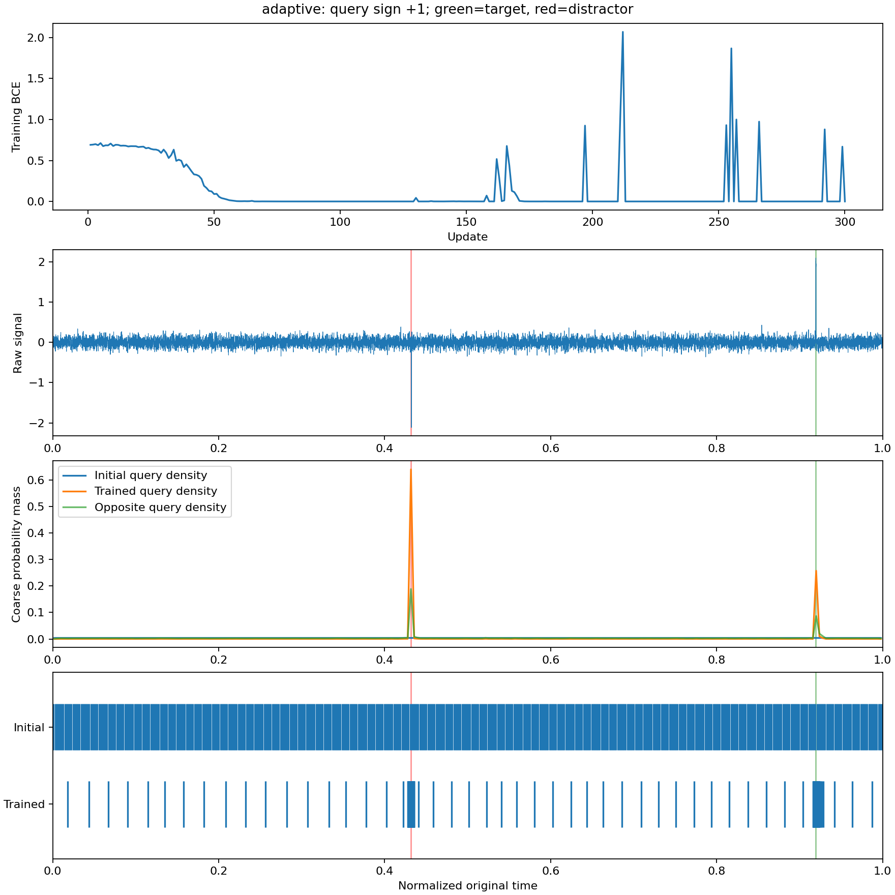

# Q-Sample 第一版：Phase 1 合成实验记录

## 结论

答案损失可以通过分段可微的逆 CDF 和线性采样，训练密度网络提高短事件覆盖率。加入局部统计与退火平滑的配置在本轮三个种子上明显优于均匀采样。

但这还不能称为完整 Q-Sample 的验证：Query 切换没有稳定地将更多点分配给对应目标；训练在退火结束附近仍存在明显波动；完整时间编码路径还能产生绕过波形证据的答案传递捷径。

## 数据和监督

每个样本长 100,000，单通道白噪声标准差 0.1。Query 是 +1 或 -1，分别询问是否存在对应极性的方波。目标以 0.5 概率出现，幅值 2、宽度 50；相反极性的干扰方波始终存在。两处事件分别位于前/后半段的随机位置，随机交换目标与干扰的半区。

这是高信噪比的合成短事件实验，幅值为噪声标准差的 20 倍，不能称为已经解决微弱事件。任务也不涉及事件持续时间、序数推理、自然语言或临床诊断。

每个配置训练 300 次更新，batch size 16，在线生成 4,800 个样本，唯一训练损失是答案 BCE。事件坐标只用于评估和画图。学习率 0.002，AdamW，梯度范数裁剪为 5。保存每一步裁剪前的密度梯度范数。

每个种子用独立随机流生成固定 256 个评估样本，同种子的方法共享数据，评估总在原始未平滑信号上进行。使用第 300 步模型，没有选择最佳 checkpoint。这些是开发中的探索性评估，不是另行冻结的最终测试集。

## 实现选择

1. 将均值、局部方差、最小值、最大值、最大绝对一阶差分池化到 256 个位置。两层小卷积及 Query FiLM 生成密度 logits；并未使用事件阈值或事件位置来指导密度。
2. Softmax 后加入权重为 1e-4 的均匀分布，线性插值到原长，再归一化。将密度视为 [0,1] 上等宽箱子的概率质量。
3. 使用 FP64 构造 CDF，在 `(j+0.5)/512` 上取确定性分位点，`searchsorted` 找区间后线性插值。再从原始信号做可微线性插值。逆 CDF 和采样的有限差分检查均通过。
4. 全模型使用有限 3σ 高斯核、复制边界及 FFT 线性卷积。σ 从 128 在前 60% 更新中线性降到零，剩余更新使用原始信号。卷积实现与直接卷积逐值核验。
5. 主要机制验证中，答案头只读 Query 极性归一化后的采样值，经过逐点 MLP 和 mean/max 聚合。时间投影单独保留并做捷径诊断。

没有使用固定 `clamp_min(1e-6)`：本配置密度下限约为 1e-9，这种截断会改变合法区间内的逆映射。当前采用 FP64 CDF，并以 FP64 的机器精度防护除零。该防护不构成梯度大小的理论上界，也不保证任意极端密度都可分辨。

## 三种子结果

种子为 7、11、23；± 为种子间样本标准差，不是置信区间。事件命中率指正例中至少一个采样坐标落入原始 50 点事件的比例；目标区采样占比指正例中落入该区的 Token 占比，边界采用 `[start,start+49]`。

| 方法 | QA 准确率（均值±种子间标准差） | 正例事件命中率 | 目标区采样占比 |
|---|---:|---:|---:|
| `adaptive` | 97.66% ± 2.56 | 97.30% | 3.6317% |
| `uniform` | 60.94% ± 1.70 | 24.21% | 0.0473% |
| `adaptive_no_blur` | 61.20% ± 2.51 | 20.78% | 0.0406% |
| `adaptive_mean_only` | 55.08% ± 1.79 | 33.55% | 0.0672% |
| `adaptive_query_blind` | 75.91% ± 19.00 | 64.18% | 3.8883% |

`adaptive_no_blur` 只去掉平滑；`adaptive_mean_only` 仅保留均值统计；`adaptive_query_blind` 将密度网络的 Query 置零，答案头仍知道所问极性。均匀采样使用相同 Token 数和相同信号答案头，训练时不做平滑。因此 adaptive 对 uniform 比较同时包含采样策略和平滑训练的差异，不能把全部提升只归于密度网络。无平滑对照有助于解释这一区别，但本轮没有完整的因子实验或最强传统检测器比较。

自适应配置三个种子的准确率为 100%、94.92%、98.05%，事件命中率为 100%、95.74%、96.15%。将其采样信号全部置零，准确率分别降至 53.52%、44.92%、49.22%；把已训练模型的网格替换成均匀网格，准确率分别降至 63.28%、55.47%、62.50%。这支持这些配置需要采样信号，但置零/换网格属于分布外干预，不能独立构成完整的因果证明。

图固定使用评估流的第一个正例，展示训练前后同一条信号，未挑选最佳样本。

## 需要保留的反例与限制

**时间坐标可成为答案通道。** `signal_time` 的 seed7 运行准确率为 100%，但目标命中率仅 24.37%；推理时把采样信号全部置零，准确率依然 100%。这说明密度网络能把事件存在性写进坐标几何，后端再读取它。该系统仍是用输入预测答案，但不能把此结果解释为采样保留了目标波形。原始探索结果保留在 `results/pilot-seed7`，当前 CLI 的复跑保留在 `results/time-shortcut-seed7`。前者在增加 readout 参数前运行，实际使用的是 signal_time，配置文件当时没有 readout 字段。

**Query 选择性没有稳定验证。** 正例上比较原 Query 和翻转 Query 在同一原目标区域的采样占比，差值在三个种子上约为 -2.084、+0.222、-0.029 个百分点。Query 确实能改变密度，但方向没有稳定对应所问目标；两个事件都获得采样也足以解题。查询盲对照仍能在部分种子取得较高准确率，且种子间波动很大。本轮不能证明“忽略强干扰、只保留 Query 相关的微弱事件”。

**退火不保证梯度稳定。** 即使最终评估较好，逐步记录中在 σ 接近或到达零后仍能出现明显 loss 尖峰和很大的裁剪前梯度。固定除法下限不能解决这一全部问题。图和 JSON 保留了这些波动，没有用稀疏日志代替完整曲线。

**统计和平滑都没有信息保留保证。** 极值及差分可能优先响应噪声，方差中的短事件也可能被稀释。高斯核只在事件附近扩展坐标梯度，有限核远处仍无事件引导；对零均值高频振荡，大尺度平滑还可能抹除目标。当前数据不能验证这些情形。

**归一化时间编码不等于物理时间恢复。** 实现提供坐标、相邻间隔和 Fourier 特征，它不是 RoPE。真实持续时间任务仍需要采样率、起始时间及总时长；接入 LLM 时也不能默认额外叠加一种位置编码就能保证精确时间推理。

## 工程验证与范围

8 项 unittest 通过，涵盖逆 CDF/采样及组合函数的有限差分梯度、极端密度、端点、FFT 平滑、梯度回传、平坦信号以及查询盲/置零控制。

额外对 `[2,1_000_000,1]` 输入做了一次随机初始化的前后向，得到 `[2,512,1]` 采样值和单调网格，密度权重梯度有限且非零；峰值张量分配约 151 MiB，详见 [million-length-smoke.json](results/million-length-smoke.json)。这是单次工程检查，没有训练百万长度任务，也没有包含 LLM 显存或 CUDA 上下文全部占用。

后续要证明查询自适应，应使用同一信号上的多个查询，增加彼此竞争的事件类别并限制预算，要求更换 Query 后采样集中区域随目标改变；同时加入查询盲和传统局部统计采样基线。在那之前，本轮证据仅支持可微自适应采样的最小机制。
