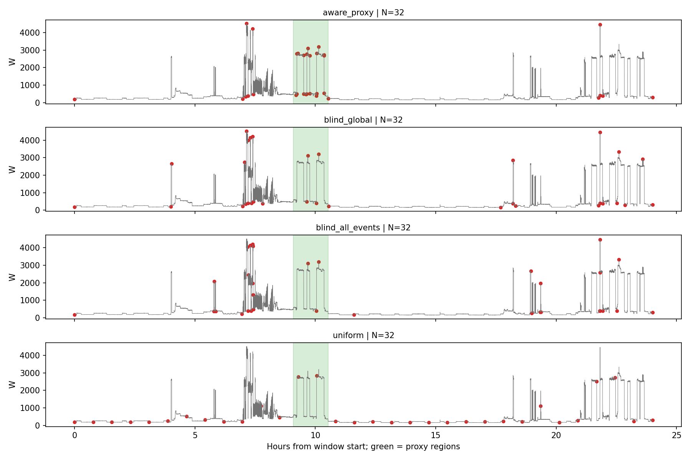

# Q-Sample v4：UK-DALE-Haystack 数据审计与最小机制诊断

日期：2026-11-04。版本独立保存在 `q-sample/v4/`，v1–v3 未修改。本轮读取完整轻量元数据、固定少量训练题的真实信号窗口，运行 CPU 审计、波形保留代理诊断及训练先验计数基线；没有优化神经网络、使用 GPU、接入 LLM、改写官方题目或答案，也没有使用测试标签训练、调参或构造密度代理。

## 判断：B，可以用于机制验证，条件采样必要性仍未成立

**不建议直接把原发布划分用于 Q-Sample 的主训练与源隔离泛化结论。** UK-DALE-Haystack 提供更充足的训练题和可追溯的插入位置，确实改善了空间辅助监督的条件；但没有发现官方同输入多 Query 配对，且背景跨划分重叠严重。当前证据不能支持 A，也没有必要彻底否定其用于训练集机制诊断的价值。

| 关键问题 | 本轮答案 |
|---|---|
| 是否真正需要 Query 条件选择？ | **未成立。** 64,997 条有效题对应 64,997 个不同重建配方，连完全相同的背景窗口也没有重复。多种题型不等于同信号上的竞争 Query；少量波形代理诊断也不能补足配对证据。 |
| 能否构造合法、有效的密度辅助监督？ | **能构造训练集 Event/Answer 位置代理，不能称为 Evidence GT。** 精确插入样本坐标可用；背景活动不完整、序数与比较所需的排他证据、负例的全范围搜索及坐标泄漏仍需处理。 |
| 无 LLM 的答案头能否强且不过采样旁路？ | 结构化输出原则上可行；**本轮没有训练并验证足够强的稀疏波形答案头。** 定位需要真实时间，但位置监督也可能把答案写入网格。旧版逐点 MLP+mean/max+BCE 不适用所有任务。 |

优先候选是 **Localization 的源时间隔离子集，作为辅助监督与波形证据验证的开发任务**；不是已经成立的 Query-Adaptive 主基准。进入网络训练前，仍须完成强盲 Oracle、共享答案验证器以及官方配对缺口的处理。

## 1. 继承前几版的失败机制

[v1](../v1/REPORT.md) 的 Adaptive 97.66% 优于 Uniform 60.94%，但 Query Blind 均值仍为 75.91%，Query 翻转不稳定，读取时间的诊断版本出现零信号仍 100% 的捷径。[v2](../v2/REPORT.md) 的 32/64 Tokens 训练 BCE 约 0.693，粗特征直接分类接近满分也没有挽救采样训练；Query-Blind 窗口 Oracle 在 32 Tokens 下仍有 94.53%。这同时涉及优化失败与任务没有强制证据竞争，不能只归因于粗网格过小。

[v3](../v3/REPORT_NLQTS_DATA_AUDIT.md) 确认 NLQTSBench 的训练规模、源 CSV 重叠和问题限定搜索范围会限制验证。转向 UK-DALE 不会自动解决插值在平坦区的零坐标梯度、逆 CDF 的条件数、采样后形态变形或答案头不足。密度下限保证正概率，不保证每个事件被采样，更不保证 QA 梯度能找到它。高斯平滑也可能改变短时设备启动形态，本轮没有证明它在真实数据上必要或有效。

## 2. 数据、代码固定版本与获取范围

- [官方数据固定 revision](https://huggingface.co/datasets/nz00shuuuu/uk-dale-haystack/tree/eb86b2ecc46b2f26b3a4e1768d7b479dc9abc521)：`eb86b2ecc46b2f26b3a4e1768d7b479dc9abc521`。
- [官方代码固定 commit](https://github.com/AI-X-Labs/TS-Haystack/tree/5e8d3162d47176e19fbd9c5f3d3cf9c6e0e9a7d4)：`5e8d3162d47176e19fbd9c5f3d3cf9c6e0e9a7d4`。复用服务器已有 `/root/autodl-tmp/cf-run/vendor/v020/TS-Haystack/`，审计时工作树干净。
- 检索本地项目、数据目录及 HF 缓存后，没有找到可复用的 UK-DALE HDF5 或信号侧车。没有重复克隆代码或下载原始 HDF5。
- 完整核验 **150 个 QA Parquet（13,497,875 字节）+ bout_index（1,418,225 字节）**，共 14,916,100 字节；此外保存 manifest、split、转换元数据和官方说明。Parquet 不含完整输入波形，只含问答与重建配方。
- 完整信号侧车约 **1,758,347,348 字节**，未整库下载。仅对预先选定的 12 条训练题发 HTTP Range 请求，读取 NPY 头、时间索引块及所需波形窗口。每段校验 HTTP 206、Content-Range、长度并记录 SHA256；全部 QA 分片按官方 LFS SHA256 校验。
- 原始来源为 Kelly 与 Knottenbelt 的 UK-DALE 家庭电力记录，官方 `source_manifest.json` 指向 NILMTK HDF5，SHA256 为 `5cb9c07ec0da0ac4cc9e1a6ee6a7ba76561f4fe4367e6de78addaa2a63432092`，6,330,639,238 字节。原始 HDF5 本轮未获取，不能声称独立重验过其内容。

信号窗口与索引共记录 238 个不同字节区间、2,993,812 字节，12/12 题重建成功。HF 没有提供逐题合成波形的校验和；本轮按固定官方函数重建，不能声称已与另一个未发布的完整合成波形文件逐字节对照。

本地缓存位于仓库外 `/root/autodl-tmp/cf-run/data/qsample-v4-ukdale/<revision>/`；[metadata_acquisition.json](metadata_acquisition.json)、[signal_acquisition.json](signal_acquisition.json) 保存获取与重建哈希。HF 数据卡标注 CC-BY-4.0，固定官方代码标注 CC-BY-NC-4.0；应分别保留数据来源与代码许可归属。

## 3. 实际题数、输入与任务

| 划分 | 发布行数 | 有效行数 | 无效行数 |
|---|---:|---:|---:|
| Train | 50,000 | 50,000 | 0 |
| Validation | 7,500 | 7,499 | 1 |
| Test | 7,500 | 7,498 | 2 |

官方 loader 会跳过 `is_valid=False`。无效题是 900 秒 Multi-Hop 验证题 1 条、900 秒 State Query 测试题 2 条。不能直接用 7,500 作为有效评估分母。每个任务有五种 context，各分片原始为 1,000/150/150 行。

### 输入不是十万或百万点

发布输入是 **一条单通道住宅总有功功率（W）**，来自 house 1、2、5 的 meter 1。原始分表是重建注入的材料和特权审计信息，不是允许交给模型的多变量输入。原时间戳不规则，转换元数据中各表中位间隔有 6 秒或 7 秒；官方统一到 6 秒，即约 0.1667 Hz。

| Context | 重建点数 L | 有效 Train / Val / Test | L/16 | L/32 | L/64 | L/128 | L/512 |
|---|---:|---:|---:|---:|---:|---:|---:|
| 900 秒 / 15 分钟 | 150 | 10,000 / 1,499 / 1,498 | 9.38 | 4.69 | 2.34 | 1.17 | 0.29 |
| 3,600 秒 / 1 小时 | 600 | 10,000 / 1,500 / 1,500 | 37.50 | 18.75 | 9.38 | 4.69 | 1.17 |
| 7,200 秒 / 2 小时 | 1,200 | 10,000 / 1,500 / 1,500 | 75.00 | 37.50 | 18.75 | 9.38 | 2.34 |
| 32,400 秒 / 9 小时 | 5,400 | 10,000 / 1,500 / 1,500 | 337.50 | 168.75 | 84.38 | 42.19 | 10.55 |
| 86,400 秒 / 24 小时 | 14,400 | 10,000 / 1,500 / 1,500 | 900.00 | 450.00 | 225.00 | 112.50 | 28.13 |

这些比值描述数值压缩程度，**不证明语义信息瓶颈**。150 点配 512 Tokens 不增加原始信息。没有人为插值扩长序列。

官方 `resample_to_grid` 的文档写 nearest-neighbour，但代码实际取**最近的前置样本保持**：`searchsorted(..., right)-1`，超过 24 秒的旧值置零。读取窗口还向前取 12 秒。已用独立小例和非规则长缺测索引测试核实，不能按文档文字实现成最近邻。

### 10 个官方任务的真实输出

| 任务 | Train / Val / Test 有效数 | 原始答案与官方评价 | 空间标签与证据需求 |
|---|---:|---|---|
| Existence | 5,000 / 750 / 750 | Yes/No；规范化后准确率 | 正例目标注入区间；负例插入同类 regime 干扰。负例没有一个局部“缺席证据区间”，需要排除全搜索范围 |
| Localization | 5,000 / 750 / 750 | `HH:MM:SS - HH:MM:SS`；IoU≥0.25 判正确 | 第 k 个目标的精确插入区间；还需识别并排序前面的目标，不能只保留答案区间 |
| Counting | 5,000 / 750 / 750 | 字符串整数 0–5；整数完全匹配 | 全部目标事件及去重/排除证据；0 的全范围问题同上 |
| Ordering | 5,000 / 750 / 750 | Yes/No；准确率 | 两类设备各一个插入事件；识别设备与时间顺序，单条题通常只需保留两处 |
| Antecedent | 5,000 / 750 / 750 | 10 类设备名称；官方 category 比较 | 前驱+目标，以及排除中间候选；两个注入事件不等于真实背景没有第三个事件 |
| Comparison | 5,000 / 750 / 750 | 时间区间；IoU≥0.25 | 最长/最短/最高峰的胜出区间；比较依赖所有候选及各自形态/持续时间 |
| Multi-Hop | 5,000 / 749 / 750 | 时间区间；IoU≥0.25 | 第 j 个 anchor 后第 k 个 target；需要 anchor、前缀候选与次序，不只最终 target |
| State Query | 5,000 / 750 / 748 | 设备类别；category 比较 | **没有插入**，从自然重叠事件提问；anchor 与重叠设备均在 `other_bouts_json`，非完整 Evidence GT |
| Anomaly Detection | 5,000 / 750 / 750 | Yes/No；准确率 | 一个正常或人为截断/放大的事件；问题通常泛指异常，没有强设备条件选择 |
| Anomaly Localization | 5,000 / 750 / 750 | 时间区间；IoU≥0.25 | 当前发布有效题均有异常；异常和正常干扰的区间可追踪，但 Query 通常只有泛化异常意图 |

**不存在独立 Duration 任务。** Comparison 会涉及持续时间，但不能据此新增一个“官方持续时间回归”任务。四类区间任务、三类 Boolean、两类 Category、一类 Integer，不应统一改为 BCE。

官方时间答案是**相对窗口开始的时长格式**，不是日历时间；`needles_json.timestamp_start/end` 却是背景时刻换算的 UTC 钟表时间。已核验全部 6,500 条 Localization：按 `insert_position_samples × 6` 重建答案，全部一致。不要把两套时间坐标直接混用；`duration_s` 源事件时长与网格截取时长也可能相差一个间隔。自然 bout 的时间范围被窗口裁剪，但 `duration_s` 可能保留原完整 bout 时长。

复用固定官方评分函数进行原答案自评分，50,000/7,499/7,498 条均通过。这是解析完整性检查，不是模型成绩。区间正确阈值仅 0.25，应同时报告连续 IoU、端点误差与语义识别，避免宽泛区间掩盖定位问题。Category 有宽松文本回退，建议并列严格类名匹配。

## 4. 真实来源、注入事件与标注可信度

普通插入题使用真实 mains 背景加真实同住户设备 ON 片段，不做边缘混合；插入区间外保持背景，区间内逐点相加。异常题另有截短周期、幅度放大并按设备上限裁剪。它是**真实片段组成的半合成 QA**，不是完全自然产生的设备问答。

`needles_json` 提供设备、插入起点/样本数、源 house/meter/时间、持续时间、峰值、异常类型/参数；`other_bouts_json` 提供背景已检出事件的类别、局部区间和统计；`difficulty_config_json` 还含 target、序数、胜者、甚至 Ordering 的答案顺序和位置。**后三者都不能作为部署时答案头或密度网络的输入。** 训练空间标签只能从训练行提取，原始自然语言问题与答案必须保留。

完整 bout index 有 57,672 条：Train 46,286、Val 5,471、Test 5,915。类别极不均衡：fridge_freezer 40,572、microwave 8,089，而 toaster 33、washing_machine 57、oven 58。训练集 93,688 次插入仅使用 19,738 个不同源时间片段，题数不等于独立真实设备样本数。不同 house、设备组合与相同源 bout 重复使用也可能形成签名捷径。

官方自己的 [Dataset Card](https://github.com/AI-X-Labs/TS-Haystack/blob/5e8d3162d47176e19fbd9c5f3d3cf9c6e0e9a7d4/src/datasets/uk_dale_haystack/DATASET_CARD.md) 已报告插入与自然数据可区分、长周期设备迁移失败等限制。这是发布者的诊断，不是本次复现实验。本轮也没有宣称电器类别可由简单幅值阈值完全识别：同 regime 干扰和真实背景会重叠；但纯突变/索引方法可能已很强，后续必须比较。

### 背景目标 OFF 存在可复现的索引冲突

官方 `BackgroundSampler` 在构造时把 bout index 过滤到当前 split，却在整段 house timeframe 上计算这些 bout 的 OFF 补集，并未把背景日期限制在本 split 的周。实际元数据证实，这不是仅靠代码推测。

用完整官方 bout index 检查背景与 `difficulty.target` 的活动区间重叠，Existence 有 509/6,500，Localization 有 837/6,500，Comparison 有 933/6,500。Existence 中 **102 道 No 题**有这种冲突（Train 60、Val 29、Test 13）。这不等同于已从波形证明 102 个答案全部错误；bout 检测本身也可能不完美。但它使“背景一定没有目标”和“所有目标只由插入标签定义”不能无条件成立。

固定的训练反例：`tasks/32400s/existence/train/data.parquet#50` 问 “Did the electric kettle run during this window?”，答案 No；背景为 h5，范围 `[1409464748217727929,1409497148217727929)` ns，完整 index 在其中记录 h5/m18 kettle `[1409473163000000000,1409473362000000000)`，其 split 是 test。[source_isolation.json](source_isolation.json) 保留完整见证。**此反例尚未单独读取分表波形复核**，不在 12 题采样性能诊断中。

## 5. 源记录隔离审计

`split_manifest.json` 确实有 290 个 (house, ISO-week)，分为 232/29/29，seed=42。各 house 是 234/35/21 周，不能照抄 Dataset Card 中较旧的 233/34/20。插入的完全相同源片段在三个划分间交集为零；**背景却没有相同的保证**。

| 划分对 | 左侧背景与右侧重叠的题数 | 右侧背景与左侧重叠的题数 | 完全相同的插入源 span 交集 |
|---|---:|---:|---:|
| Train–Val | 39,644 / 50,000 | 6,994 / 7,499 | 0 |
| Train–Test | 23,586 / 50,000 | 6,824 / 7,498 | 0 |
| Val–Test | 4,112 / 7,499 | 5,802 / 7,498 | 0 |

这里是**同 house、同 mains 通道、原始时间区间存在正长度交集**的行数，不是完全相同的整条合成输入数，也不是独立重叠配对数。窗口边界可能错开小于一帧，官方前置保持也会改变采样相位；不能把时间重叠全部称为字节完全相同，但源隔离已不成立。

见证：Train `tasks/32400s/anomaly_detection/train/data.parquet#3` 与 Test `tasks/3600s/anomaly_localization/test/data.parquet#12` 在 house 1 共享完整 3,600 秒背景原始时段。另有起点 ISO-week 与声明 split 不符的 Train 11,618、Val 6,386、Test 6,238 条；UTC 与 Europe/London 两种检查结论一致，数量略有时区边界差异，不能用时区解释大规模不一致。

7124/7498 条测试题的**完整问句字符串**已在训练题出现。模板共享是模板泛化的性质，不单独构成标签泄漏；背景重叠才是这里更直接的源隔离问题。没有完成全库原始波形近重复检测，不能宣称其余样本绝无近重复。

### 不改官方数据的保守隔离视图

按官方周归属过滤每次实际读取的背景与源事件时间窗，包含前置 12 秒及源末端额外 6 秒；跨周时两侧都必须属于本 split。筛选只依赖源时间和官方清单，不读取 QA 答案，不改行内容，不重分配官方测试题。

| 只读候选视图 | Train | Val | Test |
|---|---:|---:|---:|
| 所有读取源时间窗都归属于声明 split | 38,136 | 1,049 | 1,235 |
| 其中 Localization | 3,698 | 39 | 53 |
| 其中 Counting | 3,742 | 32 | 57 |
| 其中 Multi-Hop | 3,335 | 39 | 50 |
| 其中 State Query | 4,963 | 707 | 718 |

此视图全量事件索引 OFF 冲突检查也未额外剔除行。清单在 [source_safe_row_ids.json](source_safe_row_ids.json)，只是源时间隔离候选，不是新官方 Benchmark；样本稀疏、长度/类别分布和同设备签名共享仍需核验。不能把同 house 的周隔离称为跨住户泛化，三个 house 也不足以无代价建立设备均衡的 house-disjoint 主实验。

本轮官方测试元数据、答案和先验分数已用于审计，应整体标记为**已接触审计集**；12 条新波形全部来自 train。后续用原测试集只能报告冻结协议下的已接触官方评测，不能称从未见过的最终盲测。若需要新盲测，必须另行预注册合法源划分/官方修订版，不能通过改题或隐藏接触历史解决。

## 6. 是否有真正的条件选择任务？

对输入指纹使用背景 house/起止/dt 和所有数值插入操作（源表、源时间、插入位置/长度、异常操作），不把 Query 或答案作为输入身份。64,997 个有效配方全部不同，同背景完全相同的窗口组也为零。这说明**没有直接发布的同输入多 Query 配对**；不同配方仍可能产生近似或偶然相同波形，本轮未全库下载，不能证明全库波形两两不同。

Localization 有 1–3 个 target 和至多一个同 regime 插入干扰，Multi-Hop 有 3–5 个插入事件，Ordering 固定两处。它们提供关系推理，却未自动造成 32 或 64 Tokens 的共同证据容量不足。State Query 有自然重叠和多个候选，但类别偏置强，且同窗口多问仍缺失。Anomaly 两类 Query 一般不指定设备，最多说明查询意图驱动检测，难用来证明设备条件切换。

没有擅自生成新问题，也没有把重叠但不同的背景窗口拼成“同信号配对”。这意味着严格的 Query Flip Selectivity 和“一套盲网格同时回答同信号多个官方 Query”的最终 QA 比较，**当前发布关系下无法直接测量**。如需扩展，必须明确命名为新派生任务并另行验证，不属于本轮官方审计结果。

## 7. 固定真实波形的同预算诊断

选择规则先于看波形或分数：context ∈ {900,7200,86400} × task ∈ {Existence,Localization,Ordering,Multi-Hop}，每格取 train 第一条有效题，共 12 条，保存官方原问题、答案及行号到 [selected_train_rows.json](selected_train_rows.json)。三个 Existence 恰为负例，报告中保留，不按结果替换正例。

其中 9/12 条符合前述源时间隔离视图，另三条为 7,200 秒 Multi-Hop、86,400 秒 Localization/Ordering 的首题；仍保留预先选择的全部样本。诊断没有训练，也不以这些样本估计源隔离泛化。盲 Oracle 使用完整事件索引（包括其他 split 的来源记录）仅为当前已选信号的特权诊断，不把这些标签用于训练代理或模型输入。

通过 AST 执行固定官方 `resample_to_grid` 和 `reconstruct_sample_signal` 原函数，仅把底层存储访问替换成经过测试的 Range 窗口读取。预算固定 16、32、64、128、512；当 N>L 时最多取 L 个不同原始点。所有方法取真实 float32 值、float32 坐标，交给**同一个线性波形重建器**，没有答案头旁路。

- `aware_proxy`：知道当前题相关的插入事件，Localization 保留到第 k 个目标的前缀，Multi-Hop 保留必要 anchor/target 前缀，Ordering 保留两类，负例使用全范围代理；前后各加 60 秒上下文，区域权重 1、其余 0.02。
- `blind_global`：不读 Query，利用完整原始输入，按全局波形重建残差贪心细分。
- `blind_all_events`：不读当前 Query/答案/目标类型，允许全部插入事件及完整官方 bout index 的背景事件，按事件时长归一的区域残差细分并保留全局背景权重。**不强制平均分 Token，不规定每个事件必须几个点。**
- `uniform`：相同范围与预算的均匀采样。

前三种是带特权信息或完整波形的**采样启发式诊断**，不是经证明最优的 Oracle 上界，更不是可部署模型。没有基于目标分数挑选最优盲方法。此实现不能替代用户要求的强共同回答 Oracle：缺少同信号官方 Query 组和已验证的共享答案头。

下表是 **12 题等权的相关事件+上下文 NRMSE**，以每条原始信号的标准差（至少 1 W）归一，越小越好。三个负例使用全窗口代理。没有置信区间：这是固定个案诊断，不是随机抽样的总体性能估计。

| Tokens | Aware Proxy | Blind Global | Blind All Events | Uniform |
|---:|---:|---:|---:|---:|
| 16 | 0.2859 | 0.5821 | 0.5539 | 1.0879 |
| 32 | 0.0818 | 0.2664 | 0.2857 | 1.0014 |
| 64 | 0.0523 | 0.1481 | 0.1876 | 0.7811 |
| 128 | 0.0263 | 0.1039 | 0.0840 | 0.6271 |
| 512 | 0.0065 | 0.0304 | 0.0317 | 0.2828 |

排除 L=150 的四道短题后，其余八题在 32 Tokens 的相同指标为 Aware 0.1153、Blind Global 0.3802、Blind All Events 0.3874、Uniform 1.2606。32 Tokens 时，Aware 比 Global 的代理误差低的有 8/12 题，4 题持平；对 All Events 有 9/12 题更低。**这提供了“特权相关区域权重能改善局部波形保留”的有限正面信号**，不是同信号多 Query 的条件收益证明。

相关事件命中率（先对每题的相关事件集合求比例，再对有事件的 9 题平均；不含三个负例）如下：

| Tokens | Aware Proxy | Blind Global | Blind All Events | Uniform |
|---:|---:|---:|---:|---:|
| 16 | 87.04% | 75.93% | 81.48% | 66.67% |
| 32 | 90.74% | 85.19% | 85.19% | 83.33% |
| 64 | 94.44% | 88.89% | 94.44% | 77.78% |
| 128 | 100% | 94.44% | 94.44% | 88.89% |
| 512 | 100% | 94.44% | 94.44% | 88.89% |

保留两个反例与代价：24 小时 Ordering 在 64 Tokens 下 Aware 的上下文 NRMSE 为 0.2484，略差于 Blind Global 的 0.2410；32 Tokens 的全局 NRMSE 均值 Aware 为 0.2848，也差于 Blind Global 的 0.2252。局部代理优势不能解释成全信号无损或所有案例优胜。L=150 的四题在 512 Tokens 下所有方法重建误差均为零，此条件没有压缩瓶颈。Uniform 的非嵌套网格还会使事件命中率不随预算严格单调，这不是删点或漏报。

这些结果尚未检验设备分类、官方 QA 或共同盲网格的充分性；没有调低预算、改采样例或改变代理宽度追求更大差距。

绿色是相关事件的代理区域，红点为真实采样值；这不是训练所得密度，也不是 Query 切换图。[oracle_fidelity_results.json](oracle_fidelity_results.json) 保存所有题、预算、方法的结果，不能只展示图中个案。

需区分三个层次：事件区间命中只说明 Answer/Event Position Coverage；事件加背景的重建误差反映一种波形保留代理；Actual Evidence Coverage 和最终 QA Accuracy 仍未得到验证。特别是设备身份、持续性、排除竞争事件和顺序可能依赖重建误差没有正确加权的细节。没有以低 MSE、命中一处或降低预算导致 Uniform 失效宣布条件采样成立。

### 零波形与文字先验

使用 train 的答案频数按 (task,context) 得到多数答案，再加入 train 内完全相同 Query 的计数，未使用验证/测试答案拟合。后者在 Validation 的 State Query 达 **65.87%**，Test 为 **60.56%**；均不读波形。说明这个任务必须比较 Query-only/类别先验，不能把 60% 左右解释为波形条件推理。全部分数保存在 [semantic_checks.json](semantic_checks.json)，不是 Q-Sample 的 QA 结果。

还构造了一个**纯特权坐标反例**：训练集 Localization 的 5,000 个答案均可由已知目标端点坐标直接还原，零信号下仍 100%。这证明端点型代理采样可以形成答案信息通道，不表示训练后的 Q-Sample 已利用它，也不能当成实际模型准确率。训练后的 Zero-Signal、Coordinate-Only、换网格干预本轮尚未执行。

## 8. 空间辅助监督：可用但必须限定解释

训练行的插入坐标能提供合法位置代理，先映射到真实 6 秒网格，再积分到 coarse bins 构造概率质量，明确总和为 1。不能直接使用 `timestamp_*` 的 UTC 时间作为相对答案坐标，也不能用所有划分的 bout 标签生成训练代理。

| 代理 | 可以怎么构造 | 不足与适用任务 |
|---|---|---|
| Target Interval | 目标 Event Span 内分配质量，保留预设比例的全范围背景 | 对定位容易直接编码答案；事件内部未必含开关边缘或设备身份全证据。它是区间/位置监督，不是唯一密度真值 |
| Boundary + Context | 在开关边缘两侧放软核，并保留事件内部和前后基线 | 核宽应以秒固定，只在训练/开发协议决定；启动瞬态、截断伪迹及自然背景需单独验证。60 秒是本轮诊断约定，不是经验证最优值 |
| Multi-Region | 对计数保留全部候选，对序数/顺序保留目标前缀和 anchor，对比较保留全部竞争事件 | 需要排他/否定证据；没有标签就不能假装已经枚举所有真实事件。不能只密采最终答案赢家 |

可写 `q_proxy = ρ·Uniform + (1−ρ)·q_regions`，以 `KL(q_proxy || pθ)` 辅助。`ρ`、边界核与事件混合权重是预注册超参数，不能按测试结果选。不存在目标的题不能生成“零密度标签”；可用全范围/候选搜索代理或明确不加该项，并按负例单独报告。这三种目标都只是**训练者定义的证据保留假设**。

未来必须分开比较 QA Only、Density Warm-up→QA Fine-tuning、QA+Density Auxiliary；后两者即便收敛，也不能声称原始纯 QA 假设成功。另设直接位置回归基线，区分“学会预测位置”和“采样后保留可验证波形”两个目标。

端点/区间监督会使网格位置、点密度、间隔乃至信号取值携带答案。`grid.detach()` 只截断一条梯度路径，不去除信息。辅助监督是否合法与答案头是否利用旁路是两件事，必须同时检测。

## 9. 现有架构需要怎样适配

### 复用与时序编码器

`v2/model.py` 的 `QSample(channels,query_dim)` 已支持多通道和一般维度 Query，逆 CDF、线性采样、FiLM 可复用其设计；不要复制一个声称“绝对可微”的新实现。`SyntheticQA` 仍含标量极性操作与一维 BCE，Phase2 读出也固定四类合成语义，不能直接套到真实题。

当前 UK-DALE 主输入只有 1 个 mains 通道，不应把全部分表拼成多变量输入改善成绩。日后真实多变量扩展需按 C 共享一个时间网格、保留通道身份，报告 N×C 数值预算、缺失掩码与源时间对齐。

24 小时长度配 coarse=256 时每箱约 337.5 秒，Mean/Variance/Min/Max/MaxDiff 能指示波动，但不能保证区分启动顺序、周期波形或相同 regime 的设备。审计阶段不扩网络。先在独立训练源窗口做五统计与轻量多尺度局部 CNN 的形态可分性探针；若 full-signal/Oracle 头已失败，先改表示/头，不让采样器承担全部失败。任何粗特征只送密度分支，不送主答案头。

### 自然语言 Query

保留原问句；冻结轻量文本编码器输出 `e_Q∈R^d_text`，用训练可学习线性层投影到 FiLM 的 scale/shift（与 sampler.width 对齐）。可比较小 Cross-Attention，但首轮 FiLM 已足够。文本模型 revision、tokenizer、pooling 和最大文本长度需冻结记录，本轮未下载文本权重。

结构化 Query 对照只能从**公开问句**解析设备别名、任务意图、k/j/比较关系，不能读取 `difficulty_config.target`、`winner_index`、`state_appliance`、事件个数或坐标。泛指异常的问题也不能偷偷附加其隐藏设备类别。Query Blind 仅屏蔽采样分支的 Query，答案头仍接收同样问句，保证公平。

### 时间与可识别性

| Readout 输入 | 能做什么、缺什么 | 捷径诊断 |
|---|---|---|
| Signal Only + token 顺序 | 设备是否存在可能可做；序列模型可看相对先后。非均匀采样下通常不能恢复真实秒数/时长，旧 mean/max 还会丢顺序 | 零信号、值置乱、替换成无关真实波形；失败不等于坐标版本非法 |
| Signal + Δt | 保留局部时距；需清楚第一点偏移及窗口跨度的定义 | Δt 累加可恢复大部分坐标，给定起点/边界时尤其明显，不能称“消除泄漏” |
| Signal + Absolute Position | 本任务宜用窗口相对秒数/归一位置+窗口跨度；足以表达官方相对时间答案，不必喂源 UTC 日期 | Coordinate-only、Zero-Signal、密度/间隔特征单独解码、随机换坐标 |

绝对日历时间不属于这些相对答案的必需输入，反而可能引入住户例行活动特征。采样梯度与时间信息使用应分开控制；所有方法使用同一个时间协议。

### 无 LLM 的轻量答案头

建议先用小型顺序编码器（少层 Transformer 或时序卷积）处理**采样值、明确声明的时间特征和 Query**。主答案头不能直接读 density、粗 encoder、原序列全局统计、事件标签或 source metadata。仅增加“必须经过信号投影”的门控无法从理论上阻断信息旁路，仍须干预验证。

- Existence：单 logit 的二分类答案，使用下文明确的 BCE；Ordering 同属 Boolean 输出，但必须能识别两类事件并保留序列先后，不能只做交换不变的 mean/max。
- Counting：首轮固定为 0–5 的六类 CE，输出官方整数，并列 MAE；不把非零改成 Yes，不在首轮混用回归或有序计数目标。
- Localization：首轮固定为从采样 token 表示预测有序连续起止点，使用下文的 Smooth L1 + 区间 IoU 损失；不把答案映射成“最近采样点”的硬标签。Comparison/Multi-Hop 同为区间输出，但候选识别与关系推理仍须分别验证。软指针属于后续独立消融，不与首轮定义混用。
- Antecedent/State Query：十类设备 CE，输出规范官方类名；保留 Question-only 和类别先验对照。
- 泛化自由文本/解释没有在这十类结构化任务上被要求，不能为了避开 LLM 更改答案语义。

定位答案头能从坐标输出答案，必须用 Coordinate-only 与波形替换检查它是否真的识别设备。共享头既要在 full-signal 和强盲网格上有能力，也不能只适配某个 Oracle 网格；训练头的所有额外监督与方法需公平匹配。

#### 首轮答案损失的数学定义

以下是**下一轮最小实现的明确规格，本轮仅补充文档，尚未实现或训练验证**。三种任务各使用原始官方答案；只有 Localization 的时间字符串被无损解析成数值端点，推理后再序列化回官方格式。不会为同一道题新增官方未提供的其他任务答案。

设原始输入为 $X\in\mathbb R^{L\times C}$，间隔 $\Delta t=6$ 秒，窗口时长 $T=L\Delta t$。密度网络参数为 $\theta$，答案头参数为 $\phi$，冻结文本编码得到 $e_Q$。统一前向链路为

$$
p_\theta(X,Q)\in\Delta^{L-1},\qquad
G_\theta=\operatorname{InvCDF}(p_\theta),\qquad
Z_j=\operatorname{Interp}\!\left(X,(L-1)G_{\theta,j}\right),
$$
$$
\tau_j=\Delta t\,(L-1)G_{\theta,j},\qquad
H=R_\phi\!\left(Z,\mathcal T(G_\theta,T),e_Q\right).
$$

$\Delta^{L-1}$ 表示总和为 1 的概率质量向量；$G\in[0,1]^N$ 是固定 N 点网格，$H$ 是顺序答案编码器输出。$\mathcal T$ 是声明过的时间模式：Signal Only 时为空，时间模式可使用 $\tau/T$ 或相邻真实秒数差。**最后一个观测点是 $(L-1)\Delta t$，窗口右边界是 $L\Delta t$**，二者不能混用；事件区间采用半开区间，其结束点可以等于 T。

Existence/Counting 的首轮主读出使用 Signal Only 加 token 顺序和 Query；Localization 使用 Signal + 窗口相对绝对时间，并保留 Signal Only、Signal + Δt 作为可识别性对照。每项采样方法使用相同读出协议。答案头没有从 $p_\theta$、粗特征或标签元数据直达输出的支路。

**Existence：Bernoulli 负对数似然。** 将官方 Yes/No 映射为 $y\in\{1,0\}$。由答案头输出单个 logit $a=f^{\rm exist}_\phi(H,e_Q)$，$\hat p=\sigma(a)$：

$$
\mathcal L_{\rm exist}
=-y\log\hat p-(1-y)\log(1-\hat p)
=\operatorname{softplus}(a)-ya.
$$

实现用 `binary_cross_entropy_with_logits`，避免先 sigmoid 再取 log。首轮采用无类别权重的 BCE，$\hat p\ge0.5$ 输出 Yes，否则 No；阈值只在推理/评分时使用。类别先验基线另报，不能用验证或测试标签调整权重。

**Counting：六类 categorical 负对数似然。** 保留官方计数 $c\in\{0,1,2,3,4,5\}$，答案头输出六维 logits $b=f^{\rm count}_\phi(H,e_Q)$，$\pi_k=\operatorname{softmax}(b)_k$：

$$
\mathcal L_{\rm count}
=-\sum_{k=0}^{5}\mathbf{1}[c=k]\log\pi_k
=-b_c+\log\sum_{k=0}^{5}\exp(b_k).
$$

实现用 `cross_entropy`；推理取 $\hat c=\arg\max_k\pi_k$，输出其整数字符串。MAE $|\hat c-c|$ 是附加评价指标，不通过不可微的 argmax 训练。未来超出 0–5 的任务须另行声明输出空间，不能把较大计数裁成 5。

**Localization：有序连续端点 + Smooth L1 + 区间 IoU。** 将官方答案解析成相对秒数 $[s^*,e^*)$，满足 $0\le s^*<e^*\le T$，记归一化标签 $u^*=s^*/T$、$v^*=e^*/T$。答案头由采样表示输出两个无约束实数 $(a_s,a_e)=f^{\rm loc}_\phi(H,e_Q)$，使用

$$
\hat u=\sigma(a_s),\qquad
\hat v=\hat u+(1-\hat u)\sigma(a_e),\qquad
\hat s=T\hat u,\quad \hat e=T\hat v.
$$

该参数化在精确实数运算下保证 $0<\hat u<\hat v<1$，标签允许边界 0 和 1；实现需监测浮点饱和或区间退化。定义无量纲 Smooth L1（即 Huber 除以其转折宽度）为

$$
\ell_\delta(r)=
\begin{cases}
\dfrac{r^2}{2\delta},& |r|<\delta,\\
|r|-\dfrac\delta2,& |r|\ge\delta,
\end{cases}
\qquad \delta=\frac{\Delta t}{T}=\frac1L.
$$

转折宽度对应一个原始采样间隔，而不是一个自适应 token 间距。对归一化区间定义

$$
I=\big[\min(\hat v,v^*)-\max(\hat u,u^*)\big]_+,\qquad
U=(\hat v-\hat u)+(v^*-u^*)-I,
$$
$$
\operatorname{IoU}=\frac{I}{\max(U,\varepsilon)},\qquad
\mathcal L_{\rm loc}
=\frac12\left[\ell_\delta(\hat u-u^*)+\ell_\delta(\hat v-v^*)\right]
+\gamma\bigl(1-\operatorname{IoU}\bigr).
$$

首轮规格固定 $\gamma=1$、$\varepsilon=10^{-8}$，二者写入配置而非按测试集选择。`min/max/ReLU` 使 IoU 项分段可微；预测区间与标签不相交时该项可能没有有效梯度，端点 Smooth L1 仍提供纠偏信号。损失前不做取整、硬指针选择或 IoU≥0.25 判定；这些操作不进入反向传播。原官方 IoU≥0.25 正确率、连续 IoU 和以秒为单位的端点 MAE 都须报告。

这是**从采样证据预测答案端点**的 QA 回归，不是直接从粗 encoder 回归位置，也不是完整采样密度的监督。能够拟合端点仍不证明波形充分：时间通道可能承载答案，Coordinate-only/Zero-Signal 对照不可省略。该定义没有消除稀疏输入遗漏设备形态或边界的风险。

**与密度分支的联合目标及梯度路径。** 对 batch 内实际存在的官方任务，取

$$
\mathcal L_{\rm QA}=\frac1B\sum_{i=1}^{B}
\mathcal L_{\operatorname{task}(i)}(\hat y_i,y_i),\qquad
\mathcal L_{\rm density}=\frac1B\sum_{i=1}^{B}\sum_{\ell=1}^{L_i}
q_{i\ell}\log\frac{q_{i\ell}}{p_{\theta,i\ell}},
$$
$$
\mathcal L_{\rm total}=\beta\,\mathcal L_{\rm QA}
+\lambda\,\mathcal L_{\rm density}.
$$

$q$ 只由合法训练标签构造，并与前向中**上采样后重新归一化**的概率质量 $p_\theta$ 使用同一分箱定义；$q=0$ 的项按 0 处理，$p_\theta>0$。没有适用位置代理的题令其 density 项为 0，并单独记录数量；不能读答案构造推理输入。单任务实验直接使用对应 $\mathcal L_{\rm QA}$，不需要额外任务权重。

三个训练条件固定区分为：QA Only 为 $(\beta,\lambda)=(1,0)$；Density Warm-up 的阶段为 $(0,1)$、只更新采样器，随后切到 $(1,0)$ 联合训练答案头与采样器；QA+Density 为 $(1,\lambda_{\rm aux})$，其中正数 $\lambda_{\rm aux}$ 和 warm-up 步数须在训练前由开发协议声明，不能用测试选择。辅助项是否有效尚未验证。

仅考虑 QA 项，其到密度网络的链式法则可写为（各导数按兼容的 Jacobian 方向排列）

$$
\frac{\partial\mathcal L_{\rm QA}}{\partial\theta}
=\left(
\frac{\partial\mathcal L_{\rm QA}}{\partial Z}\frac{\partial Z}{\partial G}
+\frac{\partial\mathcal L_{\rm QA}}{\partial\mathcal T}\frac{\partial\mathcal T}{\partial G}
\right)
\frac{\partial G}{\partial p_\theta}\frac{\partial p_\theta}{\partial\theta}.
$$

Signal Only 时第二项不存在；时间模式则显式保留它，分别诊断波形路径与坐标路径。辅助 KL 另外直接提供到 $p_\theta$ 的梯度。逆 CDF、插值及上述区间损失只保证分段/几乎处处可微，**不保证梯度足够强或采样器收敛**；冻结答案头参数做 QA 微调对照时，也不能用 `no_grad` 或 detach 切断其输入梯度。

## 10. 下一轮最小实验与进入训练的门槛

1. **先确认数据协议。** 原发布划分只作官方参考分数，主机制视图使用已记录的源时间过滤。Localization 的 Val/Test 39/53 太少，不能按多个长度/设备切片后还声称稳定三种子优势；需在训练内部按底层 (house,week) 分组开发并排除所有背景/插入源跨组读取。派生划分应独立命名，不能覆盖官方文件。是否能保留足够长窗口和设备类别，待核验。
2. **先建答案验证能力。** 对固定训练/源隔离开发样本，比较 full-signal 传统变化点+设备模板/分类器、小型顺序头、官方强系统参考；再比较两种盲波形 Oracle 和当前 Query-aware 代理。所有采样法预算固定 16/32/64/128/512，不按分数继续缩小。只有 full-signal 和共享头能稳定完成官方语义时，压缩失败才有清楚解释。
3. **补足必要性证据后再主训练。** 当前没有官方同信号多 Query，严格 Query flip 必须保持“不可测”。若维护者提供配对发布或另行授权构建派生评测，应先证明同一组真实波形在共享答案验证器上，强盲 Oracle 确实不能共同保留证据，而 aware 的收益不只体现在区间命中。没有差距就承认任务无需条件采样。
4. **只做小训练机制检查。** 上述条件满足后，Localization 先比三种训练条件和三种 proxy，种子至少 7/11/23；包括同平滑策略 Uniform、Adaptive/Query Blind、No Blur、局部统计/变化点采样和 full-signal 检测器。Oracle 仅作诊断。固定 checkpoint 规则、粗分辨率、预算与时间模式；不接 LLM，不用测试选 proxy 或核宽。
5. **检查旁路与因果解释。** 每个时间模式做 Zero-Signal、Coordinate-Only、Query-only、置换波形/坐标、Uniform Grid Intervention，以及换 Query 后朝正确证据区域的变化（有合法配对后）。干预掉分可能含 OOD 影响，不把单个干预等同于完整因果证明。记录正常数据与干预数据的先验。

Query-Filtered Uniform 只能使用问句明示的时间/通道范围。完整有效问句中没有 HH:MM 格式时间限定；“第 k 个设备”“某设备之后”是需要从信号推断的条件，不能用隐藏事件坐标预裁剪。若无公开范围，其 uniform 与普通 uniform 相同；若后续有公开范围，必须公平给所有方法。

同预算比较要报告：原始/有效搜索长度、N×C、采样点数、事件覆盖、边界/上下文/竞争事件保留、波形识别、官方 QA、Query selectivity、训练梯度/稳定性、时间与存储。完整系统（例如 TS-Haystack 的分段注释/检索/LLM 方法或 Sonar-TS 工具系统）的最终 QA 与 Q-Sample 采样质量属于不同层级；其全文访问、符号时间线、额外工具和调用预算必须单列，不能混进相同 N 个数值 token 的采样表。

## 11. 与 NLQTSBench 相比，改善与未改善之处

UK-DALE 提供 50,000 条训练题、精确插入位置和源片段追溯，优于此前候选任务几十道训练题、缺少全部候选区域的状态。最长 14,400 个真实重建点，也比许多原生短裁剪 Shape 输入更适合预算诊断。

但它没有改善最关键的**同信号条件选择可检验性**：NLQTSBench 部分任务反而有同 CSV 多问，这里没有直接配对。UK-DALE 的目标位置来自半合成插入，不能称自然证据 GT；原发布背景源隔离也不成立，且保守过滤后关系任务的独立验证量很小。真实设备类别的相似性、插入伪迹和时间编码会引入新的捷径。

因此，本轮支持“训练集位置辅助监督及真实波形压缩机制值得小规模检查”，**不支持“成熟 Benchmark 已经证明 Q-Sample 必要”**。纯 QA 优化是否仍失败、辅助密度是否保留真实语义、轻量答案头能否排除坐标旁路，以及强盲方法是否已足够，均须独立验证。

## 12. 复现与证据文件

见 [README.md](README.md) 的逐步命令。本轮复用 Python 3.12、NumPy/Pandas、已有 `/root/v020-extra` 的 PyArrow 19.0.1；没有修改全局依赖。两个针对远程索引/官方重采样语义的测试通过。原答案自评分与全部分片哈希检查通过。没有训练曲线或学习密度图，因为本轮未训练采样器。

- [audit_results.json](audit_results.json)：150 分片、任务、类别、配对、重叠与 OFF 索引检查。
- [source_isolation.json](source_isolation.json)：源重叠见证、时间过滤数量及反例。
- [semantic_checks.json](semantic_checks.json)：官方自评分、相对时间核验、先验计数对照与官方源码哈希。
- [selected_train_rows.json](selected_train_rows.json)、[signal_acquisition.json](signal_acquisition.json)：固定 12 题与真实重建来源。
- [oracle_fidelity_results.json](oracle_fidelity_results.json)：全部预算与样本的波形保留代理结果，包含失败/限制解释。

本轮没有新造 Synthetic QA、改测试题或用最好的单个样本替代整体结果。严格配对 Oracle/最终 QA 仍有缺口，已明确保留，不以进入训练为目的强行给出正面判断。
