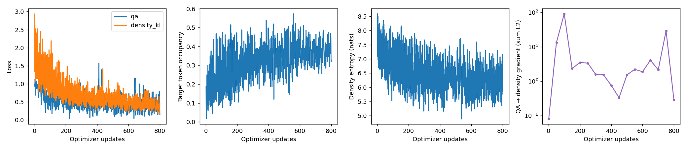
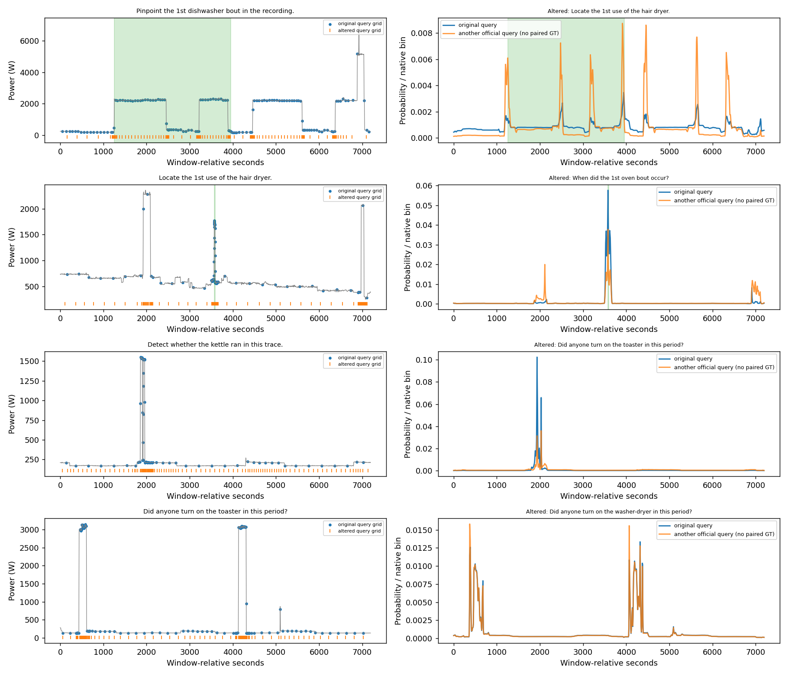
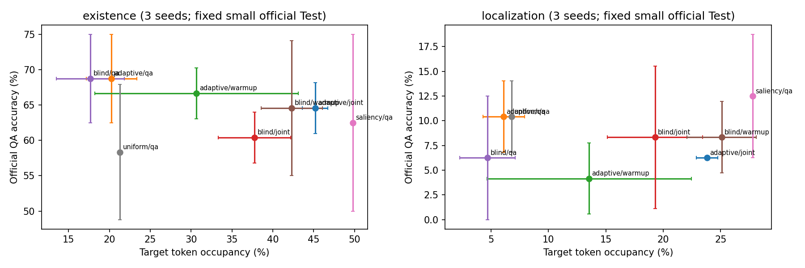
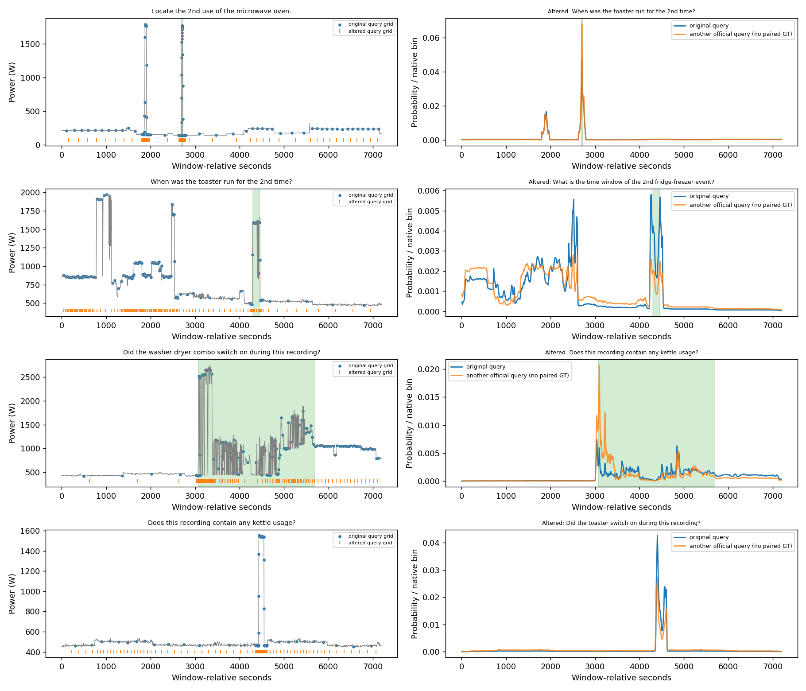

# Q-Sample v5：完整模型与 UK-DALE 官方小样本实验

## 1. 研究边界与版本继承

完整模型已实现，并完成56次官方小样本训练运行。Query-Adaptive Compression 的核心假设仍未得到验证：辅助监督提高目标占比，却未改善最终QA；定位解码与泛化明显不足。

v5 新代码、配置、逐题结果和图均单独存于本目录；v1–v4 未修改。v1 的 Adaptive 优势并未证明 Query 条件选择；v2 的严格预算任务在纯 QA 监督下出现优化失败，且存在坐标旁路；v3/v4 又说明 Answer Span 不等于完整 Evidence Span，官方原始信号背景跨划分重叠，且 UK-DALE 官方题目没有现成的同一重建信号多 Query 配对。v5 因此首先实现可训练、可诊断、可复现的完整链路，不把高准确率直接等同于 Evidence Sampling 成功。

本报告后续结果均来自官方 UK-DALE-Haystack 原生波形和原始问题；随机 Tensor 仅用于数值组件测试。不存在人工 Synthetic QA 性能实验、LLM、API 推理或大型文本模型微调。

## 2. 已实现的端到端模型

公开输入为单通道主电表功率 `X[B,L,1]`（W）、原始自然语言 Query、原生长度、6 秒采样周期及观察 mask。当前官方数据本身是单通道；推理接口遇到多通道会报错，不会静默丢弃通道。公开任务 schema 决定输出哪个答案头。

1. **文本**：冻结 [prajjwal1/bert-tiny](https://huggingface.co/prajjwal1/bert-tiny)，revision `6f75de8b60a9f8a2fdf7b69cbd86d9e64bcb3837`，2 层、128 隐藏维，约 4.4M 参数。原问题 WordPiece 分词、最长 96 Token、有效 Token 均值池化。训练缓存固定编码等价于运行冻结编码器，不更新验证/测试文本上的任何参数。它是小型预训练 BERT，**不是专门训练的句向量模型**；语义能力有限。权重 17,756,393 字节，SHA-256 `dab2c2bddcfb48ea430ef63fd76d46d67d704487844d967256a50dd7d7fd0a66`，与固定官方 LFS 指针一致。权重常驻 FP32 约 17 MiB，训练阶段使用缓存编码。未从隐藏 metadata 抽取设备或 k。
2. **波形编码**：仅以固定 `/1000` 将 W 转为 kW，不使用样本全局统计归一化。48 通道 stride-2 CNN，三个 kernel-3、dilation=1/4/16 分支，逐位置融合与 GroupNorm；仅在密度分支将局部特征池化到最多 512 位置。`coarse≤512` 与 `N=128` 是不同参数。按每条实际长度裁切后编码，避免 padding 污染。
3. **Query 密度**：128→96 的可训练 FiLM 产生通道缩放/偏移，浅层卷积输出 logits，线性插值回原生 L 后 Softmax。最终 `p=.98 softmax(logits)+.02/L`。Query-Blind 只将此处 Query 向量置零，答案头仍读取原 Query。Uniform 与 Saliency 不学习密度；Saliency 使用 9 点局部标准差＋一阶差分绝对值＋0.001 归一化。
4. **采样**：FP32 归一化、CDF、逆 CDF 区间插值与原始波形线性插值。分位点为 `(j+.5)/N`，不包含 0/1。离散 `searchsorted` 只选区间，区间 CDF 端点参与反传。没有 `[B,N,L]` 张量。支持 N=32/64/128/256/512。密度下限 .02 是显式稳定性取舍：L=14400 时最小质量约 1.39e−6，避免 v2 的极小均匀混合量在 FP32 CDF 尾部被舍入掉；不能宣称任意趋零质量均可高精度求逆。
5. **读出**：相同的 48 维、2 层、4 头 Transformer，只在 N 个采样 Token＋1 个 Query Token 上做注意力。每个 Token 的 6 个输入为采样功率、观察 mask、`t/T`、`Δt/T`、`log(1+Δt)/log(1+T)`、`log(1+T)/log(86401)`，加压缩序号正弦编码和 Query 投影。默认 `absolute` 指**窗口相对**时间，绝不是 UTC；`gaps` 消去 `t/T`；`signal` 消去全部时间/时长特征但保留 Token 次序。Δt 累加依然能暴露时间结构，不保证消除坐标通道。

Encoder 输出、原序列全局统计、density logits、GT 与 q_proxy 均不能进入答案头。原始零值不能当作缺测；官方重建结果没有独立缺测 mask，因此原生位置观察 mask 为 1、padding 为 0。采样后不存在补齐 Token；mask 作为观察信息输入读出器。真实时间为 `g×(L−1)×dt`，窗口总时长 `T=L×dt`；答案端点可以到 T，而最后观测点只到 T−dt。

`infer.py` 只接受原始 `.npy`、问题、公开任务和 dt，不加载官方题目表或任何事件标签。训练缓存 Embedding 和无标注推理使用同一文本预处理。

## 3. 数学目标与监督条件

### 3.1 最终答案

Existence 的 logit 为 z，官方标签 y∈{0,1}：

\[
\mathcal L_{exist}=-y\log\sigma(z)-(1-y)\log(1-\sigma(z)).
\]

所有 Yes/No 都参与 BCE，不做伪造事件位置的负例密度监督。

Localization 的两个原始输出 a,b 参数化为有序端点：

\[
\hat s=\sigma(a),\quad\hat e=\hat s+(1-\hat s)\sigma(b).
\]

GT 从官方 `HH:MM:SS - HH:MM:SS` 解析为窗口内秒数，再除 T。令 δ=dt/T=1/L，

\[
h_\delta(r)=\begin{cases}r^2/(2\delta)&|r|<\delta\\|r|-\delta/2&\text{otherwise},\end{cases}
\]
\[
I=\max(0,\min(\hat e,e)-\max(\hat s,s)),\quad
U=(\hat e-\hat s)+(e-s)-I,
\]
\[
\mathcal L_{loc}=\tfrac12[h_\delta(\hat s-s)+h_\delta(\hat e-e)]+1-I/\max(U,10^{-8}).
\]

不存在训练前 argmax/字符串化。最终才将连续端点乘 T、四舍五入到秒，并交给固定官方 scorer。报告 IoU≥.25 的官方 Accuracy、未舍入的连续 Mean IoU、两端平均绝对误差（秒及相对 T）。混合批次 QA Loss 按两任务实际样本数量加权。

`ModuleDict` 保留 Counting/Ordering 扩展头，但本轮没有训练或正式解码它们；Counting 预留的 6 类只是接口占位，接入官方任务必须先设合法类别范围。若采用 C 类计数，目标应为 `L_count=−log softmax(z)_c`；Ordering 二元顺序可用与 Existence 同型 BCE。它们不能被称为已支持的官方任务结果。

### 3.2 密度代理不是官方证据密度

用于优化的 q_proxy 只由 Train 标签构造。离线评估也计算标注代理与预测密度的KL诊断，均在no_grad下，不参与更新；不能把它当成测试空间监督。数学定义为：

\[
q(t)=0.8\frac{w(t)}{\sum_u w(u)}+0.2/L,\quad
\mathcal L_D=\sum_tq(t)\log\frac{q(t)}{p_\theta(t)}.
\]

实现三个可切换代理：Interval 的 w 为区间指示；Boundary+Context 为区间指示＋2 倍两个端点±60 秒邻域；Multi-Region 为每个候选区间及前后 120 秒邻域的叠加，定位题可包含截至第 k 次的同类事件。主实验固定 Boundary+Context，未根据测试表现选择代理。

定位默认代理围绕**答案区间**，不保证含有判断“第 k 次”所需的此前事件；存在性 Yes 使用已插入的目标设备事件区间，也不保证覆盖背景里的全部真实活动。以上是研究者设计的采样偏好，不是唯一正确的 Evidence Density。No 不施加局部 KL，也不强制 Uniform。所有样本均可使用低熵塌缩候选正则：

\[
\mathcal L_{cov}=[\log\min(16,L)-H(p)]_+^2.
\]

本轮其权重固定为 0，不抹平 Query 条件集中。训练总目标为 `L_QA+λ_D L_D+λ_cov L_cov`，KL 仅在有合法代理的当前样本上平均。

| 条件 | 总更新数 | 监督 |
|---|---:|---|
| QA Only | 400 | 全程 QA，λ_D=0 |
| Warm-up → QA | 400 | 前100步只有 KL，后300步撤掉 KL，QA 联合微调 |
| Joint | 400 | 全程 QA＋KL，λ_D=1 |

Uniform/Saliency 使用400步 QA，各自训练匹配答案头；Adaptive/Blind 都分别运行三条件。模型容量、时间协议和 Token 预算一致。预热条件的 QA 更新数少于 QA-only，但总更新数一致，不能解释成严格相同的 QA 优化预算。主实验所有条件均不使用高斯平滑；本轮不能重新证明或否定 v1 的平滑退火结论。

## 4. 数据、固定划分与实验规模

数据为 [nz00shuuuu/uk-dale-haystack](https://huggingface.co/datasets/nz00shuuuu/uk-dale-haystack)，revision `eb86b2ecc46b2f26b3a4e1768d7b479dc9abc521`。官方代码固定 `5e8d3162d47176e19fbd9c5f3d3cf9c6e0e9a7d4`，直接执行原始重建/前值保持函数和官方评分函数；只跳过重型框架导入，不改评分定义。

该官方基准本身是“真实 mains 背景＋真实设备片段叠加”的半合成 QA，并非完全自然产生的问答；本轮没有另造玩具任务。

沿用官方 Train/Validation/Test。`data_plan.json` 按 SHA256(`qsample-v5-seed7:`＋row_id) 固定排序，在每个 task×length×split 格取固定数量，不根据标签或性能筛选。

- 主 Train 64：两任务×原生 L1200/5400×每格16题。
- Validation 32、Test 32：每格8题，各任务各16题，单题准确率步长6.25个百分点。
- Overfit 32：每个 Train 格的前8题，无验证/测试混入；该实验中的 `validation_*.json` 明确是同一训练集的拟合评估，不是泛化验证。
- Smoke 6：两任务×原生 L150/600/1200。
- 源时间安全验证16、测试14：来自 v4 的严格读窗/UTC周安全清单，选择规则仍不看答案；后续源安全模型只用主 Train 中安全样本训练。未过滤训练来源的主模型即使在这些测试题上评估，也不能称为严格源隔离。

保留官方 Question、Answer、Yes/No 频率和原生时间轴，未插值改变题目长度。重建复用旧缓存、只取 NPY 字节窗，不下载完整信号库。部分下载连接重置后重试同一清单，失败记录保留，不换题、不缩小测试集。

v4 已审计过全部官方测试元数据，v5 的测试集不能称为未接触的全新盲测。测试标签不进入训练 Loss、训练用密度代理、模型选择或超参数修改。离线编码测试 Query 不学习参数。主 Benchmark 的原始背景跨划分重叠仍然存在；选定子集的完整输入哈希/近重复和背景交集将与最终结果一同报告。

## 5. 已实际执行的工程与过拟合测试

五项单元/工程测试通过：逆 CDF 的均匀/边界/极小概率/聚集行为；padding与信号插值；有限差分及 Signal-only QA 梯度；读出隔离与 Query-Blind 不变性；真实官方 DataLoader、损失、时间格式和反传。详见 `results/tests.log`。

| 真实原生 L | QA Loss | Density KL | QA→密度头梯度L1 |
|---:|---:|---:|---:|
|150|0.913294|0.906771|0.265939|
|600|1.135284|1.326901|0.308378|
|1200|0.949371|2.629823|1.746987|

上述梯度只证明真实路径存在；不能保证优化可用。另对 L14400、五种 N 做了随机数值组件前向测试，均有限；这**不是**真实长序列 QA 训练/性能，详见 `results/engineering_budgets.json`。

32题 Joint、N128、seed7、800步过拟合：

| 指标 | 随机初始化 | 最终 |
|---|---:|---:|
|Existence Accuracy|37.50%|100.00%|
|Existence Balanced Accuracy|42.86%|100.00%|
|Localization Accuracy|12.50%|37.50%|
|Localization Mean IoU|0.06793|0.31760|
|Localization Endpoint MAE|5776.42秒|1556.28秒|
|Localization Target Hit|81.25%|100.00%|
|Localization Target Occupancy|8.06%|33.54%|

损失明显下降、存在性可拟合，但**定位未充分过拟合**。L1200 定位准确率62.5%，L5400仅12.5%；L5400 预测/真实区间长度比的中位数约13.17。一个24秒 hair dryer 区间真实为 `00:59:30 - 00:59:54`，模型预测 `01:05:12 - 01:12:44`，虽然采样命中目标。定位失败不能归因于采样未命中；还涉及极短端点的连续解码、归一化时间精度、非重叠 IoU 的零梯度，以及“第k次”证据不完整。

训练集冻结答案头诊断中，值置乱后定位 Mean IoU 0.317，与正常0.318几乎一致；置零降至0.186；改用均匀网格仍为0.292。它提示时间网格/问题先验可能很强，必须结合后续独立坐标头的正式 held-out 结果判断。没有据此宣称采样证据有效。

## 6. 正式小规模主实验：三个种子

八条件×seed7/11/23，共24次运行；每次共享两任务训练64题、最终验证32题、测试32题，N128，400更新、batch8、AdamW lr=.001、weight_decay=.0001、全局梯度裁剪5、BF16 AMP。密度/CDF/插值保持FP32。未用梯度累积或checkpointing，实际显存足够。统一使用最后一次更新，不按验证或测试挑checkpoint。

数值为3个种子的均值±样本标准差，Accuracy/Occupancy单位为百分比，IoU无量纲。它们不是置信区间；各任务测试只有16题，不能据几分差距作显著性结论。

| 方法 / 监督 | Existence Acc | Balanced Acc | Localization Acc | Mean IoU | Endpoint MAE (s) | Loc Target Occupancy |
|---|---:|---:|---:|---:|---:|---:|
| adaptive / joint | 64.58 ± 3.61 | 64.58 ± 3.61 | 6.25 ± 0.00 | 0.0308 ± 0.0035 | 5293.04 ± 392.70 | 23.83 ± 0.94 |
| adaptive / qa | 68.75 ± 6.25 | 68.75 ± 6.25 | 10.42 ± 3.61 | 0.0446 ± 0.0104 | 5537.93 ± 414.99 | 6.10 ± 1.82 |
| adaptive / warmup | 66.67 ± 3.61 | 66.67 ± 3.61 | 4.17 ± 3.61 | 0.0326 ± 0.0093 | 5113.74 ± 803.50 | 13.54 ± 8.90 |
| blind / joint | 60.42 ± 3.61 | 60.42 ± 3.61 | 8.33 ± 7.22 | 0.0424 ± 0.0219 | 5266.48 ± 602.10 | 19.29 ± 4.15 |
| blind / qa | 68.75 ± 6.25 | 68.75 ± 6.25 | 6.25 ± 6.25 | 0.0312 ± 0.0163 | 5427.43 ± 660.26 | 4.69 ± 2.40 |
| blind / warmup | 64.58 ± 9.55 | 64.58 ± 9.55 | 8.33 ± 3.61 | 0.0656 ± 0.0108 | 4916.65 ± 804.24 | 25.10 ± 3.02 |
| saliency / qa | 62.50 ± 12.50 | 62.50 ± 12.50 | 12.50 ± 6.25 | 0.0634 ± 0.0172 | 5587.41 ± 780.99 | 27.78 ± 0.00 |
| uniform / qa | 58.33 ± 9.55 | 58.33 ± 9.55 | 10.42 ± 3.61 | 0.0462 ± 0.0171 | 5531.47 ± 1173.07 | 6.79 ± 0.00 |

完整逐种子和逐题结果见 [all_metrics.csv](results/all_metrics.csv)、[seed_summary.json](results/seed_summary.json) 及各运行 `test.json`；没有只展示最佳种子。

| 方法/监督 | 正例Acc % | 负例Acc % | 定位Hit % | 定位Occupancy % | 干扰Occupancy % |
|---|---:|---:|---:|---:|---:|
|adaptive/joint|70.83 ± 14.43|58.33 ± 7.22|100.00 ± 0.00|23.83 ± 0.94|1.87 ± 0.62|
|adaptive/qa|66.67 ± 7.22|70.83 ± 7.22|87.50 ± 10.83|6.10 ± 1.82|0.47 ± 0.25|
|adaptive/warmup|70.83 ± 7.22|62.50 ± 0.00|93.75 ± 6.25|13.54 ± 8.90|1.73 ± 2.40|
|blind/joint|79.17 ± 7.22|41.67 ± 7.22|100.00 ± 0.00|19.29 ± 4.15|2.75 ± 0.20|
|blind/qa|70.83 ± 7.22|66.67 ± 7.22|70.83 ± 21.95|4.69 ± 2.40|0.24 ± 0.27|
|blind/warmup|62.50 ± 12.50|66.67 ± 7.22|100.00 ± 0.00|25.10 ± 3.02|3.24 ± 0.79|
|saliency/qa|62.50 ± 33.07|62.50 ± 21.65|100.00 ± 0.00|27.78 ± 0.00|3.03 ± 0.00|
|uniform/qa|70.83 ± 7.22|45.83 ± 26.02|93.75 ± 0.00|6.79 ± 0.00|0.49 ± 0.00|

Target 对定位指答案区间，对存在性指已插入的目标设备事件；Hit为至少一个Token落入目标。干扰占比只统计**已插入的异类设备片段**，不等于完整背景活动；不把序数判断所需的先前同类事件简单当作可丢弃干扰。所有方法均在原始未平滑信号上评分。

**主要发现：**

- QA-only Adaptive与Blind的Existence均为68.75%；没有稳定的Query增益。Joint的64.58%对比Blind Joint的60.42%只相当于极少数题，不能抵消小样本和旁路问题。
- Joint定位占比23.83%，高于QA-only 6.10%和Uniform 6.79%，但定位QA准确率降至6.25%。Saliency不读取Query，定位占比反而达到27.78%。空间监督改变了密度，不等于改善最终答案。
- N128时Uniform已命中93.75%的定位目标；仅凭L/N=9.375或42.1875不能宣称出现强制Query竞争。命中目标而无法解码，是当前更直接的失败。
- 纯QA到密度头的梯度并非总是极小，例如seed7所记录的梯度范数和可从约0.04变到49.39。非零甚至很大都不代表方向正确；不能简单把失败解释为“不可微”或“只缺少梯度放大”。

图中的另一Query来自另一条官方题目，但在当前信号上没有配对官方GT。绿色仅表示原Query答案区间，橙色网格展示函数变化，**不表示已验证正确的条件选择**。各主配置均保存密度图和训练曲线，展示每任务最先两题，不按成功与否选图。

## 7. 预热后空间能力是否保持

额外6次独立复跑，仍为相同400更新、前100步KL→300步QA，新增固定Train评估快照，不改变优化目标、不替换原主矩阵。以下比较同一次复跑的100步和400步，不拿不同批次的训练日志冒充保持性验证。

| 方法/种子 | 预热100步定位占比 % | QA微调后400步占比 % |
|---|---:|---:|
|adaptive/7|26.27|16.67|
|adaptive/11|24.17|5.40|
|adaptive/23|27.25|8.25|
|blind/7|22.07|10.35|
|blind/11|21.31|10.89|
|blind/23|24.34|32.23|

Adaptive三种子的平均定位占比从25.90%降至10.11%；Blind从22.57%降至17.82%，且seed23反而上升。**撤掉辅助监督后空间能力不能稳定保留。** 这支持当前QA目标没有稳定维护该采样偏好的判断，不能据预热KL下降宣称采样训练成功。复跑的全部最终QA结果也在all_metrics.csv中，未并入原主矩阵均值。

## 8. 独立答案头、时间消融与冻结干预

| 固定seed7条件 | Existence Acc % | Balanced Acc % | Localization Acc % | Mean IoU | Endpoint MAE秒 |
|---|---:|---:|---:|---:|---:|
|adaptive_joint_s7|68.75|68.75|6.25|0.0323|5356.50|
|coordinate_only|56.25|56.25|12.50|0.0671|4563.84|
|query_only|62.50|62.50|6.25|0.0399|5576.57|
|adaptive_joint_signal|68.75|68.75|12.50|0.0599|5174.71|
|adaptive_joint_gaps|68.75|68.75|6.25|0.0451|5597.34|
|adaptive_joint_source_safe|50.00|50.00|0.00|0.0000|5907.98|

Coordinate-only：先冻结已训练Joint采样器，再独立初始化、训练相同54,346参数的答案头，只读网格/时间/Query。它不是简单置零测试，也不是端到端同计算预算的完整系统基线：继承了已有采样器训练成本。Query-only重新训练匹配答案头，不接收信号、数据相关坐标或时长特征；定位字符串转换仍使用公开窗口总时长。

独立Coordinate-only定位分数高于正常Joint，但两者绝对分数都很低，不能夸大成“高精度坐标捷径已复现”。它说明这些弱分数并不足以证明波形证据有效。Query-only存在性62.5%，也接近正常Joint68.75%。Signal-only/Δt消融未解决定位失败；时间输入不能单凭一次低分被判为不必要。

| 冻结Joint seed7答案头干预 | Existence Acc % | Localization Acc % | Mean IoU |
|---|---:|---:|---:|
|normal|68.75|6.25|0.0323|
|zero|68.75|6.25|0.0267|
|permutation|68.75|0.00|0.0000|
|cross|62.50|6.25|0.0298|
|uniform|75.00|6.25|0.0430|

这些是**同一个已训练答案头的分布外干预**，不能与独立训练的Uniform/Coordinate-only混为一谈。QA-only seed7存在性在置零、置换和跨信号替换后16/16预测答案都与正常一致；Joint置零后14/16一致，平均logit变化约1.18，准确率相同不代表所有预测不变。不能把正常模型的弱准确率归功于采样值。

固定X后换Query：QA-only的平均密度TV仅.00204、网格平均移动13.18秒；Joint TV=.19212、移动743.16秒；Blind和Uniform都严格为0。**Joint学会了依赖Query，但没有配对官方证据标签，无法证明移动方向正确或带来有用条件选择。** 全部逐题变化在各 `diagnostics.json`；不将其命名为有效Query Selectivity。

## 9. 原始来源、重复和标签敏感性

选定Train/Validation/Test的重建输入哈希无跨划分完全重复；同原生长度、相关系数>.999且归一化RMSE<.01的近重复为0。但有61对背景时间交集：Train–Validation14、Train–Test26、Validation–Test21；9/32验证题和14/32测试题的背景与所选Train重叠。**背景重叠不等于完整重建输入重复，也不等于没有泄漏风险。** 精确问题文本与Train重合的验证/测试各5题；模板近似的影响仍只能部分由Query-only诊断揭示。

单独源安全模型只用46道安全Train题，验证16、测试14（存在性8、定位6），结果50%存在性、0%定位。它同时改变来源与样本组成，不能把与主模型的差距单独归因为泄漏；安全周划分也不是住户/设备身份隔离。主模型在该视图的单纯过滤评测不冒充源隔离训练结果。

所选主子集中，完整bout index没有标记任何Existence No的背景目标活动冲突，因此无法估计“冲突/非冲突”分组差异；未改任何标签。这不推翻[v4](../v4/REPORT_UKDALE_DATA_AUDIT.md)在完整官方数据发现的102个No索引冲突（Train60/Val29/Test13），更不意味着未检出活动一定不存在。[input_audit.json](results/input_audit.json)保留全部重复规则和背景交集。

## 10. 原生14400点预算压力测试

在Stage1–3完成且更新/损失数值稳定后，运行预先冻结的小规模压力试验；没有扩模型或用已见测试成绩修改方案。Train16、Validation8、Test8，每任务测试仅4题；Existence测试2Yes/2No。四方法×N32/64/128/256/512、seed7、200步，各自训练读出器；Adaptive/Blind固定Joint，Uniform/Saliency固定QA-only。它不是3种监督条件的完整长序列矩阵。

L/N分别为450、225、112.5、56.25、28.125；N128长试验与主试验的数据和更新数不同，不能当作纯长度的因果消融。

| N | 方法 | Existence Acc % | Balanced Acc % | Localization Acc % | Mean IoU | Loc Hit % | Loc Occupancy % |
|---:|---|---:|---:|---:|---:|---:|---:|
|32|adaptive|75.00|75.00|0.00|0.0000|75.00|21.88|
|32|blind|75.00|75.00|0.00|0.0000|75.00|23.44|
|32|saliency|50.00|50.00|0.00|0.0000|75.00|17.97|
|32|uniform|75.00|75.00|0.00|0.0000|25.00|2.34|
|64|adaptive|25.00|25.00|0.00|0.0000|75.00|17.19|
|64|blind|50.00|50.00|0.00|0.0000|75.00|15.62|
|64|saliency|50.00|50.00|0.00|0.0000|75.00|16.80|
|64|uniform|75.00|75.00|0.00|0.0000|50.00|2.34|
|128|adaptive|50.00|50.00|0.00|0.0326|100.00|18.16|
|128|blind|50.00|50.00|0.00|0.0000|100.00|9.57|
|128|saliency|50.00|50.00|25.00|0.0821|100.00|16.80|
|128|uniform|50.00|50.00|0.00|0.0000|75.00|2.54|
|256|adaptive|75.00|75.00|0.00|0.0000|75.00|19.04|
|256|blind|50.00|50.00|0.00|0.0000|100.00|8.79|
|256|saliency|75.00|75.00|0.00|0.0000|75.00|16.70|
|256|uniform|75.00|75.00|0.00|0.0000|75.00|2.54|
|512|adaptive|50.00|50.00|0.00|0.0000|100.00|20.12|
|512|blind|50.00|50.00|0.00|0.0000|100.00|9.18|
|512|saliency|50.00|50.00|0.00|0.0000|100.00|16.75|
|512|uniform|75.00|75.00|0.00|0.0047|100.00|2.64|

大部分配置定位Accuracy=0%；只有Saliency N128的1/4题通过。Uniform定位Hit随预算从25%提高到100%，说明稀疏采样确有漏事件风险；但N512已全部命中仍不能回答定位题，当前解码/语义能力构成更强瓶颈。没有Query-aware/Blind Oracle差异或可靠配对任务，不能把这些压缩比称为已验证的条件选择瓶颈。Existence在25–75%间量化波动，4题样本不足以排名。长试验没有单独重训Coordinate-only或做3种子重复，因此不能从中排除新旁路或判断稳定优势。

长子集也做了同样审计：完全重复0对、近重复0对、背景跨划分交集4对、Existence No索引冲突0条；见 [input_audit_long.json](results/input_audit_long.json)。

## 11. 失败定位与尚未成立的假设

梯度链实际上有两条：

\[
\nabla_\theta L_{QA}=\frac{\partial L}{\partial h}
\left[\frac{\partial h}{\partial X(G)}\frac{\partial X(G)}{\partial G}
+\left.\frac{\partial h}{\partial G}\right|_{X(G)}\right]
\frac{\partial G}{\partial p}\frac{\partial p}{\partial\theta}.
\]

前项经过真实波形，后项经过坐标/间隔。平坦波形处前项可以为零；密度下限不保证波形梯度存在。KL可以直接训练p，却可能把答案位置传入第二项。Signal-only去掉直接时间输入后，采样值的排列仍可能成为隐式通道，不是理论防捷径证明。

可确定或有直接证据的限制：

1. **采样数学链路可运行**，有限差分、真实QA梯度、全56次有限Loss均通过。无证据把失败归为searchsorted使整个模型不可微。
2. **密度目标与答案不一致**：Joint改善答案区间占比，但不改善QA；Warm-up能力常在QA微调后丢失。主代理未要求保留前k−1次事件，而定位问题需要序数证据。
3. **密度分支缺少长程顺序表示**：卷积最大局部感受野约71个原始点，末端池化再扩大约一个bin；GroupNorm提供顺序无关的全局统计，不能替代“此前出现几次”的显式上下文。FiLM给出k语义也不自动带来长程计数能力。未做独立全局上下文消融，因此不能量化归因，但这是明确结构限制。
4. **读出/时间精度不足**：短至24秒的目标、长达9/24小时的窗口和CLS连续端点回归使问题很难；非重叠IoU没有端点梯度。目标已命中仍端点过宽、定位未充分过拟合及极差held-out成绩，说明当前读出尚不足够强。不能仅以更多采样点解决。
5. **信息旁路未排除**：独立无波形头可达到同量级弱分数，QA-only存在性对多种值干预不改最终答案。没有观察到v1那种100%泛化坐标捷径，但也不能把弱结果解释成使用真实证据。
6. **语义与数据不足仍待分离**：冻结MLM均值向量不是强设备/序数编码器；每任务仅32道Train题，多种设备分摊后很少。未做强文本编码器或全文波形能力上界，因此不能把全部失败单独归咎于CNN、文本或Transformer。

固定seed7 Joint的全部测试错题保存在 [failure_cases.json](results/failure_cases.json)。例如“2nd microwave”正确为 `00:45:00 - 00:45:24`，预测 `01:11:48 - 01:32:23`，仍命中目标并分配14.84% Token；“2nd toaster”正确 `01:11:36 - 01:14:24`，预测 `00:34:31 - 00:49:09`。这些不是从测试中挑选后再调模型的开发样本。

研究判断：**可微采样的工程可行性成立，辅助位置代理能改变空间分配；稳定且有用的Query-Adaptive Evidence Compression仍未成立。** 与Query-Blind相比，没有足够证据证明相同输入、不同Query时做出了正确、有用的条件选择。下一轮应先在Train/Validation确认读出足够强、补充密度的长程顺序上下文，并独立比较Multi-Region代理；所有改变都必须继续保留无波形头和源安全诊断。真实同信号多Query需要经过背景活动核验，不能仅拼接另一句Query就制造“官方配对成功”。不建议立即启动全量或大模型训练。

## 12. 实际交付、资源与复现

实际完成 **56 次训练运行**：1次32题过拟合＋24次三种子主矩阵＋5次独立坐标/问题/时间/源安全控制＋6次预热保持性复跑＋20次长序列预算试验。没有删除失败表现。

- 设备实测为 RTX 4090 D，PyTorch可见显存约24,210 MiB；开始磁盘空闲约2.1 GiB，并非假定有任意资源。
- 不含冻结BERT的Q-Sample共97,451参数：CNN28,320、FiLM12,384、密度头2,401、读出54,346。Uniform/Saliency具有同一读出容量；分配的学习密度模块不参与其实际计算，不能把同总参数计数当成相同有效学习能力。
- 56次运行记录的训练＋固定评估/序列化累计 **22.43分钟**；不包括数据网络等待与最终统一诊断。峰值PyTorch allocated **169.79 MiB**，不是包含CUDA上下文的整卡峰值。逐运行耗时、reserved/allocated、更新数和batch见 [resources_all.json](results/resources_all.json)。
- 全部194个选定重建输入成功缓存；来源记录1943个唯一字节范围、共26.27 MB，**包含缓存复用而非纯新增下载量**。没有下载完整信号库。冻结文本模型约18MB，147条唯一原问题实际9–18个WordPiece，无96词元截断。
- 固定种子、关闭cuDNN benchmark；CUDA池化/插值及FlashAttention反向仍可能非逐bit确定。额外保持性复跑与原主运行有所变化，全部保留并单独报告，不选择有利轨迹。`results/execution_notes.json`记录数值和I/O例外；一次新增下载等待逻辑的变量重名错误在任何主实验更新前修复，失败启动日志保留。
- 训练模型核心文件SHA-256为 `3ee37190dc523ece340747100dca5d99c9d5ac8935054f755709f5f68219c0c9`，已记录的所有运行与该核心一致。每次运行保存配置、源码哈希、曲线、最终模型和逐题输出。报告/绘图/下载重试的后续调整不修改模型或训练标签。

复现命令和缓存环境变量见 [README](README.md)。所有v5代码/来源清单自包含，复用共享的官方缓存，不导入旧版模型或依赖旧版目录内文件。`prepare.py --metadata`已实际校验31个所需元数据文件；`make_plan`重新生成与冻结清单完全一致。训练所用原始Question/Answer不改。

`results/*/final.pt`均保留在服务器；固定seed7参考模型另存 `models/adaptive_joint_seed7.pt`，独立坐标控制另存 `models/coordinate_only_seed7.pt`。沿用仓库 `.gitignore` 的权重排除约定，GitHub上传代码、结果、图与 [CHECKPOINTS.json](CHECKPOINTS.json)，不上传权重。固定命令可重新训练这些小模型。`infer.py`已实际以原始数组＋原问题＋公开schema完成无GT推理，输出128个合法时间坐标和官方答案格式，见 [inference_smoke.json](results/inference_smoke.json)。

| 状态 | 内容 |
|---|---|
|已实现并实际验证|冻结文本编码、CNN/FiLM密度、逆CDF、原波形插值、双任务时间Transformer、官方评分、全部关键数值与真实输入测试|
|已实际运行|32题过拟合、三种子主矩阵、独立Coordinate/Query-only、时间消融、冻结干预、源安全训练、预热保持性、原生14400点五预算|
|明确失败/不足|定位未充分拟合且泛化弱；增加命中/占比不改善QA；撤掉KL常退化；Query增益不稳且旁路未排除|
|未执行|LLM、API、全量benchmark训练、长试验三种子、完整三代理消融、完整多任务Counting/Ordering、长试验独立坐标头、强全信号/Oracle读出上界|
|未证实|同信号正确方向的Query选择、必要的信息竞争、靠真实采样波形改善最终答案、辅助监督无答案通道|

本版交付的是可运行的研究模型与真实负面证据，不是Q-Sample有效性的确认，也不是与TS-Haystack/Sonar完整系统的同资源排名。
