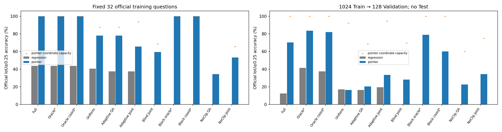
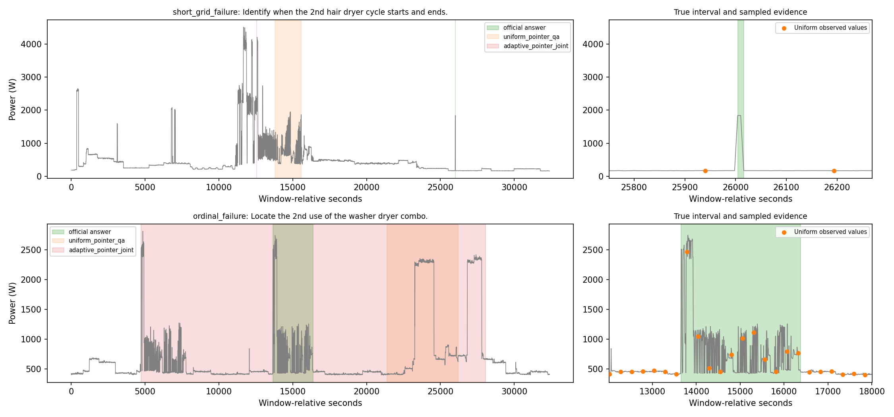

# Q-Sample v6：Localization 瓶颈定位

**结论：v5全局回归头是明确瓶颈，但不是唯一瓶颈。** Full Signal＋Pointer可达70.31%验证准确率；Learned Sampling＋Pointer＋Joint约34%。采样退化、稀疏波形利用和联合优化共同限制了后者，Oracle又存在显著坐标通道，不能仅凭目标命中率把责任全部归给答案头。

## 固定实验设置

本轮只做官方 `nz00shuuuu/uk-dale-haystack` Localization，不接入 LLM，不使用 Test。数据版本 `eb86b2ecc46b2f26b3a4e1768d7b479dc9abc521`；官方重建/评分代码版本 `5e8d3162d47176e19fbd9c5f3d3cf9c6e0e9a7d4`。复用 v5 数据缓存、冻结文本编码器、密度 CNN/FiLM、逆 CDF 和原始波形线性采样；v1–v5 未修改。

先在已有的 32 道官方 Train 定位题上训练 1,000 步，再在固定 1,024 道 Train 上从头训练 2,000 步，评估固定 128 道 Validation。两个原生长度 L=1,200/5,400 各占一半，dt=6 秒；稀疏方法 N=128，压缩比 9.375/42.1875。训练题含前述 32 题，其余及验证题按 row_id 固定哈希顺序选取，没有替换失败窗口。保留原问题及 `HH:MM:SS - HH:MM:SS` 答案，用官方 IoU≥0.25 评分，同时报告连续 IoU 和两端点平均绝对误差。

全部条件 seed=7、AdamW(lr=0.001, weight_decay=0.0001)、梯度裁剪 5；32 题 batch=8，主实验 batch=16，按原生长度分桶、相同抽样顺序，固定最后一步，不早停或用验证选模。每个主条件看到 32,000 个题目呈现，约 31.25 轮；匹配更新数和样本呈现，不匹配 FLOPs。实际使用 RTX 4090 D；卷积/Transformer BF16，GRU、CDF 和插值 FP32。仅一次种子，不能据此声称跨种子稳定性。

## 核心结果

17 个条件各运行一次 32题拟合和一次 1,024题训练，共 **34 次实际 GPU 训练**。下表 Acc 单位为 %；* 为使用标注位置的特权条件，坐标版本为独立训练的 Coordinate-only。

| 输入／训练／头 | 32题Train Acc | 1024题Train Acc | Val Acc | Val IoU | Val端点MAE秒 |
|---|---:|---:|---:|---:|---:|
| Full／回归 | 43.75 | 24.02 | 12.50 | 0.0779 | 4829.4 |
| Full／Pointer | 100.00 | 90.23 | 70.31 | 0.6804 | 2373.8 |
| Oracle-all*／回归 | 43.75 | 50.59 | 41.41 | 0.2521 | 1346.2 |
| Oracle-all*／Pointer | 100.00 | 96.88 | 83.59 | 0.7747 | 557.5 |
| Oracle-all*／坐标回归 | 43.75 | 50.98 | 37.50 | 0.2408 | 1463.3 |
| Oracle-all*／坐标Pointer | 100.00 | 92.58 | 82.03 | 0.7002 | 890.4 |
| Uniform／回归 | 40.62 | 31.45 | 17.19 | 0.0983 | 3959.3 |
| Uniform／Pointer | 78.12 | 39.94 | 16.41 | 0.1209 | 3532.8 |
| Adaptive QA／回归 | 37.50 | 30.96 | 16.41 | 0.1168 | 4313.2 |
| Adaptive QA／Pointer | 78.12 | 24.80 | 20.31 | 0.1343 | 4658.4 |
| Adaptive Joint／回归 | 37.50 | 30.57 | 19.53 | 0.1348 | 3670.9 |
| Adaptive Joint／Pointer | 65.62 | 37.79 | 33.59 | 0.2547 | 4197.9 |
| Query-Blind Joint／Pointer | 59.38 | 34.47 | 28.12 | 0.2029 | 4565.3 |
| Oracle-block*／Pointer | 100.00 | 97.27 | 78.91 | 0.6810 | 924.6 |
| Oracle-block*／坐标Pointer | 100.00 | 81.35 | 60.16 | 0.4405 | 1223.6 |
| NoClip QA／Pointer | 34.38 | 30.47 | 22.66 | 0.1503 | 4252.1 |
| NoClip Joint／Pointer | 53.12 | 44.82 | 34.38 | 0.2890 | 4604.1 |



所有有限性、样本清单和 **20,672 条官方逐题评分复核**通过；累计记录运行时间 46.47 分钟，最高已分配显存 292.1 MiB，详见 [verification.json](results/verification.json)。

## 瓶颈判断

1. **全局回归定位确有严重优化问题，任务并非完全不可学习。** Full Pointer 在32题上100%，主实验验证70.31%；同一Full骨干的回归版本仅43.75%和12.50%。但 Uniform Pointer 验证16.41%，并未超过其回归版本17.19%；不能说换头已经解决稀疏QA。Full与稀疏骨干也不同，70.31%与34%左右的差距不能全部归因于采样。

2. **Oracle 原始高分主要受坐标通道混淆，粗格对照支持波形确有价值。** Oracle-all Pointer为83.59%，独立坐标版82.03%，只差2题；809/1024训练题、92/128验证题仅插入一种设备，位置簇与公开序数本身就容易透露答案。Oracle-block为78.91%，坐标版60.16%，带波形多答对24题：128个点在粗事件区域已知时可以提供有用证据，当前稀疏读出器也并非完全不会定位；仍不能认定Oracle已消除位置特权或所有事件证据都充分。

3. **Learned 的有效证据选择与读出联训仍是主要剩余问题。** 原始Adaptive Joint Pointer为43/128题，Blind为36/128题，仅多7题；目标命中率为96.09%对77.34%，前序插入事件覆盖为93.62%对78.72%。命中明显改善而QA提升有限。Adaptive的连续网格锚点可达到IoU≥0.25的题目比例为94.53%，远高于实际33.59%；单纯“没有可输出的边界”不能解释大部分失败，但这也不证明少量观测保存了设备形态、完整活动边界或序数语义。该比例仅是给定锚点的几何表达诊断，不是完整QA能力上限；FP32与官方秒级取整会影响恰好0.25附近的临界题。

4. **存在独立的采样优化故障，去掉硬截断不是充分修复。** 32题QA-only Pointer检查的4条真实训练信号（两个长度）中，logits为−36.35至−22.97，v5的`clamp(-12,12)`使它们全部变成−12，密度均匀且QA密度梯度为0。同一权重只去clamp可恢复非零梯度，见 [sampler_check.json](results/sampler_check.json)，但该替换仅诊断梯度，不作为成绩。真正从头训练的NoClip QA在32题仅34.38%，目标命中37.50%，低CE并未让网格靠近答案；主实验QA为22.66%、Joint为34.38%，均未接近Full，Joint端点MAE反而高于原版。原版Joint的KL曲线亦明显波动。问题包含坏网格与采样器—答案头的优化耦合，不能只责怪答案头。

**时间/波形依赖。** 对已经训练好的Pointer仅将读入波形置零，Full为70.31%→0.78%，Uniform16.41%→7.03%，Adaptive Joint33.59%→27.34%，NoClip Joint34.38%→28.91%。学习网格仍由原X生成；结果提示位置/Query通道承载较多线索，不能据高命中率宣称真实波形推理充分。此项是分布外干预，不能把分差解释为可加的因果贡献，也不能替代Oracle中独立训练的坐标对照，见 [interventions.json](results/interventions.json)。

**短事件和序数。** 14个≤60秒目标中，Uniform只命中50%，连续锚点通过比例35.71%，实际0/14；Adaptive Joint为4/14，Full为9/14。Full在L1200/L5400分别84.38%/56.25%，第1次/第≥2次为76.54%/59.57%，长窗口与序数仍较难。前序覆盖只评估标注插入事件，不把原生背景中的全部同类活动当作已核验完整证据。

**下一步最有价值：固定采样器后独立训练定位头。** 从相同训练数据预热采样器，缓存固定128个原始观测及时间，再训练当前Pointer与轻量时序读出器，最后小步解冻；保持相同证据、Query、时间及预算。这能把“学习网格保留的波形不足”和“移动网格/最近边界标签导致解码器难训练”分开。当前结果支持修正回归解码及分阶段优化，尚不支持把全部瓶颈唯一归为采样器、答案头，或宣称Query-Adaptive已稳定验证成功。


## 模型及监督边界

参数量不含离线冻结并缓存的文本编码器。

- **Full Signal**：原始全部观测→轻量残差 CNN→4倍池化的双向 GRU→还原至原生时间网格→定位头，约 6.62 万参数。Full 的全局回归使用均值池化，而非 v5 的 CLS。
- **稀疏方法**：答案头仍为 v5 的 48 维、两层时间 Transformer，约 9.94 万总参数；只读取 128 个真实采样值、时间和 Query，不能读取采样器 Encoder 特征、密度或隐藏事件字段。全局回归保留 CLS；Pointer 只替换定位解码及对应训练目标。Query-Blind 仅取消密度网络中的 Query，答案头仍读取相同 Query。
- **公共 Query/时间协议**：冻结 BERT-tiny 128维，加上仅从原问题文字解析的设备名/序数 one-hot 投影，所有条件一致。这项公开语义适配不同于 v5 的纯 BERT，因此不把跨版本分数变化全部归功于定位头。时间为窗口内 t/T、Δt/T、对数物理间隔和窗口长度；没有 UTC 时间戳。
- **Oracle-all**：利用各自 Train/Validation 的全部插入事件位置，每事件等质量，外扩 12 秒，80%事件密度＋20%均匀背景；包含序数所需的前序插入事件，不按目标 Query 单独挑答案。**Validation Oracle 使用了验证标注，仅为特权诊断。**独立训练的 Coordinate-only 模型使用相同网格、Query 和初始化，波形恒为零。
- **Oracle-block**：进一步只暴露事件所在的 64 个固定粗时间格，取消格内精确边界，再采 128 点；仍使用特权事件位置，仍须与独立训练的 Coordinate-only 比较。

令归一化真值为 (s*,e*)，δ=1/L。全局回归以 sigmoid 保证 0≤s≤e≤1，QA 损失为

$$
\mathcal L_g=\tfrac12\sum_{b\in\{s,e\}}H_\delta(\hat b-b^*)+1-\operatorname{IoU}(\hat s,\hat e;s^*,e^*),\quad
H_\delta(u)=\begin{cases}u^2/(2\delta),&|u|<\delta\\|u|-\delta/2,&\text{其他}.\end{cases}
$$

Pointer 对每个观测 Token 输出 Start/End logits，训练标签取距真实边界最近的当前网格锚点索引（标签索引停止梯度）。训练使用 softmax 加权坐标的有序期望区间，损失为 $\mathcal L_{QA}=\mathcal L_g+\frac12[CE(z_s,j_s^*)+CE(z_e,j_e^*)]$。评估取 Start≤End 的最大联合得分；End 锚点为观测时间加一个原生 dt。**没有在未观测间隙内预测任意精细偏移**。因此这比较的是定位参数化与损失的组合，不能分离成纯结构收益。

Joint 为 $\mathcal L_{QA}+KL(q_{proxy}\Vert p_\theta)$，系数 1；沿用 v5 的答案边界＋邻域代理密度，不将其称为完备证据 GT。QA Only 不施加密度 KL；Pointer 的边界 CE 属于正常答案监督。标签仅在损失、明确的 Oracle 或离线评估中使用。

## 两个固定规则选取的失败案例

按 row_id 排序，分别取“Full 成功但 Uniform 的 Pointer 坐标上限不足”和“Full 成功但 Adaptive Joint 的第 k≥2 次失败”的首题，而非挑选最好看的示例；全部逐题预测均保存。

1. **12 秒事件漏采**（32400s Validation #116）：问题为 `Identify when the 2nd hair dryer cycle starts and ends.`，真值 `07:13:24 - 07:13:36`。Full 精确答对。Uniform 和 Adaptive Joint 都未命中目标及前序事件，网格可表达的最大 IoU 分别只有 0.0463 和 0.0023；当前 Pointer 再好也无法通过 0.25 阈值。这是明确的证据/边界表达缺失。
2. **命中后仍定位失败**（32400s Validation #104）：问题为 `Locate the 2nd use of the washer dryer combo.`，真值 `03:47:30 - 04:32:54`。Full 为 `03:45:06 - 04:32:54`；Adaptive Joint 已命中目标、前序覆盖率为 100%，坐标上限 IoU=0.9476，却输出 `01:18:51 - 07:47:36`。不能再归咎于完全漏采；但“前序至少有一点”不保证保留设备形态与次序识别所需的信息，也不能单凭此例证明全部波形证据充分。



## 复现与范围

依赖和官方缓存准备沿用 [v5](../v5/README.md)。在本机 `q-sample/v6/` 下执行（缺失数据时先启用现有网络配置）：

```bash
export PYTHONPATH=/root/v020-extra
export CUBLAS_WORKSPACE_CONFIG=:4096:8
/root/v016-sonarts-env/bin/python prepare.py
/root/v016-sonarts-env/bin/python execute.py
/root/v016-sonarts-env/bin/python analyze.py
```

`execute.py` 从头运行完整固定矩阵，已有完整结果及权重则跳过；本轮实际先完成原 13 条件，再串行执行 4 个补充条件，均逐条件重置相同种子。补充条件源于 **32题训练结果**：Oracle 坐标泄漏与硬截断饱和，均在看到主实验 Validation 模型成绩前确定，未替换原失败实验。数据清单与哈希见 [data_plan.json](data_plan.json)、[protocol.json](results/protocol.json)，重建 1,152 条官方窗口全部成功；不重下完整波形库。

10 种真实数据前向/反传、Oracle 输入隔离、QA 到密度的初始非零梯度及原生边界检查通过；34 次训练的曲线、逐题预测、分组指标见 [results/](results/)，核心汇总见 [summary.csv](results/summary.csv)。权重保留本机 `checkpoints/`，不纳入 Git。正式 Full 结果统一使用 FP32 GRU；最初发现 BF16 GRU 性能异常的启动日志也保留。

这里使用官方 Train/Validation 划分，**不是底层家庭/背景源完全隔离的泛化测试**，已知重叠风险沿用 [v4 审计](../v4/REPORT_UKDALE_DATA_AUDIT.md)。Full 成功说明官方任务在此划分上可学习，不能证明所有未见家庭或所有边界均可辨认。单种子、固定训练预算和每题主要一个 Query，也不构成 Query-Adaptive 稳定性或同信号 Query 翻转的最终验证。
